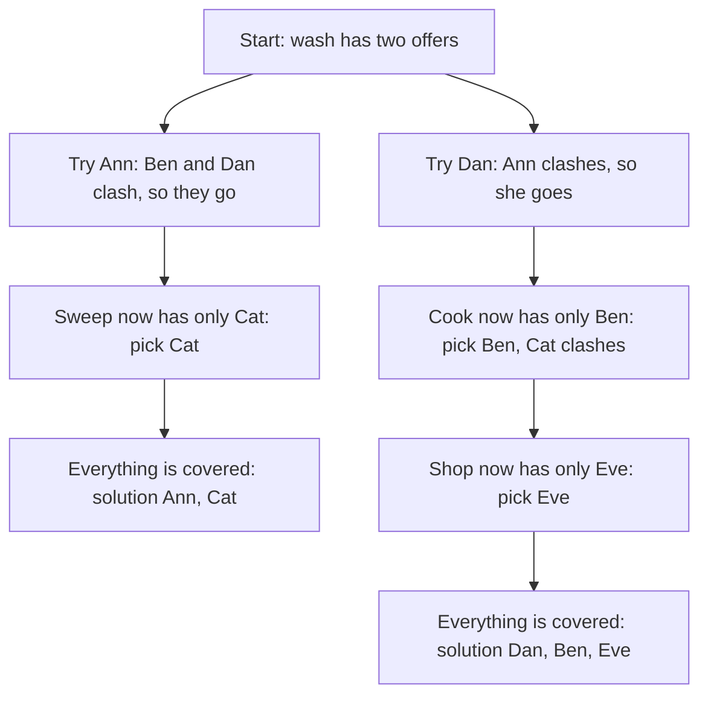
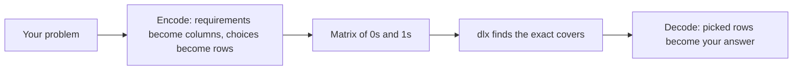

# Examples: a gentle introduction

Each directory here is a small command that solves one problem with package [dlx](https://github.com/dimchansky/dlx). This page explains the one idea they all share, so you can read any of them without knowing the mathematics. Only school arithmetic is assumed.

The [dlx README](../README.md#example-programs) says what each example teaches.

| Group | Example | Problem |
|-------|---------|---------|
| Puzzles | [sudoku](sudoku) | Fill a Sudoku board |
| Puzzles | [pentomino](pentomino) | Fill a rectangle with 12 shapes |
| Puzzles | [queens](queens) | Place queens that don't attack each other |
| Puzzles | [langford](langford) | Arrange pairs of numbers at set distances |
| Puzzles | [cardtrick](cardtrick) | Let the assistant pick which card to hide and how to lay out the rest, so the magician can name it |
| Science and maths | [kochenspecker](kochenspecker) | Show that a set of rays can't be painted |
| Science and maths | [fullerene](fullerene) | Find the double bonds of C60 |
| Science and maths | [witt](witt) | Form 132 committees of six from twelve people, so that any five share exactly one |
| Science and maths | [hat](hat) | Cover a disk with copies of the hat |
| Science and maths | [hamming](hamming) | Choose words of 0s and 1s so that every word is at most one flip from exactly one chosen word, and use them to win a hat game |
| Science and maths | [coveringsystems](coveringsystems) | Split all whole numbers into groups like "every 3rd number", so that each number is in exactly one group |
| Music | [twelvetone](twelvetone) | Use every interval once in a twelve-tone row |
| Music | [vuza](vuza) | Fill a drum loop with copies of one rhythm |
| Music | [bells](bells) | Ring every order of the bells once |
| Computing and scheduling | [crew](crew) | Choose crew duties for a day of flights |
| Computing and scheduling | [instrselect](instrselect) | Choose machine instructions for an expression |
| Computing and scheduling | [perfecthash](perfecthash) | Find a rule that gives each of Go's 25 keywords its own box in a table of exactly 25 boxes |

## What exact cover is

Many puzzles have the same shape. There is a list of **requirements**, and a list of **choices**, each meeting some of the requirements. You want to pick choices so that every requirement is met exactly once: not missed, and not met twice.

Here is a small one. Four chores need doing: wash, cook, sweep and shop. Five friends each offer to do certain chores, and a friend does all of their chores or none of them. No chore should be done twice.

- Ann offers to wash and cook.
- Ben offers to cook and sweep.
- Cat offers to sweep and shop.
- Dan offers to wash.
- Eve offers to shop.

Write this as a table. Each column is a chore, each row is an offer, and a 1 means "this offer does this chore":

|     | wash | cook | sweep | shop |
|-----|:----:|:----:|:-----:|:----:|
| Ann |  1   |  1   |   0   |  0   |
| Ben |  0   |  1   |   1   |  0   |
| Cat |  0   |  0   |   1   |  1   |
| Dan |  1   |  0   |   0   |  0   |
| Eve |  0   |  0   |   0   |  1   |

The task is now: **pick some rows so that every column has a 1 in exactly one picked row.** This table of 0s and 1s is called a matrix, and a set of rows that does this is called an exact cover.

This table has two exact covers:

| Picked rows | wash | cook | sweep | shop |
|-------------|:----:|:----:|:-----:|:----:|
| Ann, Cat    | Ann  | Ann  | Cat   | Cat  |
| Dan, Ben, Eve | Dan | Ben | Ben   | Eve  |

Picking Ann and Ben fails, because both would cook. Picking Ann and Eve fails, because nobody would sweep.

## How dlx searches

dlx tries choices and backs out of dead ends, as you would with a pencil and eraser. This way of searching is called backtracking. At each step it takes the column with the fewest rows left, because that is the most constrained requirement, and on a tie it takes the leftmost. It tries each row of that column in turn. Picking a row removes every other row that clashes with it.

All four chores start with two offers each, so the search starts with wash. Trying Ann leads to the solution Ann, Cat. Backing out and trying Dan leads to the solution Dan, Ben, Eve. This is the whole search for the table above:



A search undoes choices constantly, so undoing has to be cheap. The "dancing links" of the name are a way of storing the matrix so that undoing is very cheap. You don't need the details to use dlx, and Knuth's paper ["Dancing Links"](https://arxiv.org/abs/cs/0011047) has them.

## From a problem to a matrix and back

Every example follows the same four steps:



1. **Find the requirements.** Each thing that must happen exactly once becomes a column.
2. **List the choices.** Each possible move becomes a row, with a 1 in every column that move satisfies.
3. **Search.** dlx reports each exact cover.
4. **Decode.** Turn the picked rows back into a board, a schedule or a list of names.

Most of the thinking is in steps 1 and 2. Once the matrix is right, the rest is short.

In code, columns are numbered from 0, and each `AddRow` call lists the columns where that row has a 1. `Solve` then calls your function once per exact cover:

```go
m := dlx.NewMatrix(4)   // wash=0, cook=1, sweep=2, shop=3
m.AddRow(0, 1)          // Ann
m.AddRow(1, 2)          // Ben
m.AddRow(2, 3)          // Cat
m.AddRow(0)             // Dan
m.AddRow(3)             // Eve

m.Solve(dlx.SolutionAccepterFunc(func(cover [][]int) bool {
    fmt.Println(cover)  // prints each exact cover
    return false        // false means keep searching
}))
```

dlx reports a solution as the column lists of the picked rows, such as `[[0 1] [2 3]]`, and not as "Ann and Cat". So the columns of a row must be enough to tell you what that row meant. Each example chooses its columns with this in mind, and each README has a section on how a solution is decoded.

## "At most once": slack rows

Sometimes a requirement is optional: it may be met once, or not at all. dlx has no setting for this, because every column must be covered exactly once. The trick is to add a row that does nothing except cover that column. It is called a slack row.

Suppose the plants may be watered, but don't have to be, and only Ben will do it along with his other chores. Add a column for plants, and a slack row with a 1 in that column alone:

|       | wash | cook | sweep | shop | plants |
|-------|:----:|:----:|:-----:|:----:|:------:|
| Ann   |  1   |  1   |   0   |  0   |   0    |
| Ben   |  0   |  1   |   1   |  0   |   1    |
| Cat   |  0   |  0   |   1   |  1   |   0    |
| Dan   |  1   |  0   |   0   |  0   |   0    |
| Eve   |  0   |  0   |   0   |  1   |   0    |
| slack |  0   |  0   |   0   |  0   |   1    |

The exact covers are now Ann, Cat, slack and Dan, Ben, Eve. If Ben is picked, he covers the plants. If he isn't, the slack row fills the gap. Think of it as a stand-in who does nothing, and then drop it from the answer when decoding.

The recipe is safe only if both of these hold:

- **A slack row adds no duplicates.** Each optional column has one slack row, so an unmet requirement can be filled in only one way.
- **A slack row can be recognised.** No real row may consist of that one column alone, or the two would look the same in a solution. Here, no friend offers only to water the plants.

Slack rows also have a cost. The search treats an optional column like any other, so it can spend time deciding things that don't matter. The [queens example](queens) shows this on a real problem.

## How to read the example READMEs

Each one has roughly the same order, and you can stop when you have what you need:

1. **The problem**, with a small example.
2. **How it becomes a matrix**: what one column means, what one row means, and a small matrix drawn as a table. This is the main thing to read.
3. **How a solution decodes back** into an answer.
4. **Usage and real output** from the command.
5. **How the results are checked**, and the honest limits of the approach.

Counting in the code starts at 0, so the first row of a board is row 0. The READMEs say which convention each table uses.

The full rules of the library are in the [dlx README](../README.md).
