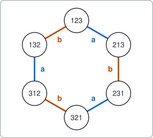
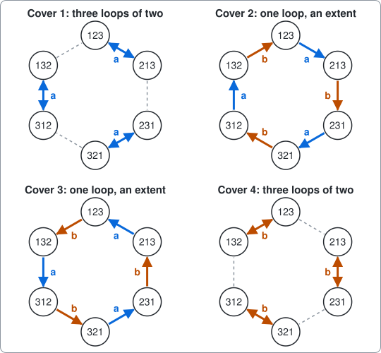
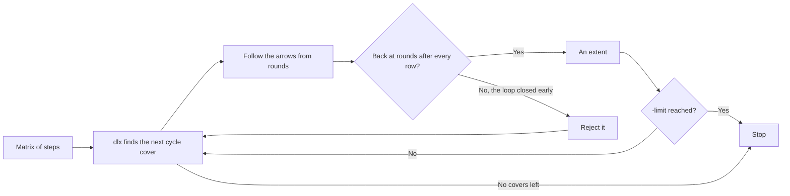
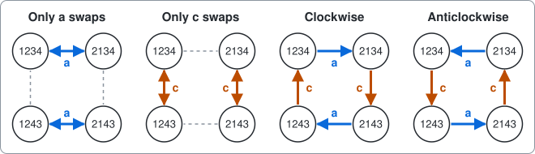

# Change ringing

A command-line search for extents of change ringing, written as an example of using package [dlx](https://github.com/dimchansky/dlx). In this example exact cover does only part of the job: the matrix finds candidates, and ordinary code throws almost all of them away. If exact cover is new to you, read the [introduction to the examples](../README.md) first.

## The problem

In English church towers, bells are rung in a changing order rather than as a tune. Each bell is number 1, 2, 3 or 4, from the lightest to the heaviest, and each one sounds once each time through the bells. One time through is called a **row**, and it is written as the order of the bells: `2134` means bell 2 sounds first, then 1, 3 and 4. Ringing starts from `1234`, which is called **rounds**.

A bell can weigh hundreds of kilograms and swings on a wheel, so a ringer can only make it sound a little earlier or later than last time. That gives the rule for going from one row to the next: **a bell may move by at most one place**. So in one step, pairs of neighbouring bells can swap, as long as no bell is in two pairs, and nothing bigger can happen.

An **extent** is the longest piece of ringing with no repeats. It follows three rules:

1. It starts and ends with rounds.
2. Every possible row comes exactly once, apart from rounds, which ends the piece as well.
3. From one row to the next, each bell moves by at most one place.

Four bells can stand in 4 x 3 x 2 x 1 = 24 orders, so an extent on 4 bells has 24 rows, and then rounds again. How many extents are there? That is the question this example answers.

### The changes

A step from one row to the next is called a **change**. A change is a rule about places, not about bells: "swap whoever is in places 1 and 2". On 4 bells, exactly four changes obey the rule and give a new row. (Leaving every bell where it is also obeys the rule, but it repeats the row, so it can't be part of an extent.) Places can only be swapped with a neighbouring place, and the only two swaps that fit in one step without overlapping are 1-2 and 3-4.

| Letter | What it does              | From `1234` |
|--------|---------------------------|-------------|
| a      | swap places 1 and 2       | `2134`      |
| b      | swap places 2 and 3       | `1324`      |
| c      | swap places 3 and 4       | `1243`      |
| d      | do a and c together       | `2143`      |

Doing the same change twice brings you back. So a step from one row to the next can always be turned around, and if you ring an extent backwards you get another extent.

### Three bells

Three bells are small enough to see the whole problem. There are 6 rows and two changes, a and b. Drawing a line between rows that are one change apart gives a ring:

An extent has to walk through all six rows and come back, so it must go once around the ring. Starting at `123`, there are two ways to do that: clockwise and anticlockwise. They are the only two extents on 3 bells:

    123 213 231 321 312 132 123
    123 132 312 321 231 213 123

The rows of 4 bells make the same kind of picture, with 24 rows and 3 lines from each with changes a b c, or 4 lines with a b c d, but no ring to follow by eye. That is where a search comes in.

## How it becomes a matrix

Forget about the order for a moment and look at one row of bells in an extent. Exactly one step leaves it, and exactly one step arrives at it. That is the part exact cover can say.

**One column of the matrix is either "the step out of this row" or "the step into this row".** **One row of the matrix is one allowed step, from one row of bells to another.**

| Matrix part | Meaning                                  | 3 bells | 4 bells, a b c | 4 bells, a b c d |
|-------------|------------------------------------------|---------|----------------|------------------|
| Column      | The step out of a row of bells           | 6       | 24             | 24               |
| Column      | The step into a row of bells             | 6       | 24             | 24               |
| Row         | An allowed step                          | 12      | 72             | 96               |
| 1s in a row | The row it leaves and the row it reaches | 2       | 2              | 2                |

This is the whole matrix for 3 bells. Each step has one 1 under `out` and one 1 under `in`. Careful with the two meanings of "row": a table row is a step, and the labels such as 123 are rows of bells.

| Step | out 123 | out 132 | out 213 | out 231 | out 312 | out 321 | in 123 | in 132 | in 213 | in 231 | in 312 | in 321 |
|---|:-:|:-:|:-:|:-:|:-:|:-:|:-:|:-:|:-:|:-:|:-:|:-:|
| 123 to 213 (a) | 1 | 0 | 0 | 0 | 0 | 0 | 0 | 0 | 1 | 0 | 0 | 0 |
| 123 to 132 (b) | 1 | 0 | 0 | 0 | 0 | 0 | 0 | 1 | 0 | 0 | 0 | 0 |
| 132 to 312 (a) | 0 | 1 | 0 | 0 | 0 | 0 | 0 | 0 | 0 | 0 | 1 | 0 |
| 132 to 123 (b) | 0 | 1 | 0 | 0 | 0 | 0 | 1 | 0 | 0 | 0 | 0 | 0 |
| 213 to 123 (a) | 0 | 0 | 1 | 0 | 0 | 0 | 1 | 0 | 0 | 0 | 0 | 0 |
| 213 to 231 (b) | 0 | 0 | 1 | 0 | 0 | 0 | 0 | 0 | 0 | 1 | 0 | 0 |
| 231 to 321 (a) | 0 | 0 | 0 | 1 | 0 | 0 | 0 | 0 | 0 | 0 | 0 | 1 |
| 231 to 213 (b) | 0 | 0 | 0 | 1 | 0 | 0 | 0 | 0 | 1 | 0 | 0 | 0 |
| 312 to 132 (a) | 0 | 0 | 0 | 0 | 1 | 0 | 0 | 1 | 0 | 0 | 0 | 0 |
| 312 to 321 (b) | 0 | 0 | 0 | 0 | 1 | 0 | 0 | 0 | 0 | 0 | 0 | 1 |
| 321 to 231 (a) | 0 | 0 | 0 | 0 | 0 | 1 | 0 | 0 | 0 | 1 | 0 | 0 |
| 321 to 312 (b) | 0 | 0 | 0 | 0 | 0 | 1 | 0 | 0 | 0 | 0 | 1 | 0 |

For example, the first step in the table leaves `123`, so it has a 1 under `out 123`, and it reaches `213`, so it has a 1 under `in 213`. Picking both "123 to 213" and "123 to 132" is impossible, because both have a 1 under `out 123`. No [slack rows](../README.md#at-most-once-slack-rows) are needed, because every row of bells really does have one step out and one step in.

### What the matrix misses

An exact cover picks one step out of every row of bells and one step into it. Follow the arrows from any row and you must come back to where you started, because no row can be entered twice. So an exact cover is a set of closed loops, with every row of bells in exactly one loop. This is called a **cycle cover**.

An extent is a cycle cover with **only one loop**. This matrix can't tell the difference. The 3 bell matrix above has four exact covers, and only two of them are extents:

Blue arrows are change a, orange arrows are change b, and the dashed grey lines are steps that the cover doesn't use.

Covers 1 and 4 are three small loops: each pair of rows swaps back and forth, so the ringing never leaves its first two rows. Yet every row of bells has one step out and one step in, so these covers satisfy every column.

"Only one loop" isn't a rule about any one step, so it doesn't fit into a column of this matrix. It depends on the whole set of steps. So the example does what you can do with any rule that a matrix leaves out: it checks each solution afterwards, and rejects the ones that fail. dlx hands each solution to a function you give it, `AcceptSolution`, and that function is the place for this check. The [crew example](../crew) handles its costs outside the search in a similar way. A much larger matrix can hold the rule itself, as [Limits](#limits) shows, but this one is smaller and faster.

This is the path for printing. With `-count`, every cover is counted and there is no `-limit` check, so it stops only when no covers are left.

## How a solution decodes back

dlx reports column numbers. The rows of bells are numbered in sorted order, with rounds as number 0, and the `in` columns come after the `out` columns. So with n rows of bells, the column for "out of row i" is i, and the column for "into row i" is n + i.

For 3 bells, n is 6 and `213` is row number 2, so the step from `123` to `213` comes back as `[0 8]`: out of row 0, and into row 8 - 6 = 2. [solver.go](solver.go) reads every step into a list `next`, where `next[i]` is the row after row i. Then `extentOf` starts at rounds and follows `next`. If it returns to rounds before it has seen every row, the cover has more than one loop, and it's rejected.

A loop has no beginning, so each extent comes from exactly one cover, and the walk starts at rounds. The two directions of a loop are two different covers, so an extent and its reverse count separately. That matches the way ringers count them.

## Installation

    go install github.com/dimchansky/dlx/examples/bells@latest

## Usage

    bells [-bells 3|4] [-changes letters] [-limit n] [-count]

- `-bells n` sets the number of bells, 4 by default. Only 3 and 4 are accepted, for the reasons under [Limits](#limits).
- `-changes letters` lists the allowed changes, from the table above, in any order. The default is every single swap: `ab` on 3 bells and `abc` on 4 bells. `abcd` allows all four changes, and takes a few seconds with `-count`.
- `-limit n` sets how many extents to print, 1 by default. Zero prints all of them.
- `-count` goes through every cycle cover and prints the totals instead, so `-limit` has no effect with it.

`-help` prints the usage text to standard error.

Extents and totals go to standard output. Error messages go to standard error, and most start with `bells:`.

| Exit code | Meaning                                               |
|-----------|-------------------------------------------------------|
| 0         | At least one extent exists, or `-help` was given      |
| 1         | There is no extent with these changes                 |
| 2         | Invalid usage, or a write failure                     |

## Examples

Print the first extent on 4 bells, using the default changes a b c:

    bells

Output:

    Extent 1:
    1234
    2134
    2143
    1243
    1423
    4123
    4213
    2413
    2431
    4231
    4321
    4312
    4132
    1432
    1342
    3142
    3412
    3421
    3241
    2341
    2314
    3214
    3124
    1324
    1234

Count the extents with those same changes:

    bells -count

Output:

    Cycle covers: 28561
    Extents: 88

Print both extents on 3 bells:

    bells -bells 3 -limit 0

Output:

    Extent 1:
    123
    213
    231
    321
    312
    132
    123
    Extent 2:
    123
    132
    312
    321
    231
    213
    123

Count the extents on 4 bells with every change allowed:

    bells -changes abcd -count

Output:

    Cycle covers: 2655552
    Extents: 10792

With changes a and b alone, the bell in place 4 never moves, so most rows can't be reached. This exits with code 1:

    bells -changes ab -count

Output:

    Cycle covers: 256
    Extents: 0

and on standard error:

    bells: no extent found

## Number of extents

There are 15 sets of changes on 4 bells: each of the 4 letters is either in or out, which gives 2 x 2 x 2 x 2 = 16, and the empty set doesn't count. Four of them have extents:

| Changes | Cycle covers | Extents | Covers per extent, about |
|---------|--------------|---------|--------------------------|
| `abc`   | 28561        | 88      | 325                      |
| `abd`   | 16384        | 106     | 155                      |
| `bcd`   | 16384        | 106     | 155                      |
| `abcd`  | 2655552      | 10792   | 246                      |

The other 11 sets have none, because from rounds they can't reach every row. The tests check this for each of them.

Of the 10792 extents, half are the reverses of the other half, which leaves 5396 different loops.

One of the 106 extents that use `bcd` is the method that ringers call [Plain Bob Minimus](https://complib.org/method/10460), which repeats the changes d b d b d b d c three times. In ringers' notation that is `-14-14,12`, where `-` swaps every pair and digits name the places that stay put, so `-` is d, `14` is b and `12` is c. The part before the comma is played forwards and then back, without repeating its last change, which turns `-14-14` into d b d b d b d, and the `12` after the comma adds the c. The 9th row, `1342`, is what ringers call its lead head:

    1234 2143 2413 4231 4321 3412 3142 1324
    1342 3124 3214 2341 2431 4213 4123 1432
    1423 4132 4312 3421 3241 2314 2134 1243
    1234

## How the results are checked

- The total of 10792 is published in ["Ringing the changes"](https://plus.maths.org/content/ringing-changes) by Burkard Polster and Marty Ross, in Plus magazine, 2009. The article calls a row a "change". We found no published source for the other totals, including the 88, so they rest on the checks below.
- A separate walk over the rows finds every extent one step at a time, with no matrix and no cycle covers. The tests compare the two lists, extent by extent, for every set of changes except `acd`, which has no extents.
- A separate count of the cycle covers goes through the rows in turn and keeps a tally of the choices so far. It involves no search, and it must give the same total.
- Both of those build their own rows and read the changes off pairs of rows, so they share no data with the solver.
- Each extent is checked against the three rules, and Plain Bob Minimus has to be among the extents. That only proves it is an extent. Its name and notation come from [CompLib](https://complib.org/method/10460), a database of ringing methods.
- The larger matrix from [Limits](#limits) has to give the same extents as the walk, on 3 bells and with `abc`, with no filter.

`go test` takes a few seconds, nearly all of it on `abcd`. It leaves out one solver run, `acd`, because that is slow and has no extents to compare: the count and the walk still check both of its totals. `go test -short` also leaves out the solver runs for the other seven sets with more than 1000 covers, and the separate count for `abcd`. The walk still checks every total of extents, including the 10792, and the count still checks the other cover totals. Use `-short` with `-race`.

## Limits

Most of the work here is not exact cover. For `abcd`, dlx produces 2655552 covers and the filter keeps 10792, so only about 1 cover in 246 is an extent. This matrix helps very little with the real difficulty of the problem, which is getting a single loop.

So this is a poor way to solve this problem, and it's here to show what happens when a matrix leaves a rule out. `-changes abcd -count` takes a few seconds on a laptop, while the plain walk in the tests finds the same 10792 extents in under a tenth of a second. The walk knows about loops as it goes, and leaves a dead end at once. dlx has to finish each cover before anyone looks at its loops.

The step matrix also won't grow. Changes a and c alone split the rows into groups of four, and a step with a or c never leaves its group. On 4 bells, one group is `1234`, `2134`, `2143` and `1243`. Drawn as a square, with a along the top and bottom and c down the sides, it can be covered in exactly 4 ways:

Each row needs one step out and one step in. So the group either splits into two pairs that swap back and forth, which can be done with a or with c, or it goes once around the square, in either direction. Blue is a, orange is c, and the dashed grey lines are steps that aren't used. On 5 bells it's the same square with a 5 on the end of each row, and the other bells give other squares.

No group depends on another, so the choices multiply: the number of covers is at least 4 multiplied by itself once per group. Allowing more changes only adds covers. On 4 bells there are 6 groups, and `-changes ac -count` reports exactly 4 x 4 x 4 x 4 x 4 x 4 = 4096 covers.

| Bells | Rows | Groups of four | At least this many covers |
|-------|------|----------------|---------------------------|
| 4     | 24   | 6              | 4096                      |
| 5     | 120  | 30             | a 19 digit number         |
| 6     | 720  | 180            | a 109 digit number        |

Stopping at the first extent doesn't rescue it. In a 20 second trial on 5 bells, once with the 4 single swaps and once with all 7 changes, dlx went through 3 to 4.5 million covers without finding an extent, and the loop through rounds never had more than 2 rows. That is about 200 thousand covers a second, slower than on 4 bells because each cover is larger. At that speed, going through every cover on 5 bells would take more than 100 thousand years, and that is only a lower limit. So the command stops at 4 bells.

### A larger matrix can hold the rule

The limit is in the step matrix, not in exact cover. A matrix can say "only one loop" if it also says when each row of bells is rung, so that the ringing has to be one path through time instead of a set of loops. With n rows of bells, time runs from 0 to n - 1, and the last step returns to rounds at time 0.

Each row of this matrix is one step at one time. For each row of bells at each time there is a pair of columns, `in` and `out`. A step that arrives at that row of bells at that time covers `in`. A step that leaves it at that time covers `out`. A [slack row](../README.md#at-most-once-slack-rows) covers both at once, and it means the ringing isn't there at that time.

The pair is what joins one step to the next, because it has just two ways to be covered: a step arrives and a step leaves, or the slack row covers both. A step can't arrive without another leaving, because the slack row would then cover `in` a second time.

Take 3 bells and the extent `123 213 231 321 312 132 123`. Each `x` is where the ringing is at that time, with one step arriving and one leaving. Each empty square is one slack row.

| Row of bells | Time 0 | Time 1 | Time 2 | Time 3 | Time 4 | Time 5 |
|--------------|--------|--------|--------|--------|--------|--------|
| `123`        | x      |        |        |        |        |        |
| `213`        |        | x      |        |        |        |        |
| `231`        |        |        | x      |        |        |        |
| `321`        |        |        |        | x      |        |        |
| `312`        |        |        |        |        | x      |        |
| `132`        |        |        |        |        |        | x      |

A second loop can't start anywhere, and here is why, one time at a time:

1. At time 0 the ringing has to be at rounds. Rounds has no slack row there, and the other rows of bells have no steps there.
2. So one step leaves at time 0, and it arrives at one row of bells at time 1.
3. That row needs a step to leave it at time 1, since its slack row can't be used.
4. Every other row of bells has nothing arriving at time 1, so its slack row has to cover its pair. That covers `out` too, so no step can leave it.
5. So exactly one step leaves at time 1, and the same argument repeats for time 2, time 3 and so on.

There is one `x` in each time column, which makes the ringing a single path.

One more column for each row of bells says that a step leaves it, so the path has to visit them all.

| Matrix part | Meaning                                                 | 3 bells, `ab` | 4 bells, `abc` |
|-------------|---------------------------------------------------------|---------------|----------------|
| Column      | A step leaves this row of bells                         | 6             | 24             |
| Column      | `out`: this row of bells at this time                   | 36            | 576            |
| Column      | `in`: this row of bells at this time                    | 36            | 576            |
| Row         | A step from one row of bells to another at this time    | 36            | 1458           |
| Row         | Slack: the ringing isn't at this row of bells this time | 35            | 575            |

That gives 1176 columns and 2033 rows for `abc`, against 48 columns and 72 rows above, and the solutions are exactly the extents, with no filter. The tests check this against the walk. The price is speed. Here `abc` took about 0.25 seconds instead of 0.04, `abd` and `bcd` about 0.9 seconds instead of 0.03, and `abcd` hadn't finished after more than 5 minutes, while the step matrix and its filter take a few seconds. That is why the example filters instead.
