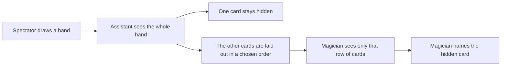
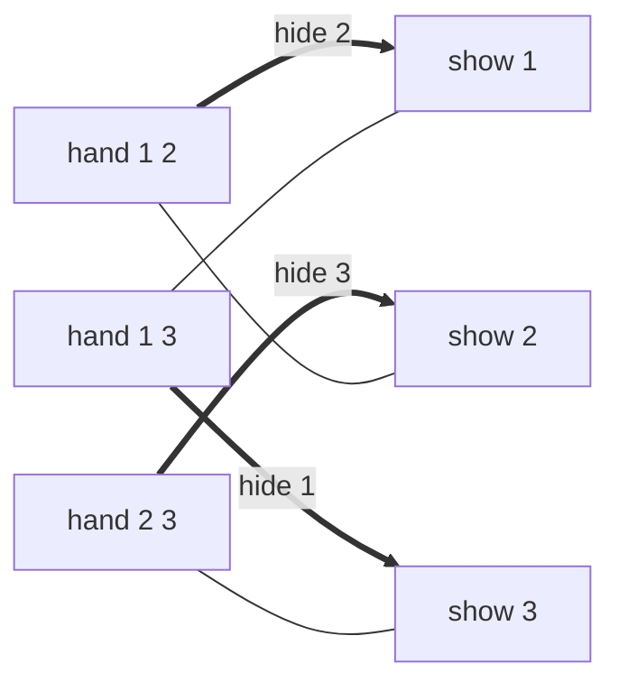

# The five-card trick

A command-line search for strategies for a card trick, written as an example of using package [dlx](https://github.com/dimchansky/dlx). The trick looks like mind reading between two people, and it is really a table that pairs hands with messages. If exact cover is new to you, read the [introduction to the examples](../README.md) first.

## The trick

A spectator draws five cards from an ordinary deck and gives them to the assistant. The assistant keeps one card hidden and lays the other four on the table, one at a time. The magician, who has seen nothing else and hears nothing, looks at those four cards and names the hidden one.

It looks impossible. Four cards are on the table, so 48 cards could be the hidden one, and four cards can be put in only 24 orders. The trick is credited to William Fitch Cheney, Jr., and the count above misses a second freedom: **the assistant chooses which card to hide.**

The right way to count is this. A **hand** is a set of cards with no order. A **message** is the row the assistant lays out, so its order matters. The assistant needs one message for each hand, and the magician reads that table backwards. So the trick works only if no two hands use the same message.

## A small version you can check by hand

Draw 3 cards from a deck of 8, numbered 1 to 8. The assistant hides one and shows two, in order.

- Messages: the first card can be any of 8, and the second any of the other 7, so there are 8 × 7 = 56.
- Hands: picking 3 cards one after another gives 8 × 7 × 6 = 336 ways, but each hand comes up in 3 × 2 × 1 = 6 orders. So there are 336 / 6 = 56.

That is exactly 56 of each, with not one message to spare. A strategy is a table of 56 lines that uses each message once. These are some lines of the one the command finds:

| Hand    | Hide | Show (in this order) |
|---------|------|----------------------|
| 1 2 3   | 3    | 1 then 2             |
| 1 2 4   | 2    | 1 then 4             |
| 1 2 5   | 5    | 2 then 1             |
| ...     | ...  | ...                  |
| 2 5 7   | 5    | 7 then 2             |

The magician's copy is the same table sorted by the last column. On seeing 7 then 2, the magician finds that line and says 5. The table needs no pattern: any table that gives each hand its own message works. Finding one is a job for a search.

## Which decks can work

There must be at least as many messages as hands, or two hands would have to share a message. For a hand of k cards, the counts are equal when the deck has k × (k-1) × ... × 1 cards, plus k-1 more. One card above that, there are more hands than messages.

| Cards in a hand | Largest possible deck | Hands     | Messages  |
|-----------------|-----------------------|-----------|-----------|
| 2               | 3                     | 3         | 3         |
| 3               | 8                     | 56        | 56        |
| 4               | 27                    | 17550     | 17550     |
| 5               | 124                   | 225150024 | 225150024 |

Enough messages is not obviously enough, because each hand may only use messages made of its own cards. Still, [Michael Kleber's article](https://classes.csail.mit.edu/6.042/spring18/Kleber-cardTrick.pdf) shows that the limit can always be reached. A smaller deck then works too, because its hands are also hands of the larger deck.

With a hand of 5 from 52 cards there are 6497400 messages for 2598960 hands, 2.5 times as many, so the classic trick has room to spare.

## How it becomes a matrix

**One column of the matrix is one hand, or one message.** **One row of the matrix is one possible line of the table: this hand uses this message.**

A hand column must be covered exactly once, because each hand needs exactly one line. A message column must be covered by at most one line, so that the magician can read it in only one way. A row has a 1 under its hand and a 1 under its message, and there is a row only if the message is made of that hand's cards.

| Matrix part | Meaning                                         | Hand 3, deck 7 | Hand 3, deck 8 |
|-------------|-------------------------------------------------|----------------|----------------|
| Column      | A hand, which needs exactly one message         | 35             | 56             |
| Column      | A message, used by at most one hand             | 42             | 56             |
| Row         | One hand with one of its messages               | 210            | 336            |
| Row         | A slack row for one message                     | 42             | none           |

A hand of 3 has 6 messages: 3 cards to hide, then 2 orders for the other two. So deck 8 has 56 × 6 = 336 rows.

### The whole matrix for 2 cards from a deck of 3

The assistant hides one card and shows the other. There are three hands and three messages, and one row for each way to pair them:

|                  | hand 1 2 | hand 1 3 | hand 2 3 | show 1 | show 2 | show 3 |
|------------------|:-:|:-:|:-:|:-:|:-:|:-:|
| hand 1 2, show 1 | 1 | 0 | 0 | 1 | 0 | 0 |
| hand 1 2, show 2 | 1 | 0 | 0 | 0 | 1 | 0 |
| hand 1 3, show 1 | 0 | 1 | 0 | 1 | 0 | 0 |
| hand 1 3, show 3 | 0 | 1 | 0 | 0 | 0 | 1 |
| hand 2 3, show 2 | 0 | 0 | 1 | 0 | 1 | 0 |
| hand 2 3, show 3 | 0 | 0 | 1 | 0 | 0 | 1 |

Two rows that give one message to two hands can't both be picked, because both have a 1 in that message's column. That single rule is what keeps the magician from being confused.

Drawing hands on the left and messages on the right shows the choice. The thick lines are the rows dlx finds first, and the thin lines are the other three rows:

This matrix has two exact covers, and the thin lines are the second. Read the first as a rule: shown card 1 means 2, shown 2 means 3, and shown 3 means 1. So the hidden card is the next one round a ring of three. The second strategy goes round the ring the other way.

Pairing things off like this, with each one used at most once, is called a matching.

### Spare messages: slack rows

Below the largest deck there are more messages than hands, so some messages go unused. But dlx needs every column covered, so each message gets a [slack row](../README.md#at-most-once-slack-rows) that covers it alone. It reads "this message is not used".

The smallest case is 2 cards from a deck of 2. There is one hand and two messages:

|                  | hand 1 2 | show 1 | show 2 |
|------------------|:-:|:-:|:-:|
| hand 1 2, show 1 | 1 | 1 | 0 |
| hand 1 2, show 2 | 1 | 0 | 1 |
| slack show 1     | 0 | 1 | 0 |
| slack show 2     | 0 | 0 | 1 |

It has two exact covers: `hand 1 2, show 1` with `slack show 2`, and `hand 1 2, show 2` with `slack show 1`. Both conditions of the recipe hold. An unused message can be covered in only one way, so slack rows add no duplicates. And a real row has two columns where a slack row has one, so they can be told apart.

When hands and messages are equal, as for deck 8, every message must be used, so the program adds no slack rows.

## How a solution decodes back

dlx reports column numbers. Hands are numbered in dictionary order from 0, and the messages follow them, also in dictionary order. For the default trick, the hands take columns 0 to 55 and the messages take columns 56 to 111.

[solver.go](solver.go) skips the rows with one column, because those are slack rows. In each other row, the first number is the hand and the second is 56 plus the message. Hand `2 5 7` is number 31 and message `7 2` is number 43, so that line comes back as `[31 99]`. The hidden card is the card of the hand that the message leaves out, here 5.

## Installation

    go install github.com/dimchansky/dlx/examples/cardtrick@latest

## Usage

    cardtrick [-hand size] [-deck size]
    cardtrick [-hand size] [-deck size] -play cards
    cardtrick [-hand size] [-deck size] -count

- `-hand size` sets the cards in a hand, 3 by default, from 2 to 4.
- `-deck size` sets the cards in the deck, 8 by default. Cards are numbered from 1. The largest deck that is searched is 3 for hands of 2, 8 for hands of 3, and 25 for hands of 4. See [Limits](#limits).
- `-play cards` performs the trick on one hand, such as `2,5,7`.
- `-count` goes through every strategy and prints the total. It takes tricks of up to 10 hands.

With neither `-play` nor `-count`, the command prints a whole strategy, then performs the trick once for every hand. In that performance, the magician has only a notebook of messages and hidden cards, with no hands in it.

`-count` and `-play` can't be combined. `-help` prints the usage text to standard error.

Results go to standard output. Error messages go to standard error, and most start with `cardtrick:`.

| Exit code | Meaning                                                      |
|-----------|--------------------------------------------------------------|
| 0         | A strategy exists, or `-help` was given                      |
| 1         | The deck has more hands than messages, so there is none      |
| 2         | Invalid usage, a trick beyond the limits, or a write failure |

## Examples

Print a strategy for 3 cards from a deck of 8 and try it on all 56 hands:

    cardtrick

Output, shortened in the middle:

    Hands: 56
    Messages: 56

    hand  1  2  3  hide  3  show  1  2
    hand  1  2  4  hide  2  show  1  4
    hand  1  2  5  hide  5  show  2  1
    hand  1  2  6  hide  2  show  1  6
    ...
    hand  5  7  8  hide  8  show  7  5
    hand  6  7  8  hide  8  show  7  6

    Magician named 56 of 56 hidden cards

Perform it on one hand:

    cardtrick -play 2,5,7

Output:

    Spectator draws 2 5 7
    Assistant hides 5 and shows 7 2
    Magician sees 7 2 and names 5

Print the whole strategy for 2 cards from a deck of 3, which is the ring described above:

    cardtrick -hand 2 -deck 3

Output:

    Hands: 3
    Messages: 3

    hand  1  2  hide  2  show  1
    hand  1  3  hide  1  show  3
    hand  2  3  hide  3  show  2

    Magician named 3 of 3 hidden cards

Run the largest trick the command searches, keeping only the last line:

    cardtrick -hand 4 -deck 25 | tail -n 1

Output:

    Magician named 12650 of 12650 hidden cards

One card above the limit is answered by counting, with no search, and exits with code 1:

    cardtrick -deck 9

Output, on standard error:

    cardtrick: no strategy: 84 hands but only 72 messages

Count the strategies for 3 cards from a deck of 4:

    cardtrick -deck 4 -count

Output:

    Strategies: 876

## Number of strategies

| Cards in a hand | Deck | Hands | Messages | Strategies |
|-----------------|------|-------|----------|------------|
| 2               | 2    | 1     | 2        | 2          |
| 2               | 3    | 3     | 3        | 2          |
| 3               | 3    | 1     | 6        | 6          |
| 3               | 4    | 4     | 12       | 876        |
| 3               | 5    | 10    | 20       | 7198848    |
| 4               | 4    | 1     | 24       | 24         |
| 4               | 5    | 5     | 60       | 7146144    |

The total for 3 cards from a deck of 6 did not finish in 15 seconds, and the command refuses it.

## A recipe with no search

For a deck at the limit, a strategy can also be computed with no table at all. Kleber's article gives this recipe and says he learned it from Elwyn Berlekamp. Here it is for 3 cards from a deck of 8, with the cards numbered from 0 to 7, as the recipe needs.

The spectator draws 1, 4 and 6.

1. **The assistant picks the card to hide.** The cards add up to 11, which leaves remainder 2 when divided by 3. So the assistant hides the card in position 2 of the hand, counting from 0 in increasing order. That is 6.
2. **The magician narrows it down.** Imagine the deck with the shown cards deleted and the rest renumbered 0 to 5. The cards shown add up to 5, and the hidden card's new number leaves the remainder that takes 5 up to a multiple of 3, which is 1. So the new number is 1 or 4.
3. **The order picks one of them.** Increasing order means the smaller choice, and decreasing order means the larger. The assistant shows 4 then 1, so the new number is 4.
4. **The magician counts.** Without 1 and 4, the deck is 0, 2, 3, 5, 6, 7. Number 4 in that list, counting from 0, is 6.

Step 2 works because the card in position p has p cards of the hand below it, all of them shown. So its new number is its old number minus p. And p was chosen from the sum of the whole hand, so the hidden card cancels out, and the remainder of the new number depends only on the cards shown.

## The classic rule for 52 cards

The matrix for 5 cards from 52 would have over 9 million columns, and no magician could remember the table. The rule below is short enough to learn. Think of the ranks as 13 places round a clock face: A, 2, 3, ..., 10, J, Q, K, then A again.

1. Five cards always include two of one suit, since there are only four suits.
2. Going round the clock from one of those two cards to the other takes at most 6 steps in one of the two directions. The assistant hides the card that is ahead and shows the other one first.
3. The other three cards tell the number of steps. Order the deck by rank, then by suit: clubs, diamonds, hearts, spades. The three cards are then small (S), middle (M) and large (L).

| Order shown | SML | SLM | MSL | MLS | LSM | LMS |
|-------------|:---:|:---:|:---:|:---:|:---:|:---:|
| Steps       | 1   | 2   | 3   | 4   | 5   | 6   |

Take the hand 3♣ 5♦ 9♣ J♥ 2♠. The two clubs are 6 steps apart, from 3 up to 9, so 9♣ is hidden and 3♣ goes first. The others are 2♠ (small), 5♦ (middle) and J♥ (large), and 6 steps is the order LMS. So the assistant lays out 3♣, J♥, 5♦, 2♠. The magician sees a club first, reads 6 steps from the other three, counts 6 up from 3, and says the 9 of clubs.

## How the results are checked

- **Every strategy is checked against the rules.** The tests confirm, with no matrix, that each hand appears once, that the shown and hidden cards are exactly that hand, and that no message is used twice. This runs on every deck for hands of 2 and 3, and on decks 4, 8, 12, 16 and 25 for hands of 4.
- **The performance can fail.** A test gives `perform` a strategy that reuses a message and sees the score drop, so "56 of 56" is a real result.
- **The totals come from a second counter.** A separate function in the tests uses no matrix: it gives out messages one hand at a time and remembers how many ways finish from each set of used messages. It matches every total in the table. The two largest totals take dlx about 6 and 11 seconds, so the tests leave them to that counter. They were also run once by hand with `-count`, with the same results.
- **Existence doesn't rest on the search.** The tests run the recipe above on every hand of the largest decks for hands of 2, 3 and 4, including all 17550 hands of deck 27, and confirm that each hand gets its own message. For deck 124 they try a random sample of 50000 hands, since 225150024 is too many.
- **The classic rule.** The tests play it on all 2598960 hands of a 52-card deck, and the magician is right every time.
- **The counting shortcut.** The formula for the largest deck is compared with the counts of hands and messages. For hands of 2 and decks 4 to 6, the tests confirm that the matrix itself has no exact cover.

`go test` runs everything. `go test -short` skips the slow searches, the 52-card walk and the two largest totals, and shrinks the deck-124 sample to 2000 hands. Use `-short` with `-race`.

## Limits

The command stops at hands of 4, and at deck 25 for those. Deck 25 takes about a second on the machine used to write this. Decks 26 and 27 have strategies, as the recipe shows, but this program doesn't find them, so it says so and exits with code 2.

- **Deck 26** did not finish in over four minutes, although deck 25 takes a second. It seems to be a matter of luck: a trial that listed the message columns in a different order solved deck 26 in under a second. That is not something to rely on, so the command doesn't use it.
- **Deck 27** has not one spare message. A search of five minutes found nothing, and the tests only build its strategy with the recipe.

A likely reason is that a mistake made early in the table only shows up near the end, and backtracking undoes the most recent choices first.

Proving by search that a deck has no strategy is also out of reach. Deck 9 for hands of 3, with 84 hands and 72 messages, did not finish in 15 seconds. Counting settles it at once, so the command counts first.

## Sources

The trick, its history, the limit on the deck, the recipe and the rule for 52 cards, with this order of suits, are all in Michael Kleber, "The Best Card Trick", Mathematical Intelligencer 24 #1 (Winter 2002), [available here](https://classes.csail.mit.edu/6.042/spring18/Kleber-cardTrick.pdf).
