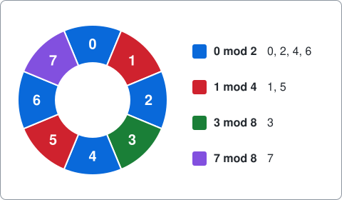
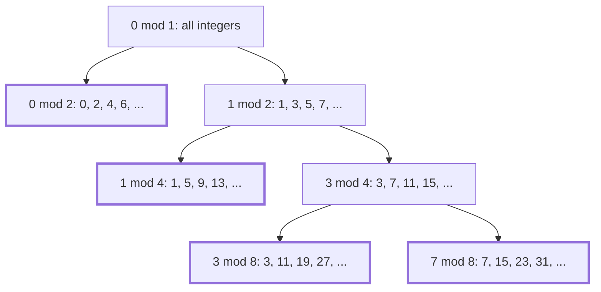

# Exact covering systems

A command-line solver that splits the integers into remainder classes, written as an example of using package [dlx](https://github.com/dimchansky/dlx). If exact cover is new to you, read the [introduction to the examples](../README.md) first.

## The problem

Divide 13 by 4 and you get 3 with remainder 1, because 13 = 3 × 4 + 1. Dividing by 4 can only leave a remainder of 0, 1, 2 or 3, so every integer belongs to one of four groups. Such a group is called a **remainder class**, and we write it like this:

| Class | Meaning | Its members from 0 on |
|-------|---------|-----------------------|
| `0 mod 2` | Remainder 0 when divided by 2 | 0, 2, 4, 6, 8, 10, ... |
| `1 mod 4` | Remainder 1 when divided by 4 | 1, 5, 9, 13, 17, 21, ... |
| `3 mod 4` | Remainder 3 when divided by 4 | 3, 7, 11, 15, 19, 23, ... |

The number after `mod` is the **modulus**. A class has one member in every stretch of that many integers: `1 mod 4` holds one integer in every four. Negative integers belong too, and the remainder is never negative: -1 = -1 × 4 + 3, so -1 is in `3 mod 4`.

These three classes do something neat. The first holds all the even numbers. The other two hold the odd numbers, shared out with none missing and none repeated. So **every integer is in exactly one of the three classes**. A list of classes with this property is called an **exact covering system**. The task is to find all of them, for a given choice of moduli.

Picture the integers wrapped around a wheel. This wheel has 8 spokes and shows the system `0 mod 2`, `1 mod 4`, `3 mod 8`, `7 mod 8`, where each class gets one colour. Going on past 7, the number 8 lands on the spoke of 0, the number 9 on the spoke of 1, and so on:

Two things make this interesting. Each class is infinite, yet a finite matrix decides the question. And the answers hold a surprise: however you try, you can't make all the moduli different. See [Can all the moduli be different?](#can-all-the-moduli-be-different).

## From all the integers to n numbers

There are infinitely many integers, and a matrix needs a finite number of columns. The way out is to pick a number n that every modulus divides. For the first system above, n=4 works, since 2 and 4 both divide 4.

Adding n to an integer never changes a remainder when every modulus divides n. For example, 1 and 5 and 9 all leave the same remainder when divided by 2, and also when divided by 4. So an integer behaves just like its own remainder when divided by n, and only the numbers 0 to n-1 need checking. If they are each in exactly one class, then so is every integer. That is what the wheel shows: the integers go round and round on the same n spokes.

This loses nothing. Any list of classes has such an n, because the product of the moduli is one. So `-n` chooses which moduli are allowed: exactly the divisors of n.

## How it becomes a matrix

**One column of the matrix is one of the numbers 0 to n-1.** **One row of the matrix is one remainder class whose modulus divides n.** A row has a 1 under each number in its class. Picking rows so that each column gets exactly one 1 means that each number lands in exactly one class, which is the definition.

For n=4, the moduli are 1, 2 and 4, so there are 1 + 2 + 4 = 7 classes:

| Class     | 0 | 1 | 2 | 3 |
|-----------|:-:|:-:|:-:|:-:|
| `0 mod 1` | 1 | 1 | 1 | 1 |
| `0 mod 2` | 1 | 0 | 1 | 0 |
| `1 mod 2` | 0 | 1 | 0 | 1 |
| `0 mod 4` | 1 | 0 | 0 | 0 |
| `1 mod 4` | 0 | 1 | 0 | 0 |
| `2 mod 4` | 0 | 0 | 1 | 0 |
| `3 mod 4` | 0 | 0 | 0 | 1 |

The class `0 mod 1` holds every integer, since dividing by 1 always leaves 0. It is a system all by itself, and a dull one. This matrix has 5 exact covers:

| Picked rows | 0 | 1 | 2 | 3 |
|-------------|:-:|:-:|:-:|:-:|
| `0 mod 1` | `0 mod 1` | `0 mod 1` | `0 mod 1` | `0 mod 1` |
| `0 mod 2`, `1 mod 2` | `0 mod 2` | `1 mod 2` | `0 mod 2` | `1 mod 2` |
| `0 mod 2`, `1 mod 4`, `3 mod 4` | `0 mod 2` | `1 mod 4` | `0 mod 2` | `3 mod 4` |
| `1 mod 2`, `0 mod 4`, `2 mod 4` | `0 mod 4` | `1 mod 2` | `2 mod 4` | `1 mod 2` |
| `0 mod 4`, `1 mod 4`, `2 mod 4`, `3 mod 4` | `0 mod 4` | `1 mod 4` | `2 mod 4` | `3 mod 4` |

Each cell names the picked class that holds that column's number. Picking `0 mod 2` with `0 mod 4` is not allowed, because both have a 1 under the number 0. The even numbers would then be counted twice over.

The matrix stays small as n grows, since the number of rows is the sum of the divisors of n:

| n  | Columns | Rows |
|----|---------|------|
| 4  | 4       | 7    |
| 8  | 8       | 15   |
| 16 | 16      | 31   |
| 30 | 30      | 72   |
| 32 | 32      | 63   |

## How a solution decodes back

dlx reports the column lists of the picked rows. [solver.go](solver.go) adds the numbers of a class in increasing order, so the first column of a row is the smallest member, which is the remainder. A class with modulus m holds n/m of the numbers 0 to n-1, so the length of the row gives m back.

For n=8, the row `[1 5]` starts at 1 and has 2 numbers, so its modulus is 8 / 2 = 4, and it means `1 mod 4`. The classes of a system are then sorted by modulus and by remainder, so that each system always prints the same way.

## Building systems by splitting

Any class can be split into equal parts. The odd numbers `1 mod 2` split in two: `1 mod 4` and `3 mod 4`. In general, `r mod m` splits into p classes with modulus p × m. Start from the class of all integers and keep splitting, and you get a tree. Its leaves are always an exact covering system, because splitting a class changes neither which integers are covered nor how many times. This tree builds the system on the wheel. The four classes with nothing below them are the leaves, drawn with a thick outline:

The leaves also explain the fractions. Each split shares a fraction of the integers equally, so the fractions of the leaves still add up to 1. For the tree above: 1/2 + 1/4 + 1/8 + 1/8 = 1. This holds for every exact covering system, since each number from 0 to n-1 is counted once.

### Counting systems for powers of 2

When n is a power of 2, every system is such a tree, and that gives a rule for the totals. Take any system for n. There are two cases:

1. It contains `0 mod 1`, and then that class is the whole system.
2. It doesn't, and then every modulus is even. A class with an even modulus holds only even numbers or only odd numbers: `1 mod 4` is all odd. So the system falls into two separate parts, one that shares out the even numbers and one that shares out the odd numbers.

Halve the even numbers, and the first part becomes a system for n/2 on the integers. Subtract 1 from the odd numbers and halve them, and the second part does too. The two parts can be chosen freely and independently. So:

    total for n = (total for n/2) × (total for n/2) + 1

The extra 1 is case 1. Starting from one system for n=1, this gives:

| n         | 1 | 2 | 4 | 8  | 16  | 32     |
|-----------|---|---|---|----|-----|--------|
| Rule      | 1 | 1×1+1 = 2 | 2×2+1 = 5 | 5×5+1 = 26 | 26×26+1 = 677 | 677×677+1 = 458330 |
| Systems   | 1 | 2 | 5 | 26 | 677 | 458330 |

These numbers are sequence [A003095](https://oeis.org/A003095) in the Online Encyclopedia of Integer Sequences, which also counts binary trees of limited height.

The same argument works for powers of any prime p, a number that only 1 and itself divide, since a class whose modulus is a multiple of p falls inside one class mod p. There are p parts instead of two, so each total is the previous one multiplied by itself p times, plus 1. For the powers of 3, the numbers 3, 9 and 27, that gives 1×1×1+1 = 2, then 2×2×2+1 = 9, then 9×9×9+1 = 730.

### Splitting doesn't explain everything

For n=30, there is a system that no tree builds:

    0 mod 6, 2 mod 6, 1 mod 10, 3 mod 10, 5 mod 10, 9 mod 10, 7 mod 15, 4 mod 30, 10 mod 30, 16 mod 30, 17 mod 30, 27 mod 30, 28 mod 30

Give the 13 classes the letters A to M, in that order, and write each number's class under it. Every number from 0 to 29 has exactly one letter:

     0  1  2  3  4  5  6  7  8  9 10 11 12 13 14 15 16 17 18 19 20 21 22 23 24 25 26 27 28 29
     A  C  B  D  H  E  A  G  B  F  I  C  A  D  B  E  J  K  A  F  B  C  G  D  A  E  B  L  M  F

A tree's first split into p parts needs p to divide every modulus. But no number above 1 divides all of 6, 10 and 15: 2 doesn't divide 15, 3 doesn't divide 10, and 5 doesn't divide 6. Of the 276734 systems for n=30, 13500 are like this. For every n below 30, splitting builds them all.

The count that splitting does build, 263234 for n=30, agrees with sequence [A353860](https://oeis.org/A353860) for all n from 1 to 30. That sequence is defined in a different way, by merging numbers in a list, so this match is an observation here and not something proved.

## Can all the moduli be different?

Try to make every modulus different, and you get stuck. Take `0 mod 2`. That leaves the odd numbers, so take `1 mod 4`. That leaves `3 mod 4`, so take `3 mod 8`. What remains is `7 mod 8`, and it needs a class of its own, with the same modulus 8 again. Taking a smaller piece only moves the problem along.

For powers of 2, the tree shows why. Look at the deepest split in the tree: its two leaves have the same modulus. For other n no such tree need exist, but the result still holds. In any exact covering system of two or more classes, the largest modulus appears at least twice. This is a theorem of Mirsky and Newman, found independently by Davenport and Rado ([Wikipedia](https://en.wikipedia.org/wiki/Covering_system) has the story, and [Ekhad, Fraenkel and Zeilberger](https://arxiv.org/abs/1511.04293) state it and go further). The usual proof uses complex numbers, so it isn't given here.

The `-distinct` flag lets dlx look for a system like this, as a test of the theorem and as a second use of [slack rows](../README.md#at-most-once-slack-rows). It adds a column for each modulus above 1, and that modulus's classes all cover it, so at most one of them can be picked. A modulus may also go unused, so each one gets a slack row. The class `0 mod 1` is dropped, because it is the only system of one class. For n=4:

| Row        | 0 | 1 | 2 | 3 | m2 | m4 |
|------------|:-:|:-:|:-:|:-:|:--:|:--:|
| `0 mod 2`  | 1 | 0 | 1 | 0 | 1  | 0  |
| `1 mod 2`  | 0 | 1 | 0 | 1 | 1  | 0  |
| slack m2   | 0 | 0 | 0 | 0 | 1  | 0  |
| `0 mod 4`  | 1 | 0 | 0 | 0 | 0  | 1  |
| `1 mod 4`  | 0 | 1 | 0 | 0 | 0  | 1  |
| `2 mod 4`  | 0 | 0 | 1 | 0 | 0  | 1  |
| `3 mod 4`  | 0 | 0 | 0 | 1 | 0  | 1  |
| slack m4   | 0 | 0 | 0 | 0 | 0  | 1  |

At most one class can be picked for `m2`, which covers 2 numbers, and at most one for `m4`, which covers 1 number. That is 3 numbers at best, so the 4 number columns can't all be covered, and this matrix has no exact cover. The tests find none for any n up to 120 either.

Slack rows are safe here for the two usual reasons. An unused modulus can be filled in only one way, by its own slack row. And a slack row can be told apart: it starts at a column past n-1, while a class row starts with a number from 0 to n-1.

## Installation

    go install github.com/dimchansky/dlx/examples/coveringsystems@latest

## Usage

    coveringsystems [-n number] [-limit n] [-count] [-distinct]

- `-n number` allows the moduli that divide this number, 8 by default, from 1 to 4096. That cap only stops the program building a huge matrix: many numbers below it are not practical, as the [limits](#limits) show.
- `-limit n` sets how many systems to print, 30 by default. Zero prints all of them. The default is higher than in the other examples because the first system is always the dull `0 mod 1`, and the default n=8 has only 26 systems.
- `-count` goes through every system and prints the total instead, so `-limit` has no effect with it.
- `-distinct` asks for at least two classes with all moduli different. It never finds one.

`-help` prints the usage text to standard error.

Systems and totals go to standard output. Error messages go to standard error, and most start with `coveringsystems:`.

| Exit code | Meaning                                                 |
|-----------|---------------------------------------------------------|
| 0         | At least one system exists, or `-help` was given        |
| 1         | There are no systems, which happens only with `-distinct` |
| 2         | Invalid usage, or a write failure                       |

## Examples

Print every system for n=6:

    coveringsystems -n 6

Output:

    0 mod 1
    0 mod 2, 1 mod 2
    0 mod 2, 1 mod 6, 3 mod 6, 5 mod 6
    0 mod 3, 1 mod 3, 2 mod 3
    0 mod 3, 1 mod 3, 2 mod 6, 5 mod 6
    0 mod 3, 2 mod 3, 1 mod 6, 4 mod 6
    0 mod 3, 1 mod 6, 2 mod 6, 4 mod 6, 5 mod 6
    1 mod 3, 2 mod 3, 0 mod 6, 3 mod 6
    2 mod 3, 0 mod 6, 1 mod 6, 3 mod 6, 4 mod 6
    1 mod 2, 0 mod 6, 2 mod 6, 4 mod 6
    1 mod 3, 0 mod 6, 2 mod 6, 3 mod 6, 5 mod 6
    0 mod 6, 1 mod 6, 2 mod 6, 3 mod 6, 4 mod 6, 5 mod 6

Count the systems for n=16:

    coveringsystems -n 16 -count

Output:

    Systems: 677

No system has all its moduli different, so this exits with code 1:

    coveringsystems -n 12 -distinct

Output, on standard error:

    coveringsystems: no system found

## Number of systems

| n       | 1 | 2 | 3 | 4 | 5 | 6  | 7 | 8  | 9 | 10 | 11 | 12  | 13 | 14  | 15 | 16  |
|---------|---|---|---|---|---|----|---|----|---|----|----|-----|----|-----|----|-----|
| Systems | 1 | 2 | 2 | 5 | 2 | 12 | 2 | 26 | 9 | 36 | 2  | 206 | 2  | 132 | 40 | 677 |

| n       | 24    | 27  | 30     | 32     |
|---------|-------|-----|--------|--------|
| Systems | 44388 | 730 | 276734 | 458330 |

A prime n always has exactly 2 systems: the whole of the integers, or all n classes.

## How the results are checked

The tests do the following. The code that does the checking doesn't use dlx or the matrix.

- Every system found for n up to 30 is tested against the definition on the integers from 0 to 3n-1, and its fractions must add up to 1.
- The systems for n up to 30 are compared, as a whole, with a separate [backtracking](../README.md#how-dlx-searches) search.
- The totals for 1, 2, 4, 8, 16 and 32 are compared with the sequence [A003095](https://oeis.org/A003095), and the totals for powers of 2, 3, 5 and 7 with the rule above.
- A separate function decides whether a system can be built by splitting. It finds 13500 systems for n=30 that can't, none below that, and counts that match [A353860](https://oeis.org/A353860).
- `-distinct` finds nothing for n up to 120, and the backtracking search finds no such system for n up to 30. To be sure the empty answer isn't a broken matrix, one test adds spare rows that let the largest modulus repeat, and then finds near misses such as `0 mod 2, 1 mod 4, 3 mod 8, 7 mod 8`.

`go test` checks all of this. `go test -short` skips n above 21, n=32 and `-distinct` above n=60, and is the one to use with `-race`.

## Limits

The totals grow very fast. On the machine used to write this, the 458330 systems for n=32 took under a second, but the rule above gives 210066388901 systems for n=64, which would take days.

`-distinct` searches without finding anything, and the search gets slow for numbers with many divisors. It took under half a second for n=360, and did not finish within a minute for n=720.

The search only reports systems whose moduli divide n. To look for a system, you have to choose an n that allows its moduli.
