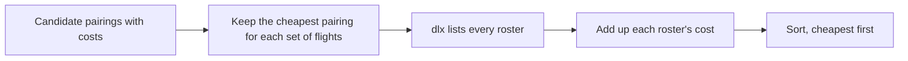

# Crew pairing

A command-line solver for a small crew pairing problem, written as an example of using package [dlx](https://github.com/dimchansky/dlx). If exact cover is new to you, read the [introduction to the examples](../README.md) first.

## The problem

An airline must staff every flight of the day. A **pairing** is a set of flights that one crew can work, and it has a cost, such as pay and hotels. A set of pairings that staffs the whole day is called a **roster** here. The task is to pick pairings so that every flight is flown by exactly one crew, at the lowest total cost.

This kind of problem is called **set partitioning**. To partition a set means to divide it into groups so that each item lands in exactly one group. Here the items are the flights, and the groups are the pairings. It appears wherever every job must be done exactly once: delivery routes, shifts, machine schedules.

This is a simplified version. Real pairings span several days and must start and end at a crew base, and thousands of flights give vastly more candidate pairings than this search could list.

## A small example

Take four flights and six candidate pairings. Written in the command's input format:

```
flights F1 F2 F3 F4
A  900 F1 F2
B  700 F3 F4
C 1000 F2 F3
D  500 F1
E  450 F4
L 1500 F1 F2 F3 F4
```

The first line lists the flights. Each line after it is one pairing: its name, its cost, and the flights it covers. So pairing A costs 900 and covers F1 and F2. The [Input](#input) section has the full rules.

## How it becomes a matrix

The mapping is direct, and it's the simplest one in these examples. **One column of the matrix is one flight.** **One row of the matrix is one candidate pairing**, with a 1 under each flight it covers. The cost isn't in the matrix at all, so it is shown here only in the row label:

| Pairing (cost) | F1 | F2 | F3 | F4 |
|----------------|:-:|:-:|:-:|:-:|
| A (900)        | 1 | 1 | 0 | 0 |
| B (700)        | 0 | 0 | 1 | 1 |
| C (1000)       | 0 | 1 | 1 | 0 |
| D (500)        | 1 | 0 | 0 | 0 |
| E (450)        | 0 | 0 | 0 | 1 |
| L (1500)       | 1 | 1 | 1 | 1 |

Picking rows so that each column has exactly one 1 is the same as staffing each flight exactly once. A flight that no pairing covers would leave its column empty, so there would be no rosters at all, and the command reports that. This matrix has three exact covers, and adding up each one's costs gives the ranking:

| Roster  | Sum                | Total |
|---------|--------------------|-------|
| L       | 1500               | 1500  |
| A, B    | 900 + 700          | 1600  |
| D, C, E | 500 + 1000 + 450   | 1950  |

This chart shows which pairing flies each flight in the three rosters. Every flight has exactly one pairing in every roster, which is what an exact cover means here:

| Roster  | F1 | F2 | F3 | F4 |
|---------|:-:|:-:|:-:|:-:|
| L       | L | L | L | L |
| A, B    | A | A | B | B |
| D, C, E | D | C | C | E |

For the sample file [pairings.txt](pairings.txt):

| Matrix part | Meaning                                                   | Count in pairings.txt  |
|-------------|-----------------------------------------------------------|------------------------|
| Column      | A flight, which must be flown by exactly one crew         | 12                     |
| Row         | A candidate pairing, covering its flights                 | 19, from 20 candidates |

<details>
<summary>The whole sample as a table, with flights numbered from 101</summary>

Rows A2 and D1 are the same, so only one of them goes into the matrix, as explained below.

| Pairing (cost) | 101 | 102 | 103 | 104 | 105 | 106 | 107 | 108 | 109 | 110 | 111 | 112 |
|---|:-:|:-:|:-:|:-:|:-:|:-:|:-:|:-:|:-:|:-:|:-:|:-:|
| A1 (900) | 1 | 1 | 0 | 0 | 0 | 0 | 0 | 0 | 0 | 0 | 0 | 0 |
| A2 (700) | 0 | 0 | 1 | 1 | 0 | 0 | 0 | 0 | 0 | 0 | 0 | 0 |
| A3 (800) | 0 | 0 | 0 | 0 | 1 | 1 | 0 | 0 | 0 | 0 | 0 | 0 |
| A4 (650) | 0 | 0 | 0 | 0 | 0 | 0 | 1 | 1 | 0 | 0 | 0 | 0 |
| A5 (750) | 0 | 0 | 0 | 0 | 0 | 0 | 0 | 0 | 1 | 1 | 0 | 0 |
| A6 (820) | 0 | 0 | 0 | 0 | 0 | 0 | 0 | 0 | 0 | 0 | 1 | 1 |
| B1 (1150) | 1 | 1 | 1 | 1 | 0 | 0 | 0 | 0 | 0 | 0 | 0 | 0 |
| B2 (1250) | 0 | 0 | 1 | 1 | 1 | 1 | 0 | 0 | 0 | 0 | 0 | 0 |
| B3 (1200) | 0 | 0 | 0 | 0 | 0 | 0 | 1 | 1 | 1 | 1 | 0 | 0 |
| B4 (1180) | 0 | 0 | 0 | 0 | 0 | 0 | 0 | 0 | 1 | 1 | 1 | 1 |
| B5 (1400) | 0 | 0 | 0 | 0 | 1 | 1 | 1 | 1 | 0 | 0 | 0 | 0 |
| C1 (1300) | 1 | 0 | 0 | 1 | 1 | 0 | 0 | 0 | 0 | 0 | 0 | 0 |
| C2 (1000) | 0 | 1 | 1 | 0 | 0 | 0 | 0 | 0 | 0 | 0 | 0 | 0 |
| C3 (990) | 0 | 0 | 0 | 0 | 0 | 1 | 1 | 1 | 0 | 0 | 0 | 0 |
| C4 (1450) | 0 | 1 | 1 | 0 | 0 | 1 | 1 | 1 | 0 | 0 | 0 | 0 |
| R1 (520) | 1 | 0 | 0 | 0 | 0 | 0 | 0 | 0 | 0 | 0 | 0 | 0 |
| R2 (500) | 0 | 1 | 0 | 0 | 0 | 0 | 0 | 0 | 0 | 0 | 0 | 0 |
| R3 (560) | 0 | 0 | 0 | 0 | 0 | 0 | 0 | 0 | 0 | 0 | 1 | 0 |
| R4 (540) | 0 | 0 | 0 | 0 | 0 | 0 | 0 | 0 | 0 | 0 | 0 | 1 |
| D1 (680) | 0 | 0 | 1 | 1 | 0 | 0 | 0 | 0 | 0 | 0 | 0 | 0 |

</details>

## What dlx leaves out

The interesting part is what dlx doesn't do, because real problems run into both of these.

**dlx has no costs.** It finds solutions and doesn't rank them. An exact cover is a yes-or-no question, and a matrix of 0s and 1s has nowhere to put a price. So cost is handled outside the search: [solver.go](solver.go) lists every roster, adds up each one's cost, and sorts them.



That means listing every roster, which is fine for a few dozen candidates and useless for a real airline's thousands. Real crew pairing uses integer programming, a family of methods that can steer toward a low cost without listing every solution.

**dlx doesn't identify rows.** A solution lists each row's columns, not which row it was, so two pairings with the same flights look identical. Here that happens for A2 and D1 in [pairings.txt](pairings.txt): both cover F103 and F104, at costs of 700 and 680. The solver gives each set of flights a single matrix row and remembers the cheapest pairing for it, since a dearer one can't be in the cheapest roster. As a result, the rosters are counted by how they divide up the flights, and a dearer duplicate never appears, even with `-limit 0`.

## How a solution decodes back

Each row of a solution is a list of flights. The solver uses that list as a key to look up the cheapest pairing with those flights, then adds its cost to the roster's total.

## Installation

    go install github.com/dimchansky/dlx/examples/crew@latest

## Input

```
# Comments start with a hash.
flights F101 F102 F103
A1  900 F101 F102
A2  700 F103
```

- Blank lines and lines starting with `#` are skipped. A `#` later in a line is not a comment.
- The first other line is the word `flights` followed by every flight name.
- Each later line is a pairing: a unique name, a cost from 0 to 1000000, and the flights it covers. Fields are separated by whitespace.
- Naming an unlisted flight is an error, which catches typos.
- Input is read to the end, so if you type at a terminal, finish with Ctrl-D.

[pairings.txt](pairings.txt) is a made-up sample with 12 flights.

## Usage

    crew [-limit n] < pairings.txt

`-limit n` sets how many rosters to print, cheapest first, 1 by default. Zero prints all of them. All rosters are found and held in memory whatever the limit. Rosters of equal cost appear in the order the search found them.

`-help` prints the usage text to standard error.

Rosters go to standard output. Error messages go to standard error, and most start with `crew:`.

| Exit code | Meaning                                                    |
|-----------|------------------------------------------------------------|
| 0         | At least one roster exists, or `-help` was given           |
| 1         | No roster covers every flight                              |
| 2         | Invalid usage, invalid input, or a read or write failure   |

## Examples

Run this from this directory. Find the two cheapest rosters:

    crew -limit 2 < pairings.txt

Output:

    Rosters covering every flight: 40

    Roster 1, cost 3730:
      B1    1150  F101 F102 F103 F104
      B5    1400  F105 F106 F107 F108
      B4    1180  F109 F110 F111 F112

    Roster 2, cost 3780:
      B1    1150  F101 F102 F103 F104
      A3     800  F105 F106
      A4     650  F107 F108
      B4    1180  F109 F110 F111 F112

Each line of a roster shows the pairing's name, its cost and its flights.

## How the results are checked

The tests compare the cost of every roster with a plain check that tries every combination of candidates, for the sample file and for 500 random problems.

## Limits

Every roster is found and held in memory, even with `-limit 1`, so the running time and memory grow with the number of rosters. This suits a few dozen candidates and not a real airline schedule.
