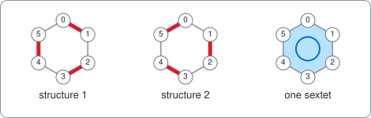
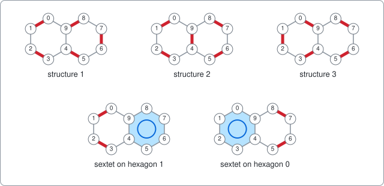
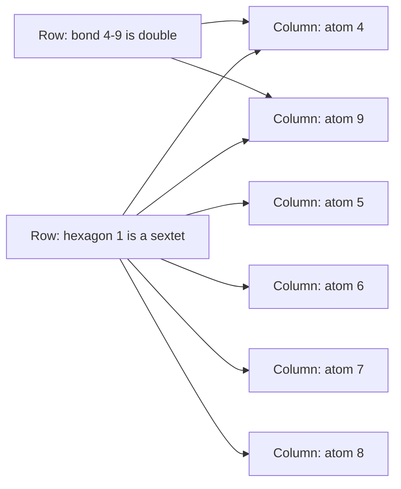
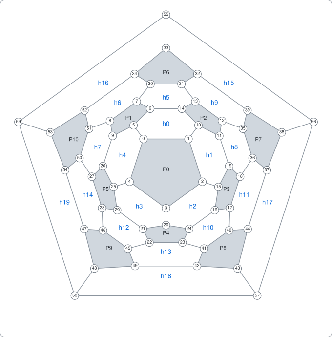
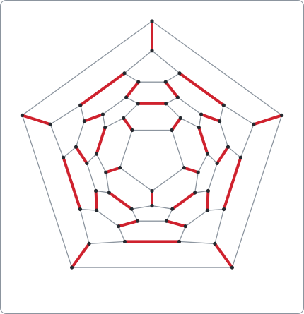
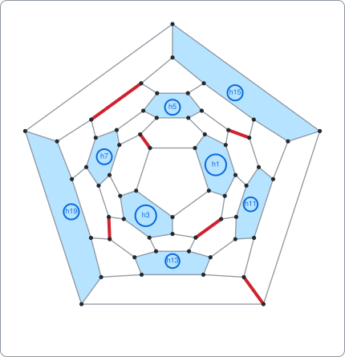

# Fullerene

A command-line tool that finds the double bonds of the football-shaped molecule C60, written as an example of using package [dlx](https://github.com/dimchansky/dlx). If exact cover is new to you, read the [introduction to the examples](../README.md) first. No chemistry is assumed: everything needed is explained below.

## The problem

C60 is a real molecule, also called buckminsterfullerene: 60 carbon atoms arranged like the seams of a football, with 12 pentagons and 20 hexagons. Each corner where seams meet is an atom, and each seam is a bond between two atoms.

A carbon atom has four bonds to give, but in C60 each atom has only three neighbours. So one of its three bonds must be a **double bond**, and the other two stay single. The question is:

> Which bonds are double, so that every atom has exactly one double bond?

An answer is called a **Kekulé structure**. C60 has 12500 of them.

The same question works for a much smaller molecule. Benzene is a ring of 6 carbon atoms, and it has 2 answers. The red lines here are double bonds:

Look at the third drawing. In the two structures the double bonds take turns around the ring, but real benzene is neither of them: the electrons of its three double bonds spread evenly around the whole ring. Chemists draw this as a circle and call it a **sextet**, after the six electrons involved. The chemist Erich Clar's rule of thumb is that a molecule tends to be more stable when it can be drawn with more sextets. So a second question is:

> How many hexagons of a molecule can be sextets at once?

A sextet uses up all six of its atoms, so no atom may be in two sextets, and any atoms left over must still pair up in double bonds. For C60 the answer is 8.

Both questions suit this library because a molecule turns into a matrix with almost no work: the chemistry rule "exactly one" is already the rule of exact cover.

## Dots and lines

A drawing of dots joined by lines is called a **graph**. Here the dots are atoms and the lines are bonds. Picking lines so that every dot is on exactly one picked line is called a **perfect matching**: think of pairing everyone in a room with someone standing next to them. So a Kekulé structure is a perfect matching of the molecule's graph.

## A small example: naphthalene

Naphthalene is two hexagons sharing a bond: 10 atoms and 11 bonds. It has 3 Kekulé structures. It can also hold one sextet, on either hexagon, and then the other four atoms can pair up in only one way:

It can't hold two sextets, because the two hexagons share atoms 4 and 9.

## How it becomes a matrix

**One column of the matrix is one atom,** which needs exactly one role. **One row of the matrix is one thing that gives atoms their role:** a bond that could be double, or a hexagon that could be a sextet. A bond's row has two 1s, and a hexagon's row has six.

Both rows in the diagram cover atoms 4 and 9, so an exact cover can't pick both. That single fact is the whole "one role per atom" rule.

| Matrix part | Meaning                                   | Naphthalene | C60 |
|-------------|-------------------------------------------|-------------|-----|
| Column      | An atom, which needs exactly one role     | 10          | 60  |
| Row         | A bond that may be double                 | 11          | 90  |
| Row         | A hexagon that may be a sextet (`-clar`)  | 2           | 20  |

Here is the whole matrix for naphthalene, with `a0` to `a9` for the atoms:

|           | a0 | a1 | a2 | a3 | a4 | a5 | a6 | a7 | a8 | a9 |
|-----------|:-:|:-:|:-:|:-:|:-:|:-:|:-:|:-:|:-:|:-:|
| bond 0-1  | 1 | 1 | 0 | 0 | 0 | 0 | 0 | 0 | 0 | 0 |
| bond 1-2  | 0 | 1 | 1 | 0 | 0 | 0 | 0 | 0 | 0 | 0 |
| bond 2-3  | 0 | 0 | 1 | 1 | 0 | 0 | 0 | 0 | 0 | 0 |
| bond 3-4  | 0 | 0 | 0 | 1 | 1 | 0 | 0 | 0 | 0 | 0 |
| bond 4-5  | 0 | 0 | 0 | 0 | 1 | 1 | 0 | 0 | 0 | 0 |
| bond 5-6  | 0 | 0 | 0 | 0 | 0 | 1 | 1 | 0 | 0 | 0 |
| bond 6-7  | 0 | 0 | 0 | 0 | 0 | 0 | 1 | 1 | 0 | 0 |
| bond 7-8  | 0 | 0 | 0 | 0 | 0 | 0 | 0 | 1 | 1 | 0 |
| bond 8-9  | 0 | 0 | 0 | 0 | 0 | 0 | 0 | 0 | 1 | 1 |
| bond 0-9  | 1 | 0 | 0 | 0 | 0 | 0 | 0 | 0 | 0 | 1 |
| bond 4-9  | 0 | 0 | 0 | 0 | 1 | 0 | 0 | 0 | 0 | 1 |
| hexagon 0 | 1 | 1 | 1 | 1 | 1 | 0 | 0 | 0 | 0 | 1 |
| hexagon 1 | 0 | 0 | 0 | 0 | 1 | 1 | 1 | 1 | 1 | 1 |

Keep only the 11 bond rows and the exact covers are the 3 Kekulé structures. For example, structure 2 picks the rows 0-1, 2-3, 4-9, 5-6 and 7-8. Check it in the table: each column has a 1 in exactly one of those five rows.

Add the two hexagon rows and there are 5 exact covers: the same 3, plus "hexagon 1, bond 0-1, bond 2-3" and "hexagon 0, bond 5-6, bond 7-8". From here on, an exact cover of this larger matrix is called a **cover**. A cover with no hexagons is a Kekulé structure.

Sextets need no new idea. Every atom still has one role, so adding rows with six 1s is all it takes.

`fullerene -molecule naphthalene -clar` goes through those 5 covers and groups them by how many sextets they use:

| Sextets | Covers | Different sets of hexagons | Sets that cannot grow |
|--------:|-------:|---------------------------:|----------------------:|
| 0       | 3      | 1                          | 0                     |
| 1       | 2      | 2                          | 2                     |
| Total   | 5      | 3                          | 2                     |

Check it against the drawing above, row by row:

- The 3 covers with no sextets are the 3 Kekulé structures. They all use the same set of hexagons, the empty one, so there is 1 set. That set can still grow, because either hexagon could join it.
- The 2 covers with one sextet use 2 different sets: just hexagon 0, or just hexagon 1. Neither can grow, because the two hexagons share atoms 4 and 9.

## Building C60

The matrix for C60 is the same recipe with 60 columns, so the only real work is writing down the molecule. [molecule.go](molecule.go) builds it from one small table, `pentagonNeighbours`, with no geometry.

No two pentagons of a football touch, and each is joined to five others by a single bond. So the table lists, for each of the 12 pentagons, the five pentagons around it in order. Each atom lies on exactly one pentagon, which gives a simple numbering: pentagon p holds atoms 5p to 5p+4, and atom 5p+i points at the pentagon in position i of row p. Then:

- Neighbours around a pentagon are bonded: 12 × 5 = 60 bonds.
- Two atoms that point at each other are bonded: 30 more bonds, which makes 90.
- Three pentagons that are all neighbours of each other surround a hexagon: 20 hexagons.

For example, atom 0 of pentagon 0 points at pentagon 1, and atom 5 of pentagon 1 points back at pentagon 0, so 0-5 is a bond. Hexagon h0 is surrounded by pentagons 0, 1 and 2, and its atoms are the ones that point between those three: 0, 5, 6, 14, 10 and 1 around the ring. This flat map shows the result. It is the football opened through one pentagon and stretched flat, so the outer five atoms, 55 to 59, are pentagon 11:

You can follow any printed answer on this map.

## How a solution decodes back

dlx reports each picked row as its list of columns, in the order given to `AddRow`. A column number is an atom number, so there is almost nothing to decode. [solver.go](solver.go) tells the rows apart by length:

- Two columns: a double bond. For naphthalene, the row `[4 9]` is the bond 4-9.
- Six columns: a sextet. For naphthalene, the row `[4 5 6 7 8 9]` is hexagon 1, found with a lookup table.

## Three results about C60

**The structure that matches the real molecule.** Exactly one of the 12500 structures has no double bond along a pentagon. All 30 of its double bonds lie between two hexagons, and every hexagon gets three. Each of these bonds also joins two pentagons: its two ends lie on different pentagons, and it has a hexagon on either side. Measurements of real C60 show the same pattern: the bonds between two hexagons are the shorter ones, as double bonds are.

**The sextet table.** `fullerene -clar` goes through all 250967 covers and groups them the same way as the naphthalene table:

| Sextets | Covers | Different sets of hexagons | Sets that cannot grow |
|--------:|-------:|---------------------------:|----------------------:|
| 0       | 12500  | 1                          | 0                     |
| 1       | 41580  | 20                         | 0                     |
| 2       | 67650  | 160                        | 0                     |
| 3       | 66900  | 660                        | 0                     |
| 4       | 42000  | 1510                       | 0                     |
| 5       | 16352  | 1912                       | 0                     |
| 6       | 3620   | 1240                       | 10                    |
| 7       | 360    | 320                        | 280                   |
| 8       | 5      | 5                          | 5                     |
| Total   | 250967 | 5828                       | 295                   |

A set "cannot grow" if no further hexagon can join it as a sextet. Those sets are the **Clar structures**, and the most sextets any set can hold is the **Clar number**, here 8. Some sets stop early: 10 sets of 6 hexagons leave no room for a seventh, though other sets go on to 8.

The last column is the published Clar polynomial of C60, 5x⁸ + 280x⁷ + 10x⁶, where each number is how many Clar structures have the size given by the power of x. Those numbers add up to 295. Some authors use "Clar structure" only for the largest sets, which would give 5.

**The five largest sets are five cubes.** Each hexagon touches exactly three others, and two touching hexagons share atoms, so no cover of any size can hold both. The centres of the eight hexagons of a set are the corners of a cube, and each hexagon belongs to exactly two of the five sets. This is the classic picture of five cubes inside a dodecahedron, a solid with 12 faces and 20 corners, one corner for each hexagon of C60. Here is one of the five, the first of the sets printed by `fullerene -clar` under Examples below: the sextets 1 3 5 7 11 13 15 19, labelled as on the map above, and the double bonds 0-5 12-35 16-24 28-46 34-52 43-57:

## Installation

    go install github.com/dimchansky/dlx/examples/fullerene@latest

## Usage

    fullerene [-molecule name] [-limit n] [-count] [-clar]

- `-molecule name` picks the molecule: `c60` by default, `benzene`, `naphthalene` or `benzyl`. Benzyl is benzene with a seventh atom attached. An odd number of atoms can't pair up, so it has no Kekulé structure.
- `-limit n` sets how many Kekulé structures to print, 1 by default. Zero prints all of them.
- `-count` goes through every Kekulé structure and prints the total instead.
- `-clar` adds the hexagon rows, goes through every cover, and prints the sextet table, followed by the covers with the most sextets.

`-count` and `-clar` can't be combined, and `-limit` has no effect with either. `-help` prints the usage text to standard error.

Results go to standard output. Error messages go to standard error, and most start with `fullerene:`.

| Exit code | Meaning                                                |
|-----------|--------------------------------------------------------|
| 0         | At least one structure exists, or `-help` was given    |
| 1         | There are no structures                                |
| 2         | Invalid usage, or a write failure                      |

## Examples

Print the first Kekulé structure of C60, as pairs of atoms from the map above:

    fullerene

Output:

    0-1 2-3 4-25 5-6 7-8 9-26 10-11 12-35 13-14 15-16 17-40 18-19 20-21 22-45 23-24 27-50 28-29 30-31 32-39 33-34 36-37 38-56 41-42 43-44 46-47 48-49 51-52 53-54 55-59 57-58

List all structures of naphthalene:

    fullerene -molecule naphthalene -limit 0

Output:

    0-1 2-3 4-5 6-7 8-9
    0-1 2-3 4-9 5-6 7-8
    0-9 1-2 3-4 5-6 7-8

Count the structures of C60:

    fullerene -count

Output:

    Kekule structures: 12500

Print the sextet table of C60:

    fullerene -clar

Output:

    Sextets  Covers   Sets Cannot grow
          0   12500      1           0
          1   41580     20           0
          2   67650    160           0
          3   66900    660           0
          4   42000   1510           0
          5   16352   1912           0
          6    3620   1240          10
          7     360    320         280
          8       5      5           5
      Total  250967   5828         295
    sextets 1 3 5 7 11 13 15 19, double bonds 0-5 12-35 16-24 28-46 34-52 43-57
    sextets 0 3 6 8 10 14 15 18, double bonds 2-15 9-26 13-31 22-45 37-44 53-59
    sextets 0 2 7 9 11 12 16 18, double bonds 4-25 7-30 11-19 23-41 38-56 47-54
    sextets 2 4 5 8 13 14 16 17, double bonds 1-10 8-51 17-40 21-29 32-39 48-58
    sextets 1 4 6 9 10 12 17 19, double bonds 3-20 6-14 18-36 27-50 33-55 42-49

Benzyl has no structure, so this exits with code 1:

    fullerene -molecule benzyl

Output, on standard error:

    fullerene: no Kekule structure found

## How the results are checked

The main checks don't trust the solver's graph. The tests build C60 a second time, from the published coordinates of a truncated icosahedron: atoms are points in space, a bond is two points at distance 2, and pentagons and hexagons are found by searching for rings of 5 and 6 bonds. Then:

- **Same molecule.** A search finds a renumbering of the atoms that turns the solver's graph into the coordinate graph exactly, and puts its 20 hexagons on the 20 rings found there. The graph also has the 120 symmetries it should have: 60 turns and their mirror images.
- **Kekulé count, without any search.** Kasteleyn's method turns a graph drawn without crossing lines into a square table of +1, -1 and 0. A single number calculated from that table, its determinant, is the square of the number of perfect matchings. The test works in exact fractions and gets 156250000, which is 12500 × 12500.
- **The whole table, with a different search.** A test chooses hexagons directly on the coordinate graph, counts the matchings of the atoms left over with a plain recursive count, and rebuilds every number in the Covers and Sets columns, including the 12500.
- **The Clar polynomial, without matchings.** Among the rings of the coordinate graph, the sets of non-touching hexagons that have no room for another number exactly 5, 280 and 10, by size. Their counts by size also equal the Sets column, so for C60 every set of non-touching hexagons leaves the other atoms able to pair up.
- **Published numbers.** The total of 12500 was published in 1986 by Klein, Schmalz, Hite and Seitz (J. Am. Chem. Soc. 108, 1301), and independently by others. A test confirms that the 12500 fall into 158 kinds when structures that differ only by a turn or a reflection count as one, matching Vukičević, Kroto and Randić ([Croatica Chemica Acta 78, 2005](https://hrcak.srce.hr/16)). The polynomial and the total of 295 come from Shiu, Lam and Zhang ([J. Mol. Struct. THEOCHEM 622, 2003](https://scholars.hkbu.edu.hk/en/publications/clar-and-sextet-polynomials-of-buckminsterfullerene/)). That paper's abstract gives those numbers and speaks of a "maximal independent set polynomial". The meaning used here, sets that cannot grow, reproduces all three of its coefficients.
- **Valid answers.** Every Kekulé structure and every largest cover is checked to give each atom exactly one role, using real bonds and real hexagons.

`go test` checks everything. `go test -short` skips the full C60 runs through dlx, which are much slower with `-race`, and keeps the independent checks. Use `-short` with `-race`.

## Limits

This is a teaching example, not the right tool for large molecules. dlx visits every answer one at a time, so the work of `-count` grows with the number of structures, and that number grows very fast with the size of the molecule: 3 for naphthalene, 12500 for C60.

Better methods are known. Counting the perfect matchings of any graph that can be drawn without crossing lines, as every fullerene can, takes polynomial time with the Fisher-Kasteleyn-Temperley algorithm, the method behind the determinant test above. That means the work grows like a fixed power of the number of atoms, not by multiplying with every extra atom. Finding one perfect matching of any graph is polynomial too, with Edmonds' blossom algorithm. What dlx offers here is simplicity: the same few lines answer both questions, and sextets took only a few more rows.

The tool knows only these four molecules, and it models which bonds are double, not real energies. The number of Kekulé structures and of sextets is a rough guide to stability, not a measurement of it.
