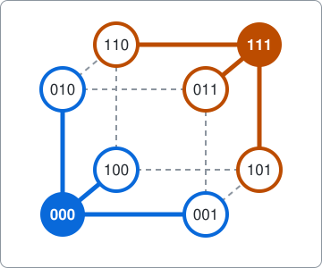
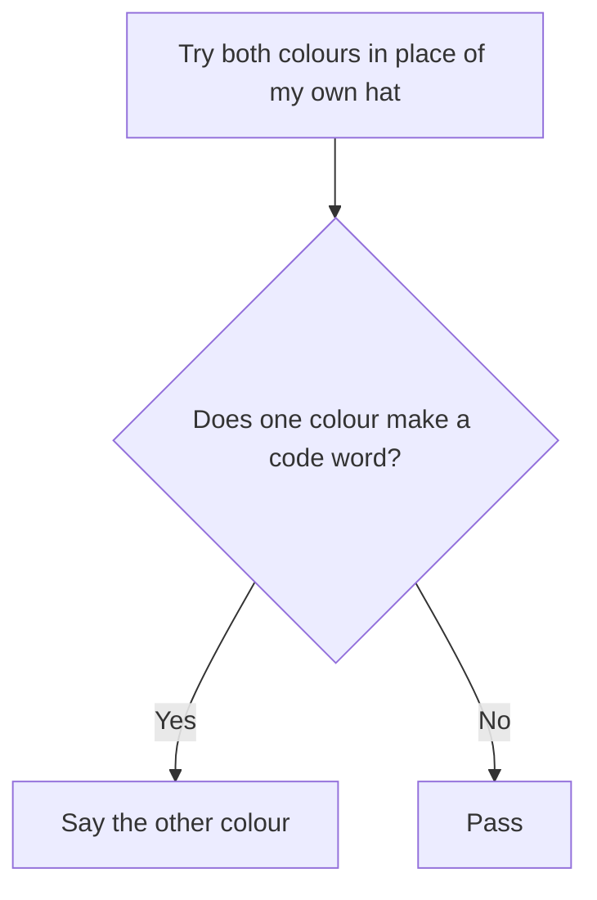

# Perfect codes and the hat game

A command-line search for perfect codes, written as an example of using package [dlx](https://github.com/dimchansky/dlx). A perfect code answers a puzzle that looks impossible: seven prisoners win a guessing game 7 times out of 8, although each guess on its own is a coin flip. Perfect codes were first built for error correction: if you send only code words and one digit gets flipped on the way, the receiver can still tell which word you meant. Richard Hamming published a family of them in 1950, which is why the command is called `hamming`. If exact cover is new to you, read the [introduction to the examples](../README.md) first.

## The puzzle

Seven prisoners stand in a room. Each is given a white or a black hat, chosen by a fair coin flip. A prisoner sees the other six hats but not their own. They may agree on a plan beforehand, but once the hats are on they can't communicate.

Then all of them answer at the same moment. Each one says "white", says "black", or passes. The team goes free if **at least one prisoner guesses, and every guess is right**. One wrong guess loses, and so does everybody passing.

An easy plan is that one prisoner guesses and the rest pass, which wins half the time. It seems impossible to do better, because the other hats say nothing about your own, so any single guess is right half the time. Yet the team can win 112 of the 128 possible patterns of hats, which is 7/8.

### Three prisoners

Three prisoners already show the trick. The plan: **if the two hats you see match, say the other colour. If they differ, pass.** There are 8 patterns of hats, each equally likely:

| Hats (W white, B black) | Prisoner 1 | Prisoner 2 | Prisoner 3 | Team |
|-------------------------|------------|------------|------------|------|
| W W W                   | B, wrong   | B, wrong   | B, wrong   | loses |
| W W B                   | pass       | pass       | B, right   | wins |
| W B W                   | pass       | B, right   | pass       | wins |
| W B B                   | W, right   | pass       | pass       | wins |
| B W W                   | B, right   | pass       | pass       | wins |
| B W B                   | pass       | W, right   | pass       | wins |
| B B W                   | pass       | pass       | W, right   | wins |
| B B B                   | W, wrong   | W, wrong   | W, wrong   | loses |

The team wins 6 of 8 patterns, which is 3/4, the best any plan can do for three prisoners. Count the guesses: 6 are right and 6 are wrong, so each guess really is a coin flip. The plan doesn't make anyone guess better. It **puts the wrong guesses together**: all 6 land on the 2 losing patterns, while each winning pattern has a single right guess and nothing else.

### Why 7/8 can't be beaten

Take any plan and any prisoner, and pair up the hat patterns that differ only in that prisoner's hat. The prisoner sees the same thing in both patterns of a pair, so they answer the same way in both. A guess is therefore right in one pattern of the pair and wrong in the other. Adding up over all prisoners, **every plan has as many right guesses as wrong guesses**. This is about fixed plans, where what you see decides your answer. A prisoner who also tosses a private coin is just picking one fixed plan at random, and that can't beat the best fixed plan.

A won pattern holds at least one right guess and no wrong one. A lost pattern holds at most 7 wrong guesses. So the wins can't exceed the right guesses, which equal the wrong guesses, which can't exceed 7 times the losses. With 128 patterns, wins of at most 7 times the losses means at least 16 losses, and at most 112 wins.

To reach that limit, every lost pattern must hold 7 wrong guesses and every won pattern exactly one right guess. Finding 16 patterns to lose on is what a perfect code does.

## From hats to words

Write a white hat as 0 and a black hat as 1. A pattern of hats is now a **word** such as `0110100`. Here are the only ideas needed:

- The **distance** between two words is the number of places in which they differ. `0110100` and `0110101` have distance 1, and `000` and `111` have distance 3.
- The **neighbourhood** of a word is the word itself plus every word at distance 1. A word of 7 digits has 7 neighbours, because any of its 7 digits can flip, so its neighbourhood has 8 words.
- A **perfect code** is a set of words, called code words, whose neighbourhoods contain every word exactly once. Every word is either a code word or one flip away from exactly one code word.

Two code words are always at least 3 apart. If they were only 1 or 2 apart, some word would be within one flip of both: for `000` and `011`, that word is `001`. It would then lie in two neighbourhoods, which a perfect code doesn't allow.

For words of 3 digits, draw the 8 words as the corners of a cube, so that a line joins two words at distance 1. The code `000`, `111` splits the corners into two neighbourhoods, one around each filled corner. Every corner is in exactly one of them.

A cube of 7 digits can't be drawn, but the arithmetic is the same: there are 128 words, each neighbourhood holds 8, so a perfect code has 128 / 8 = 16 words.

### The plan, in terms of the code

The prisoners agree on a perfect code. Each prisoner then asks the same question: "With the hats I see, could my hat colour complete a code word?"

Both colours can't make a code word, because those two words would be at distance 1, and code words are at least 3 apart. Then there are two cases:

- **The hats are not a code word.** They are one flip away from exactly one code word, so exactly one prisoner can complete a code word, namely the one whose hat is the flipped digit. That prisoner says the other colour, which is the true one. Everyone else passes. The team wins.
- **The hats are a code word.** Every prisoner sees a code word that their own hat completes, so all 7 say the other colour, and all are wrong. The team loses.

So the team loses exactly on the 16 code words, and wins on the other 112. That is the limit proved above. The plan for three prisoners is this same plan with the code `000`, `111`.

## Which lengths can have a perfect code

The neighbourhoods share out all the words evenly, so the neighbourhood size must divide the number of words. With words of length n, that means n+1 must divide a product of n twos. A product of twos has only powers of 2 as divisors, so n+1 must itself be a power of 2. For n=4, 5 does not divide 16. This test can only rule a length out: a yes below says that the sizes fit, not that a code exists. For lengths 1, 3 and 7 the search finds codes, and for length 15 a recipe builds one, as described under [How the results are checked](#how-the-results-are-checked).

| Length n | Words | Neighbourhood size | Sizes fit? |
|----------|-------|--------------------|------------|
| 1        | 2     | 2                  | yes        |
| 3        | 8     | 4                  | yes        |
| 4        | 16    | 5                  | no         |
| 7        | 128   | 8                  | yes        |
| 8        | 256   | 9                  | no         |
| 15       | 32768 | 16                 | yes        |

The command checks this first, so it answers every length with no code at once. The check saves real time only at the longer lengths. On the raw matrix, with no check, the search proves there is no code for lengths 8, 9 and 10 in under a second, and for length 12 in a second or two. Length 14 takes a minute or two, and lengths 11 and 13 were still running after three minutes.

## How it becomes a matrix

**One column of the matrix is one word, which must lie in exactly one neighbourhood.** **One row of the matrix is one word offered as a code word, and it has a 1 in every column of that word's neighbourhood.**

| Matrix part | Meaning                                   | Count for length 3 | Count for length 7 |
|-------------|-------------------------------------------|--------------------|--------------------|
| Column      | A word to be covered                      | 8                  | 128                |
| Row         | A candidate code word                     | 8                  | 128                |
| 1s in a row | The candidate and its neighbours          | 4                  | 8                  |

This is the whole matrix for length 3. For example, row `001` has its 1s under `001` itself and under its neighbours `000`, `011` and `101`.

|     | 000 | 001 | 010 | 011 | 100 | 101 | 110 | 111 |
|-----|:---:|:---:|:---:|:---:|:---:|:---:|:---:|:---:|
| **000** | **1** | **1** | **1** | 0 | **1** | 0 | 0 | 0 |
| 001 | 1 | 1 | 0 | 1 | 0 | 1 | 0 | 0 |
| 010 | 1 | 0 | 1 | 1 | 0 | 0 | 1 | 0 |
| 011 | 0 | 1 | 1 | 1 | 0 | 0 | 0 | 1 |
| 100 | 1 | 0 | 0 | 0 | 1 | 1 | 1 | 0 |
| 101 | 0 | 1 | 0 | 0 | 1 | 1 | 0 | 1 |
| 110 | 0 | 0 | 1 | 0 | 1 | 0 | 1 | 1 |
| **111** | 0 | 0 | 0 | **1** | 0 | **1** | **1** | **1** |

Rows `000` and `111`, shown in bold, together have exactly one 1 in every column, so `000`, `111` is an exact cover. This matrix has four exact covers, and each is a pair of opposite corners of the cube: `000`, `111`, then `001`, `110`, then `010`, `101`, then `011`, `100`.

Two rows can't both be picked if their neighbourhoods overlap, because some column would then have two 1s. That is what keeps code words 3 apart, and it needs no separate rule. No slack rows are needed either, because every word must be covered exactly once.

## How a solution decodes back

dlx reports column numbers, so each word needs a number. A word is read as a binary number: `101` is 4 + 0 + 1 = 5, and `0000111` is 4 + 2 + 1 = 7.

[solver.go](solver.go) adds each row with the candidate's own column first. So the first number of each reported row is a code word, and that is all the decoder reads. For length 7, the row for `0000111` comes back as `[7 6 5 3 15 23 39 71]`: the word 7, then its seven neighbours. The decoder keeps the 7 and sorts the 16 code words into order.

## Bonus: a football pool

The same matrix works with three digit values. In a football pool you predict several matches, each ending in a home win, a draw or an away win. Write these as 0, 1 and 2. How few coupons guarantee that one of them has at most one match wrong, whatever happens?

With 4 matches there are 3 × 3 × 3 × 3 = 81 possible results. A digit can change to two other values, so a word has 2 × 4 = 8 neighbours and a neighbourhood of 9 words. The neighbourhood of `0000` is itself and `1000`, `2000`, `0100`, `0200`, `0010`, `0020`, `0001`, `0002`. Since 81 / 9 = 9, a perfect code has 9 words, and those are the 9 coupons. The matrix has 81 columns and 81 rows, and the columns are numbered by reading words in base 3, where each place is worth three times the one to its right: `0012` is 0 + 0 + 3 + 2 = 5. Fewer coupons can't work, because 8 neighbourhoods reach at most 72 of the 81 results.

    hamming -base 3 -n 4

Output:

    Code 1:
    0000
    0111
    0222
    1012
    1120
    1201
    2021
    2102
    2210

If the real result is `2222`, the coupon `0222` has one match wrong. Other results work the same way, and each is within one match of exactly one coupon.

## Installation

    go install github.com/dimchansky/dlx/examples/hamming@latest

## Usage

    hamming [-base 2|3] [-n length] [-limit n] [-count]
    hamming [-n length] -hat
    hamming [-n length] -play hats

- `-base b` sets how many digit values a word uses, 2 by default. It can be 2 or 3.
- `-n length` sets the word length, 7 by default, from 1 to 14 in base 2 and from 1 to 8 in base 3. The limits are explained under [Limits](#limits).
- `-limit n` sets how many codes to print, 1 by default. Zero prints all of them.
- `-count` goes through every code and prints the total instead, so `-limit` has no effect with it.
- `-hat` prints the first code, then scores its plan against every pattern of hats. It works in base 2 only and ignores `-limit`.
- `-play hats` prints the first code, then one round against the given hats, such as `0110100`, where 0 is white and 1 is black. It works in base 2 only, takes as many digits as the word length, and ignores `-limit`.

`-count`, `-hat` and `-play` can't be combined. `-help` prints the usage text to standard error.

Results go to standard output. Error messages go to standard error, and all start with `hamming:` except errors from flag parsing, which come from the flag package.

| Exit code | Meaning                                       |
|-----------|-----------------------------------------------|
| 0         | A code exists, or `-help` was given           |
| 1         | No perfect code exists for this base and length |
| 2         | Invalid usage, or a write failure             |

## Examples

Find the first code of length 7, the one the prisoners use:

    hamming

Output:

    Code 1:
    0000000
    0000111
    0011001
    0011110
    0101010
    0101101
    0110011
    0110100
    1001011
    1001100
    1010010
    1010101
    1100001
    1100110
    1111000
    1111111

Score its plan on every pattern of hats:

    hamming -hat

Output, after the same code:

    Hat patterns:  128
    Team wins:     112
    Team loses:    16
    Right guesses: 112
    Wrong guesses: 112

Play a round. `0110101` is not a code word, but it is one flip from the code word `0110100`, so the last prisoner alone speaks:

    hamming -play 0110101

Output, after the code:

    Hats: 0110101
    Prisoner 1 sees ?110101 and passes
    Prisoner 2 sees 0?10101 and passes
    Prisoner 3 sees 01?0101 and passes
    Prisoner 4 sees 011?101 and passes
    Prisoner 5 sees 0110?01 and passes
    Prisoner 6 sees 01101?1 and passes
    Prisoner 7 sees 011010? and says 1: right
    Team wins

And `0000111` is a code word, so everybody guesses wrong:

    hamming -play 0000111

Output, after the code:

    Hats: 0000111
    Prisoner 1 sees ?000111 and says 1: wrong
    Prisoner 2 sees 0?00111 and says 1: wrong
    Prisoner 3 sees 00?0111 and says 1: wrong
    Prisoner 4 sees 000?111 and says 1: wrong
    Prisoner 5 sees 0000?11 and says 0: wrong
    Prisoner 6 sees 00001?1 and says 0: wrong
    Prisoner 7 sees 000011? and says 0: wrong
    Team loses

Count the codes of length 7:

    hamming -count

Output:

    Codes: 240

Length 8 has no perfect code, so this exits with code 1:

    hamming -n 8

Output, on standard error:

    hamming: no perfect code found

## Number of codes

| Base | Length | Words | Words in a code | Perfect codes |
|------|--------|-------|-----------------|---------------|
| 2    | 1      | 2     | 1               | 2             |
| 2    | 3      | 8     | 2               | 4             |
| 2    | 7      | 128   | 16              | 240           |
| 3    | 1      | 3     | 1               | 3             |
| 3    | 4      | 81    | 9               | 72            |

Every other length the command accepts has none. Any of the 240 codes gives the same score: 112 wins.

## How the results are checked

- **Every code is checked against the definition.** The tests count, for each word, the code words at distance 0 or 1, without using the matrix.
- **The two totals are rebuilt with no search.** [Hamming's recipe](#hammings-recipe) gives the same 240 codes the search finds, and a [recipe for the football pool](#a-recipe-for-the-football-pool) gives the same 72.
- **Nothing is missing.** A separate search, with no matrix and no neighbourhoods, [counts the codes another way](#counting-the-codes-another-way) and gets the same totals for lengths 3, 4 and 7. For length 1 there is nothing to search, because a code is a single word, so the totals there are just the number of words.
- **The hat game.** The tests play all 128 patterns with each of the 240 codes and get 112 wins, 16 losses, 112 right guesses and 112 wrong guesses every time. For each of the 240 codes, they check that no prisoner's answer ever depends on their own hat. They also check that the team loses when everybody passes, and when a right guess comes with a wrong one. For three prisoners, they try all 531441 fixed plans, with no code involved, and the best one wins 6 of 8 patterns, as the plan here does.
- **The shortcut for impossible lengths.** The tests confirm that the matrix itself has no exact cover for lengths 2, 4, 5, 6, 8, 9, 10 and 12 in base 2, and for lengths 2, 3, 5 and 6 in base 3.

`go test` runs everything. `go test -short` skips the slowest checks: the search for length 7 codes with no matrix, all 531441 plans, and the shortcut check for lengths 9, 10 and 12 in base 2 and length 6 in base 3. Use `-short` with `-race`.

### Hamming's recipe

Hamming's recipe builds these codes without a solver. It uses a special addition of binary numbers: add each column on its own, where 0 + 0 and 1 + 1 give 0, and 0 + 1 gives 1, with no carrying. So 3 + 5 is `011` + `101` = `110`, which is 6, and any number added to itself gives 0.

Now give the places of a word the labels 1, 2, 3 and so on, and give each word a sum: add the labels of its 1 digits. For length 3, `101` has the sum 1 + 3 = 2. Here are all eight words:

| Word  | Labels added | Sum |
|-------|--------------|-----|
| `000` | none         | 0   |
| `001` | 3            | 3   |
| `010` | 2            | 2   |
| `011` | 2 + 3        | 1   |
| `100` | 1            | 1   |
| `101` | 1 + 3        | 2   |
| `110` | 1 + 2        | 3   |
| `111` | 1 + 2 + 3    | 0   |

Words with the same sum form a code. The four sums 0 to 3 give the pairs `000`, `111`, then `011`, `100`, then `010`, `101`, then `001`, `110`, which are the four codes of length 3.

It works because flipping a digit changes a word's sum by that place's label. To get from one sum to another, flip the place labelled with those two sums added together. For example, `101` has sum 2. To reach sum 1, flip the place labelled 2 + 1 = 3, which gives `100`, whose sum is 1. Only one place has that label, so every word is one flip from exactly one word of each other sum. This is also why every label from 1 to 3 is needed: with one missing, some sums couldn't be reached.

For length 7, the labels 1 to 7 can go on the places in 5040 orders, each giving 8 codes. Together they make exactly 240 different codes.

### A recipe for the football pool

Take the nine words made of c, d, c + d and c - d, where c and d are 0, 1 or 2. Sums wrap around after 2 and differences before 0, so 2 + 2 = 1 and 1 - 2 = 2. For c = 1 and d = 2 that gives `1202`. Rearranging the places, swapping 1 and 2 in any of the places, and then shifting (explained next) gives exactly 72 codes.

### Counting the codes another way

The separate search tries sets of words at least 3 apart, and finds 30 codes that contain `0000000` and 8 that contain `0000`. It finds 1 that contains `000`. For length 1 a code is the word itself, so it tries nothing, and the count below only gives back the number of words, 2 and 3.

To **shift** a code, add one fixed word to all of its words, digit by digit with wrap-around, so that `0111` shifted by `0012` is `0120`. Two words differ in the same places before and after, so the result is another code. Any word can be shifted onto any other, so every word lies in equally many codes: 30 in base 2 and 8 in base 3.

Now count the words of all the codes in two ways. By words, it is 128 words × 30 codes each. By codes, it is the number of codes × 16 words each. So there are 128 × 30 / 16 = 240 codes, and the same count gives 81 × 8 / 9 = 72.

## Limits

The search doesn't reach length 15. A perfect code of length 15 exists, with 2048 words: the tests build one with the recipe above, using the labels 1 to 15, and check it against the definition. But dlx sees only a matrix of 32768 rows and columns, and on the machine used to write this it found no code in five minutes. So the command stops at 14 digits in base 2, which is 16384 words, rather than appearing to hang. In base 3 it stops at 8 digits, the longest that stays within 16384 words. Length 7 is no trouble: the total takes about two milliseconds.

The game needs a perfect code, so `-hat` and `-play` only work for 1, 3 or 7 prisoners. Other team sizes up to 14 exit with code 1, larger ones exit with code 2 as invalid usage, and this example has no plan for any of them.

The 7/8 is the chance for the team, with hats chosen by fair coin flips. It doesn't change the 1/2 chance of any single guess.

## Sources

The hat game and the 7/8 result are described in the Wikipedia article [Hat puzzle](https://en.wikipedia.org/wiki/Hat_puzzle), and the football pool problem, with 9 coupons for 4 matches, in [Covering code](https://en.wikipedia.org/wiki/Covering_code). Hamming's recipe is in [Hamming code](https://en.wikipedia.org/wiki/Hamming_code).
