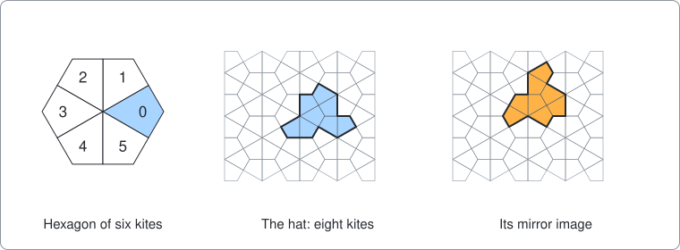
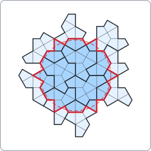
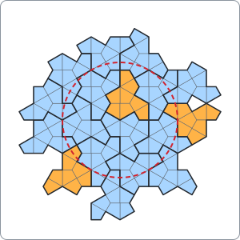
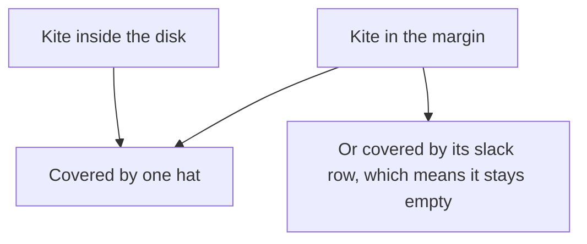
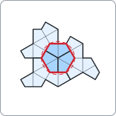
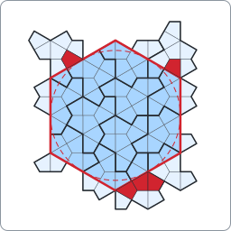

# The hat

A command-line program that tries to cover a disk with copies of the hat, written as an example of using package [dlx](https://github.com/dimchansky/dlx). If exact cover is new to you, read the [introduction to the examples](../README.md) first.

## The problem

Tiles cover the plane periodically if the pattern repeats, like bathroom tiles: you can slide the whole pattern some distance and it lands on itself. For a long time nobody knew whether one single shape could cover the plane, but only in patterns that never repeat this way. In 2023 David Smith, Joseph Myers, Craig Kaplan and Chaim Goodman-Strauss proved that one can, in the paper ["An aperiodic monotile"](https://arxiv.org/abs/2303.10798). Their shape is called the hat.

The hat is made of eight kites. Start with hexagons that cover the plane, each with corners 2 away from its middle. Cut each hexagon into six kites, from its middle to the middles of its sides. Each kite has two sides of length 1 and two of about 1.73, the square root of 3, as marked on kite 0 of the picture. Numbering the kites by the corner they point at gives the numbers 0 to 5 in the picture.

The surprise is on the right of the picture. Every way of covering the whole plane with hats uses some mirror images too, as the paper shows and its [follow-up](https://arxiv.org/abs/2305.17743) repeats. A mirror image is the shape you get by flipping the tile over, and you can't get it just by turning the tile.

This program lets you see that on a small scale. It asks: can hats cover a disk, with no gaps and no overlaps, if they may stick out past the edge?

- With turned copies only, a disk of radius 5 can be covered and a disk of radius 6 cannot.
- With mirror images allowed, a disk of radius 6 can be covered. Every such cover uses at least one mirror image.

This cover of radius 5 uses no mirror images:

The solid red line is the edge of the disk, and everything inside it is covered. The dashed circle only shows the radius. The disk is made of whole kites, so its edge doesn't follow the circle: the circle pokes out past the edge in places, and spikes of the edge poke out past the circle, because a kite counts if its centre is inside. [The rules](#the-rules-of-the-disk) say which kites count. The dark kites are in the disk, and the pale ones are the parts of hats that stick out.

This cover of radius 6 uses three mirror images, drawn in orange:

The kites of this disk happen to form a plain hexagon, so its edge is not jagged.

## The rules of the disk

The hats lie on the kite grid: every hat is made of eight whole kites of the grid. A placement of a hat is one of its orientations together with a position:

- There are 6 orientations of the hat, one for each turn by a multiple of 60 degrees.
- The mirror image adds 6 more, so 12 in all.

The disk is centred on the middle of a hexagon. It holds the kites whose centres are at most the radius from the middle of the disk, so it is not truly round. The centre of a kite here is the average of its four corners, which lies 5/4 from the middle of its hexagon. A radius of 2 holds just the six kites of the central hexagon. The unit is the short side of a kite.

Every kite of the disk must be covered by exactly one hat. Kites outside the disk may stay empty, but no two hats may overlap there either.

## How it becomes a matrix

The [introduction](../README.md#what-exact-cover-is) explains exact cover. Here, **one column of the matrix is one kite, and one row is either one placement of a hat or a slack row for one kite.**

The kites come in two kinds, and the difference between them is the main idea here:

The margin is every kite outside the disk that a hat touching the disk can reach. Margin kites need columns because they stop two hats from overlapping outside the disk: two hats on the same margin kite would both have a 1 in its column. A margin kite may stay empty, so it takes at most one hat. That is the job of a [slack row](../README.md#at-most-once-slack-rows): a matrix row that covers that one kite and nothing else.

| Matrix part | Meaning                                     | Turned copies, radius 6 | With mirrors, radius 6 |
|-------------|---------------------------------------------|------------------------:|-----------------------:|
| Column      | A kite of the disk                          | 72                      | 72                     |
| Column      | A kite of the margin                        | 102                     | 114                    |
| Row         | A hat placement, with 1s in its eight kites | 120                     | 240                    |
| Row         | A slack row for one margin kite             | 102                     | 114                    |

Only placements that touch the disk get a row. The others could not help to cover it.

Here is the smallest case: radius 2 with turned copies only. The disk has six kites, k0 to k5, named after the numbers in the first picture. There are 18 hat placements, h0 to h17. The whole matrix has 36 columns and 48 rows, so this table leaves things out: it folds the 30 margin columns into one count, and it doesn't show the 30 slack rows. The second table below shows some of those.

| Hat row | k0 | k1 | k2 | k3 | k4 | k5 | Margin kites |
|---------|:--:|:--:|:--:|:--:|:--:|:--:|:------------:|
| h0 | 1 | 1 | 0 | 0 | 1 | 1 | 4 |
| **h1** | 0 | **1** | **1** | 0 | 0 | 0 | 6 |
| **h2** | 0 | 0 | 0 | **1** | **1** | 0 | 6 |
| h3 | 1 | 1 | 1 | 0 | 0 | 1 | 4 |
| h4 | 0 | 0 | 1 | 1 | 0 | 0 | 6 |
| h5 | 0 | 0 | 0 | 0 | 1 | 1 | 6 |
| h6 | 1 | 1 | 1 | 1 | 0 | 0 | 4 |
| **h7** | **1** | 0 | 0 | 0 | 0 | **1** | 6 |
| h8 | 0 | 0 | 0 | 1 | 1 | 0 | 6 |
| h9 | 1 | 1 | 0 | 0 | 0 | 0 | 6 |
| h10 | 0 | 1 | 1 | 1 | 1 | 0 | 4 |
| h11 | 0 | 0 | 0 | 0 | 1 | 1 | 6 |
| h12 | 1 | 0 | 0 | 0 | 0 | 1 | 6 |
| h13 | 0 | 1 | 1 | 0 | 0 | 0 | 6 |
| h14 | 0 | 0 | 1 | 1 | 1 | 1 | 4 |
| h15 | 1 | 0 | 0 | 1 | 1 | 1 | 4 |
| h16 | 1 | 1 | 0 | 0 | 0 | 0 | 6 |
| h17 | 0 | 0 | 1 | 1 | 0 | 0 | 6 |

Each row adds up to 8, because a hat has eight kites. Some hats put four kites in the central hexagon, and some put two.

Look for a set of rows with one 1 in each of the columns k0 to k5. The bold rows are one answer: h1 covers k1 and k2, h2 covers k3 and k4, and h7 covers k0 and k5. Rows h0 and h1 can't be picked together, because both have a 1 in column k1. They would overlap on that kite.

The bold rows give this picture:

Here is a slice of the same matrix with its margin columns showing. It has one disk column, three margin columns and five rows, two of them slack rows. Margin kites are named by their column number in the matrix, so m10 is column 10:

| Row        | k1 | m10 | m14 | m23 |
|------------|:--:|:---:|:---:|:---:|
| hat h1     | 1  | 1   | 1   | 0   |
| hat h3     | 1  | 0   | 0   | 1   |
| slack m10  | 0  | 1   | 0   | 0   |
| slack m14  | 0  | 0   | 1   | 0   |
| slack m23  | 0  | 0   | 0   | 1   |

Pick hat h1. It fills m10 and m14, so the slack rows of those two can't be picked: both would put a second 1 in the column. It leaves m23 empty, and every column must have a 1, so slack m23 goes in. A hat that doesn't reach a margin kite pays for that with one slack row, and that is all a slack row does.

This disk has 28 covers in all. The margin columns change nothing in this tiny case: the disk columns alone also give 28. They matter as soon as the disk grows, because two hats that fit together in the disk can still clash outside it. At radius 6 with turned copies, dropping the margin columns gives 38 false covers instead of 0. Here is one of them, with each margin kite under two hats drawn dark red:

Inside the red line nothing is wrong, so a matrix with only disk columns accepts this. With the margin columns, two hats on one of those red kites would both have a 1 in its column.

The two safety rules for slack rows from the [introduction](../README.md#at-most-once-slack-rows) both hold:

- An empty margin kite can be filled in only one way, by its own slack row, so each set of hats is exactly one exact cover.
- A hat row has eight columns and a slack row has one, so they can't be confused.

## How a solution decodes back

dlx reports the column numbers of the picked rows. In [solver.go](solver.go), the disk kites get the lowest column numbers, 0 to 5 here, and the margin kites get higher numbers as hats first reach them. The first cover for the matrix above starts like this:

    [[10 11 12 13 1 2 14 15] [23] [24] [30] [33] [34] [35] [16 17 18 19 20 21 3 4] ...

- Rows with one column, such as `[23]`, are slack rows, so the decoder skips them.
- Rows with eight columns are hats. The first one is h1: its columns 1 and 2 are the disk kites k1 and k2, and the other six are margin kites.

The columns of a hat row always come back in the same order, so the program keeps a map from those eight numbers to the placement that made them. That gives each hat's orientation and position, which is enough to count the mirror images and draw the picture.

## Installation

    go install github.com/dimchansky/dlx/examples/hat@latest

## Usage

    hat [-r radius] [-rotations] [-count] [-svg]

- `-r radius` sets the radius of the disk, 6 by default, from 2 to 64. That cap is a round number that catches a mistyped radius. The matrix stays small even at 64. The search is what takes too long, far below it, as the limits below show. The `Disk of radius` line is printed before the search starts, so you can tell that it is running.
- `-rotations` allows only turned copies of the hat, not its mirror image.
- `-count` goes through every cover and prints the total.
- `-svg` prints the first cover as an SVG picture instead of a summary. It can't be combined with `-count`.

`-help` prints the usage text to standard error.

Results go to standard output. Error messages go to standard error, and most start with `hat:`.

| Exit code | Meaning                              |
|-----------|--------------------------------------|
| 0         | A cover exists, or `-help` was given |
| 1         | No cover exists                      |
| 2         | Invalid usage, or a write failure    |

## Examples

Cover the default disk, with mirror images allowed:

    hat

Output:

    Disk of radius 6: 72 kites, 240 hat placements
    Cover: 18 hats, 3 of them reflected

The same disk with turned copies only has no cover, so this exits with code 1:

    hat -rotations

Output, with the second line on standard error:

    Disk of radius 6: 72 kites, 120 hat placements
    hat: no cover found

The largest disk, by the rule above, that turned copies can cover:

    hat -r 5 -rotations

Output:

    Disk of radius 5: 48 kites, 78 hat placements
    Cover: 11 hats, 0 of them reflected

Count the covers:

    hat -r 5 -rotations -count

Output:

    Covers: 14

Draw a cover. Three of the pictures on this page were drawn this way, with these commands:

    hat -r 5 -rotations -svg > rotations.svg
    hat -svg > mirrors.svg
    hat -r 2 -rotations -svg > small.svg

The first picture on this page, of the kites and the hat, was not drawn by the program, and neither was the dark red of the false cover. The tests check both against the program's kites.

## Number of covers

Two covers count as different if their sets of hats differ, even if only outside the disk.

| Radius                | 2  | 3   | 4    | 5    | 6     |
|-----------------------|----|-----|------|------|-------|
| Kites in the disk     | 6  | 18  | 30   | 48   | 72    |
| Covers, turned copies | 28 | 46  | 76   | 14   | 0     |
| Covers, with mirrors  | 80 | 716 | 4228 | 3676 | 26844 |

The counts don't have to grow with the radius: a bigger disk asks for more, while its jagged edge changes which covers fit.

At radius 6, the 26844 covers use from 13 to 19 hats. Flipping a cover over swaps the two shapes, so the number of mirror images alone says little: 16 of 17 is just the flip of 1 of 17. What does say something is the number of hats of the rarer shape, which goes from 1 to 7. For example, 24 covers have 15 hats with 7 mirror images, and their 24 flips have 8. The 18 hats printed above are only the first cover the search reached. A different order of rows gives a different first cover, so that number says nothing about the hat.

## What this shows and what it doesn't

It shows these things:

- For this disk, centred on a hexagon, with hats on the kite grid, turned copies alone can cover radius 5 and can't cover radius 6.
- They can't cover any bigger radius either, because a cover of a bigger disk would also cover the smaller disk inside it. The tests also check radii 7 and 8 directly.
- Radius 6 needs at least one mirror image, and some cover uses exactly one.

It doesn't show these things:

- **Nothing about a truly round disk.** Radius 5 works only because the disk counts a kite by its centre, which gives 48 kites. If every kite with any part inside the circle had to be covered, radius 5 would have 60 kites and no cover, and the largest disk for turned copies would be radius 4. Radii 2 to 4 would have 46, 46 and 64 covers, and radii 6 and 7 none. Radius 6 has the same 72 kites under both rules, so the result that it needs mirror images doesn't depend on the rule.
- **Nothing about hats off the grid.** The search only tries hats made of whole kites of this grid. Appendix A of the paper proves that every covering of the whole plane by hats lies on such a grid. This program takes that from the paper and doesn't check it.
- **Nothing about the hat covering the plane, or never repeating.** The paper proves those. A cover of a disk may be impossible to extend, because nothing here looks past the hats that touch the disk. In the paper's patches one of the two shapes is sparse, while a cover of this disk can have 7 hats of one shape and 8 of the other.
- **Nothing about other centres.** A disk centred somewhere else might give a different radius.

Together with that result from Appendix A, the answer for radius 6 agrees with the paper. A covering of the plane by turned copies alone would lie on a grid and would have to cover this disk, and it can't. That is a small check of a known result, not a new proof, and it relies on the appendix.

It doesn't matter which of the two shapes counts as the unreflected one: flipping a cover over gives a cover of the same disk with the other shape.

## How the results are checked

The tests start from the [published outline](https://github.com/isohedral/hatviz/blob/main/geometry.js) of the hat, written down by one of the authors. The kites in [solver.go](solver.go) are a second, separate description of the same shape, and the tests prove the two agree:

- All eight kites lie inside the outline, and their total area equals the area of the outline, so they fill it exactly. This uses whole numbers only.
- The outline has 13 sides, of lengths 1, 2 and the square root of 3, as the paper says.
- The hat uses four of the six kite directions once and two opposite directions twice, as the paper says.
- All 12 orientations of the kites match the same 12 orientations of the outline.

Every total in the table, and the ranges of hats and of the rarer shape at radius 6, come from two searches that give the same result. One is dlx. The other is a plain [backtracking](../README.md#how-dlx-searches) search in the tests, which shares no code with the solver: it has its own copy of the outline, its own coordinates, and its own turn, flip and move, and it finds a hat's kites as the kite centres inside the outline.

The tests also check the first 200 covers of each total for gaps and overlaps, and they compare these with the program: the three pictures of covers, the false cover, the kites and hat outlines in the first picture, both small matrices above, and the raw solution line below them. The numbers for a disk without margin columns and for the disk of whole kites touching the circle are tested too, but those rest on dlx alone.

`go test` checks every total. `go test -short` skips the three largest, with mirrors at radius 4, 5 and 6.

## Limits

Slack rows have a cost here, as they do in the [queens example](../queens#limits). dlx treats a margin kite like any other column, so it can spend its time deciding which margin kites stay empty, which doesn't matter for the disk. For counting at radius 6, the plain search in the tests was about twice as fast as dlx on the machine used to write this.

The time to find one cover jumps around with the radius. On that machine the first cover took a moment at radius 10, from seconds to tens of seconds at radii 11 to 13, and over two minutes at radius 14. At the cap, `hat -r 64 -rotations` took about 14 MB of memory and gave no answer in over six minutes.
