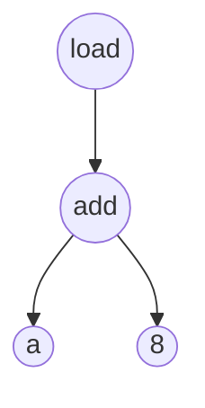
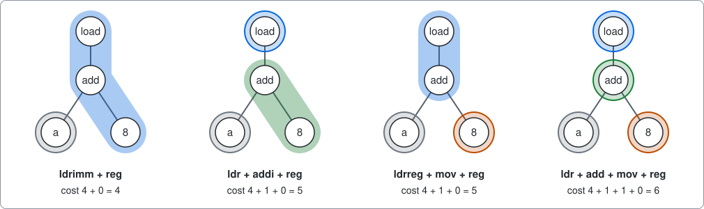
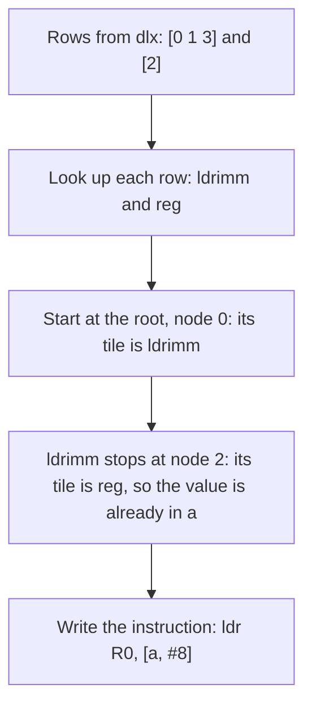

# Instruction selection

A small model of one step inside a compiler, written as an example of using package [dlx](https://github.com/dimchansky/dlx). It takes an arithmetic expression and chooses machine instructions for it by covering the expression with tiles. If exact cover is new to you, read the [introduction to the examples](../README.md) first.

Exact cover is not the best tool for this job on trees. The [section on dynamic programming](#dynamic-programming-is-the-right-tool) shows the better method and explains why this example uses exact cover anyway.

## The problem

A compiler turns a program into instructions that a processor can run. A processor can only do small steps, such as adding two numbers. It keeps the numbers it is working on in **registers**, a few small named boxes inside the processor. Everything else is in **memory**, a long row of numbered boxes. The number of a box is its **address**, and reading a box into a register is called a **load**.

Suppose register `a` holds the address where some data starts, and a program wants the value 8 boxes further on. The compiler writes this as an expression:

    load(add(a, 8))

Read it from the inside out: add 8 to `a`, then load from that address. Drawn as a picture, this is an **expression tree**. Each circle is a node. A node's operands hang below it, and they must be worked out before the node itself. Although it is called a tree, the root is at the top.

The interesting part is that a processor usually has several ways to do the same thing, because some instructions do more than one step at once. This example's machine has an instruction that adds a constant, and another that loads from an address. It also has a load that does the addition itself. So the tree above can become two instructions or just one:

| Program | What it does | Cost |
|---------|--------------|:----:|
| `add R0, a, #8` `ldr R1, [R0]` | Put a+8 in register R0, then load from the address in R0 | 5 |
| `ldr R0, [a, #8]` | Load from address a+8 in one instruction | 4 |

In this notation, `#8` is the constant 8, and square brackets mean the memory box at that address, so `[a, #8]` is the box at address a+8.

The **cost** stands for how long an instruction takes. The task is to pick instructions that compute the whole tree at the lowest total cost.

## The instructions

An instruction fits a piece of the tree. Think of each one as a **tile** cut to the shape of that piece. A tile covers some nodes, and wherever it stops, it reads a value that another tile has put in a register. This table is the whole machine. `_` marks a place where a tile stops, and `C` is a constant that the tile includes.

| Tile | Shape | Cost | Instruction | Meaning |
|------|-------|:----:|-------------|---------|
| `reg` | a register | 0 | none | The value is already in a register |
| `mov` | `C` | 1 | `mov R0, #C` | Put a constant in a register |
| `add` | `add(_, _)` | 1 | `add R0, x, y` | Add two registers |
| `adds` | `add(_, _)` | 2 | `adds R0, x, y` | The same sum, and it also notes whether the result was zero |
| `addi` | `add(_, C)` | 1 | `add R0, x, #C` | Add a constant |
| `mul` | `mul(_, _)` | 3 | `mul R0, x, y` | Multiply |
| `madd` | `add(mul(_, _), _)` | 3 | `madd R0, x, y, z` | Multiply, then add, in one step |
| `lsl` | `shl(_, C)` | 1 | `lsl R0, x, #C` | Shift left by C places |
| `addshift` | `add(_, shl(_, C))` | 1 | `add R0, x, y, lsl #C` | Shift, then add, in one step |
| `ldr` | `load(_)` | 4 | `ldr R0, [x]` | Load |
| `ldrimm` | `load(add(_, C))` | 4 | `ldr R0, [x, #C]` | Add a constant, then load |
| `ldrreg` | `load(add(_, _))` | 4 | `ldr R0, [x, y]` | Add two registers, then load |
| `ldrshift` | `load(add(_, shl(_, C)))` | 4 | `ldr R0, [x, y, lsl #C]` | Shift, add, then load |

A **shift** by C places multiplies by 2 C times, so `shl(i, 3)` means i × 8. Numbers in a computer are often 8 boxes wide, so the number at position i of a list that starts at address `a` is at address a + i × 8. This is why `load(add(a, shl(i, 3)))` is so common that machines have an instruction for it.

The instructions look like a small part of the ARM64 processor, simplified. **The costs are invented** to keep the example easy to follow, and they are not measurements of any real processor.

## Tilings

A **tiling** is a set of tiles that covers each node of the tree exactly once. One rule keeps the count simple: when two instructions fit exactly the same nodes, they count as one tile, the cheaper one. So `adds` is never used here, because `add` fits the same nodes for less. The section on [costs](#costs-stay-outside-the-matrix) explains why. With that rule, the tree above has four tilings:

Each coloured shape is one tile. A tile for a register costs 0, so `a` adds nothing, but it still has to be covered like every other node. The cheapest tiling is the first one, at cost 4.

## How it becomes a matrix

**One column of the matrix is one node of the tree.** Each node must be computed exactly once. **One row of the matrix is one tile placed on the tree**, with a 1 under each node it covers.

| Matrix part | Meaning | Count for `load(add(a, 8))` |
|-------------|---------|:---:|
| Column | A node of the tree | 4 |
| Row | One tile in one place | 7 |

This is the whole matrix. The nodes are numbered from 0, top first, then the left operand's nodes before the right operand's:

| Row | load (0) | add (1) | a (2) | 8 (3) |
|-----|:---:|:---:|:---:|:---:|
| `ldr` | 1 | 0 | 0 | 0 |
| `ldrimm` | 1 | 1 | 0 | 1 |
| `ldrreg` | 1 | 1 | 0 | 0 |
| `add` | 0 | 1 | 0 | 0 |
| `addi` | 0 | 1 | 0 | 1 |
| `reg` | 0 | 0 | 1 | 0 |
| `mov` | 0 | 0 | 0 | 1 |

Picking rows with exactly one 1 in every column gives the four tilings from the picture, and no others:

| Picked rows | load | add | a | 8 | Cost |
|-------------|:---:|:---:|:---:|:---:|:---:|
| `ldrimm`, `reg` | `ldrimm` | `ldrimm` | `reg` | `ldrimm` | 4 |
| `ldr`, `addi`, `reg` | `ldr` | `addi` | `reg` | `addi` | 5 |
| `ldrreg`, `mov`, `reg` | `ldrreg` | `ldrreg` | `reg` | `mov` | 5 |
| `ldr`, `add`, `mov`, `reg` | `ldr` | `add` | `reg` | `mov` | 6 |

For example, `ldrimm` and `addi` can't be picked together, because both have a 1 under `add`. Both would compute that sum.

### Why the tiles always join up

The matrix says nothing about tiles fitting together, yet they always do. Take `ldr`, which stops at `add`, so it needs the value of `add` in a register. Which tile covers `add`? It can't reach up to include `load` as well, because `ldr` already covers `load`. So the tile covering `add` must have `add` as its top node, and that tile computes exactly the value `ldr` needs. The same reasoning holds at every place a tile stops. The top node of the whole tree has nothing above it, so its tile starts there too.

So "cover each node exactly once" is the only rule. This works here because every tile leaves its result in the same kind of place, a register. The [limits](#limits) say more about this.

### Costs stay outside the matrix

dlx knows nothing about cost. It lists every tiling, and [solver.go](solver.go) adds up the cost of each one and keeps the cheapest. The [crew example](../crew) works in the same way.

`add` and `adds` have the same shape, so at the same place they cover the same nodes. As matrix rows they would be identical, and dlx reports a row by its columns alone, so the two could not be told apart. So the solver keeps one row for each set of nodes, with the cheapest instruction for it, and the table above has no row for `adds`.

Swapping `adds` for `add` only lowers the cost, so this never changes the cheapest tiling. It does change what gets counted. The totals, the list from `-limit` and the growth table all count sets of nodes, each with its cheapest instruction. A program that differs only by using `adds` is not counted, so `add(a, b)` has one tiling, not two, and `load(add(a, 8))` has four, not five.

## How a solution decodes back

dlx reports the cheapest tiling as two rows, `[0 1 3]` and `[2]`, which are lists of column numbers. Each list is sorted, so its first number is the top node of that tile.

The decoder starts at the tile on the root and first produces the code for each operand. That way, each value is in a register before an instruction reads it. A `reg` tile writes no instruction and gives the register's own name. The registers `R0`, `R1` and so on are numbered as they are written.

## Installation

    go install github.com/dimchansky/dlx/examples/instrselect@latest

## Usage

    instrselect [-expr expression] [-limit n]

- `-expr expression` sets the expression, `load(add(a, 8))` by default.
- `-limit n` sets how many tilings to print, cheapest first, 1 by default. Zero prints all of them, counted as described under [Tilings](#tilings). The search goes through every tiling whatever the limit.

`-help` prints the usage text to standard error.

An expression is built from these parts. Spaces are optional, and an expression can have up to 64 nodes.

| Part | Examples |
|------|----------|
| A register: a lowercase name, which may contain digits | `a`, `x2` |
| A constant: a whole number from 0 to 2^64 - 1 | `8` |
| An operator | `add(x, y)`, `mul(x, y)`, `shl(x, y)`, `load(x)` |

Tilings go to standard output, and tilings of equal cost are in the order the search found them. Error messages go to standard error, and most start with `instrselect:`.

| Exit code | Meaning |
|-----------|---------|
| 0 | At least one tiling exists, or `-help` was given |
| 1 | The instructions can't cover the expression |
| 2 | Invalid usage, an invalid expression, or a write failure |

## Examples

Each line of a tiling shows an instruction, then the tile it came from, that tile's cost and the nodes it covers. `reg` tiles are not listed, as they write no instruction and cost 0.

List all four tilings of the expression above:

    instrselect -limit 0

Output:

    Expression: load(add(a, 8))
    Nodes: 4, rows: 7, tilings: 4

    Tiling 1, cost 4:
      ldr R0, [a, #8]            ; ldrimm, cost 4, covers load add 8
      result in R0

    Tiling 2, cost 5:
      add R0, a, #8              ; addi, cost 1, covers add 8
      ldr R1, [R0]               ; ldr, cost 4, covers load
      result in R1

    Tiling 3, cost 5:
      mov R0, #8                 ; mov, cost 1, covers 8
      ldr R1, [a, R0]            ; ldrreg, cost 4, covers load add
      result in R1

    Tiling 4, cost 6:
      mov R0, #8                 ; mov, cost 1, covers 8
      add R1, a, R0              ; add, cost 1, covers add
      ldr R2, [R1]               ; ldr, cost 4, covers load
      result in R2

Read position `i` of a list of 8-box numbers. One instruction does the whole job:

    instrselect -expr 'load(add(a, shl(i, 3)))'

Output:

    Expression: load(add(a, shl(i, 3)))
    Nodes: 6, rows: 9, tilings: 4

    Tiling 1, cost 4:
      ldr R0, [a, i, lsl #3]     ; ldrshift, cost 4, covers load add shl 3
      result in R0

Multiply and add, with the two cheapest tilings:

    instrselect -expr 'add(mul(a, b), c)' -limit 2

Output:

    Expression: add(mul(a, b), c)
    Nodes: 5, rows: 6, tilings: 2

    Tiling 1, cost 3:
      madd R0, a, b, c           ; madd, cost 3, covers add mul
      result in R0

    Tiling 2, cost 4:
      mul R0, a, b               ; mul, cost 3, covers mul
      add R1, R0, c              ; add, cost 1, covers add
      result in R1

This machine can only shift by a constant, so no tile fits the `shl` node here. Its column has no rows, and the command exits with code 1:

    instrselect -expr 'shl(a, b)'

Output, on standard error:

    instrselect: no tiling covers every node of shl(a, b)

## Dynamic programming is the right tool

Listing every tiling only to keep the cheapest one wastes work, and the number of tilings grows very fast. In the expression `load(add(load(add(a, 8)), 8))` and its longer relatives, each level can be tiled in 4 ways, whatever the other levels do, counted as described under [Tilings](#tilings). So 10 levels have 4 × 4 × ... × 4 = 1,048,576 tilings:

| Levels | Nodes | Rows | Tilings | Time with dlx |
|:---:|:---:|:---:|:---:|:---:|
| 8 | 25 | 49 | 65,536 | about 0.5 s |
| 10 | 31 | 61 | 1,048,576 | about 7 s |
| 11 | 34 | 67 | 4,194,304 | about 29 s |
| 21 | 64 | 127 | 4,398,046,511,104 | not run |

The times come from one run on the machine used to write this, and they vary from run to run. The last line is the 64-node cap. Its total comes from dynamic programming, as dlx could not list that many.

**Dynamic programming** gets the same answer without listing anything. It works from the bottom of the tree to the top and, at each node, writes down the cheapest cost of computing that node. Those numbers are all it needs to decide the node above:

| Node | Tiles that can sit on top of this node | Cheapest |
|------|------------------------------------------|:---:|
| `a` | `reg`: 0 | 0 |
| `8` | `mov`: 1 | 1 |
| `add` | `add`: 1 + 0 (for `a`) + 1 (for `8`) = 2 `adds`: 2 + 0 (for `a`) + 1 (for `8`) = 3 `addi`: 1 + 0 (for `a`) = 1 | 1 |
| `load` | `ldr`: 4 + 1 (for `add`) = 5 `ldrreg`: 4 + 0 (for `a`) + 1 (for `8`) = 5 `ldrimm`: 4 + 0 (for `a`) = 4 | 4 |

Each node is handled once, so the work grows with the size of the tree instead of exploding. The cheapest cost at the root is 4, the same answer dlx gives. A production compiler working on trees should use this. Aho and Johnson applied dynamic programming to code generation in 1976, and the survey below says that many later methods were influenced by it.

The exact cover model is also a choice made for this example. The survey ["Survey on Instruction Selection"](https://arxiv.org/abs/1306.4898) by Hjort Blindell states the tree problem as every node being "covered by at least one pattern" (section 3.1), so its basic definition allows tiles to overlap. Some methods it describes do require exactly one (section 5.3). On a tree with these tiles, requiring exactly one loses nothing. Take a working program whose tiles overlap, and start at the tile on the root. It reads the values at the places where it stops, so each of those places needs a tile with its top node there. Follow those tiles down the same way. The tiles you reach cover every node exactly once, because each one starts where another stops. No tile reads the result of any other tile, so those can go, and that can only lower the cost.

So this example is here to show how a problem turns into a matrix, and why tiles join up without a rule for it. It is not a way to build a compiler.

## How the results are checked

- **An independent method.** The test file has its own dynamic programming, written out rule by rule with its own tree type. It uses neither the pattern table nor the parser, and it also counts tilings by adding and multiplying, without listing them. On 2000 random trees, the same ones on every run, its cheapest cost and its count of tilings both match dlx. The largest tree has 48 nodes and 53 rows, the most tilings for one tree is 512, and the total is 14,045 tilings. 136 of the trees have no tiling, because they shift by a register, and both methods agree on those too. Its rules have no `adds`, so this check can't test the rule about `adds`. A test of `add(a, b)` covers that rule.
- **Overlaps don't help.** Dynamic programming also places tiles edge to edge, so it can't show that overlapping tiles gain nothing. Another test finds the cheapest set of tiles that covers each node at least once, trying every combination of rows. It doesn't even ask that the tiles join up, so it can only find a lower cost. On 3,432 random trees of at most 18 nodes, the cost always equals the one from dlx.
- **Running the programs.** Every tiling of every one of those trees becomes a program, and a small stand-in for the processor, written in the test, runs that program as text. Its result must equal the value of the expression worked out from the tree. This shows that the tiles really do join up, and that the instructions read their operands in the right order.
- **Published numbers.** The matrix, the outputs on standard output and the growth table are checked by tests. For 10, 11 and 21 levels, the tests check the totals by dynamic programming only. The dlx runs at 10 and 11 levels were done by hand, and their totals matched. The times are not tested.

`go test` checks all of this. `go test -short` uses 200 trees instead of 2000 and skips the 8-level run with dlx. Use `-short` with `-race`.

## Limits

- **Trees only.** If a value is used twice, as in `add(load(a), load(a))`, this example computes it twice. Real compilers often compute such a value once and use it twice. That node then hangs below two others, so the picture is no longer a tree. There, tiles overlapping can be useful, and exact cover would forbid it.
- **One kind of result.** The tiles join up by themselves only because every tile leaves its result in a register. If some instructions gave a result in another form, the tile above would have to accept that form, and covering each node once would not be enough. The survey points out this gap for an exact-once model (section 5.3.3).
- **Operand order matters.** `addi` fits a constant on the right only, so `add(8, a)` costs 2 and `add(a, 8)` costs 1. The same goes for `madd` and `addshift`. Compilers usually tidy such expressions first, and this example doesn't.
- **Simplified machine.** Real instructions limit which constants they accept, and a real shift inside a load must match the data size. Here any constant fits.
- **Unlimited registers.** Each instruction writes a new register. Choosing real registers and the final order of instructions are later steps in a compiler.
- **Slow on big expressions.** The number of tilings multiplies as the tree grows. The 64-node cap only stops the program building a huge matrix. Many expressions well below it would take far too long, as the table above shows.
