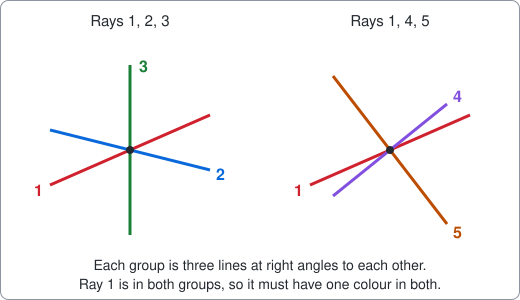
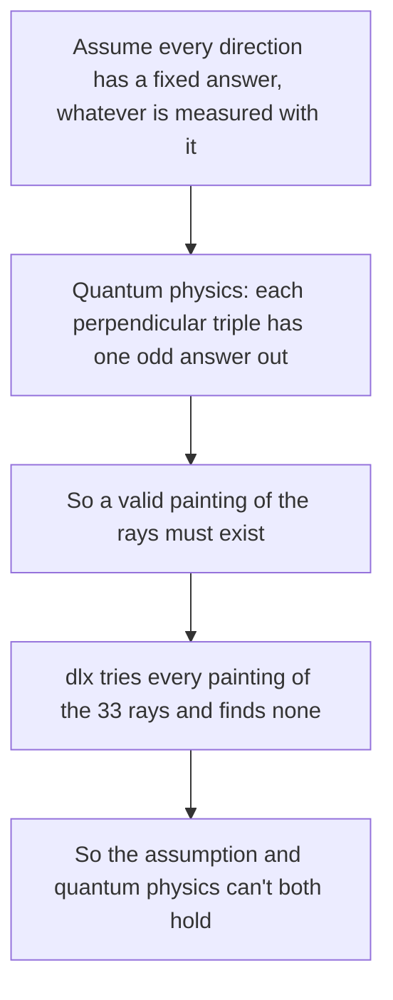

# Kochen-Specker: a proof with no solutions

A command that shows a colouring puzzle has no answer, written as an example of using package [dlx](https://github.com/dimchansky/dlx). If exact cover is new to you, read the [introduction to the examples](../README.md) first.

Most examples here look for solutions. This one is about the opposite: the search goes through every possibility and finds none, and that empty result is the theorem.

## The puzzle

Take a list of lines through one point, like spokes through the hub of a wheel. The lines are called **rays**. Unlike a ray in school geometry, which starts at a point and goes one way, these run both ways, so the point (1, 2, 0) and the point (-1, -2, 0) lie on the same ray. Some rays meet at right angles, and those are called **perpendicular**.

You can test this with arithmetic. Multiply the matching coordinates of two rays and add the results. The rays are perpendicular exactly when the sum is 0. For (0, 1, 1) and (0, 1, -1), the sum is 0·0 + 1·1 + 1·(-1) = 0, so they are.

Three rays that are all perpendicular to each other form a **triple**, like the edges at the corner of a box. The rules of the puzzle are:

1. Paint every ray green or red. Each ray gets one colour, whichever group you look at it in.
2. In every triple of perpendicular rays, exactly one ray is green.
3. Two perpendicular rays are never both green.

Rule 3 follows from rule 2, as long as you imagine the missing third ray of any perpendicular pair. A triple has only one green ray, so two rays of the same triple can't both be green.

The difficulty is that a ray usually belongs to several triples, and rule 1 ties them together. In the picture, ray 1 belongs to two triples. If it is green, then rays 2, 3, 4 and 5 must all be red. If it is red, each triple needs a green ray of its own.

A few triples are easy to paint. In 1991 Asher Peres published 33 rays in ordinary three-dimensional space for which it can't be done. This command proves that with dlx.

Rays are numbered from 1 in this README and in the output, because the papers do that. The first few of the 33 are ray 1 (1, 0, 0), ray 2 (0, 1, 0), ray 4 (0, 1, 1) and ray 10 (√2, -1, 1). Use `-rays` to list them all.

The 33 rays follow a short rule. Take each of these four patterns, write its numbers in every order, and try every choice of plus and minus signs:

    (0, 0, 1)    (0, 1, 1)    (0, 1, √2)    (1, 1, √2)

Two results that differ only by an overall sign are the same ray, so the patterns give 3, 6, 12 and 12 rays. The 24 rays of the set in four dimensions, which comes up later, follow the same rule with 4, 12 and 8 rays from these patterns:

    (0, 0, 0, 1)    (0, 0, 1, 1)    (1, 1, 1, 1)

## Why physicists care

This section is the background. You don't need it to follow the matrix.

Quantum physics predicts the results of measurements. It does not say what a particle was "really like" beforehand. A natural hope is that it was like something: that hidden inside the particle are fixed answers to every question you could ask, and a measurement only reads them out. Such fixed answers are called hidden variables.

Here is how the puzzle meets that hope. Spin is a built-in property of a particle that gives a number when you measure it along a chosen direction. For one kind of particle, called spin 1, you can pick a direction and measure the square of that number, which gives the answer 0 or 1. Three perpendicular directions can be asked about at the same moment, and quantum physics says the three answers always add up to 2. So exactly one of the three answers is 0, and that direction is the odd one out. Paint it green.

If the answers were fixed in advance, each direction would have one colour that does not depend on which two other directions you measure with it. Those are rules 1 and 2. So a fixed answer for every direction would be a valid painting, and Kochen and Specker proved in 1967 that no such painting exists. A set of rays with no painting is a small, checkable proof of their theorem. Theirs used 117 rays. Peres got that down to 33, which is small but not the smallest known: Conway and Kochen found a set of 31.

What this does **not** show matters just as much:

- It does not rule out all hidden variables. It rules out those where a direction's answer ignores what else is measured with it. A theory whose answers depend on that context is not touched, and neither is one that gives up fixed answers for some questions. Bohmian mechanics, a known alternative version of quantum theory, is often described in both ways: a particle has a definite position, but a spin result depends on the apparatus used.
- It is not an experiment. It is a fact about geometry, and it says nothing until you add the predictions of quantum physics. Experiments test statistical consequences of those predictions, and how much those tests settle is still argued about.
- It assumes perfectly exact directions. Real instruments have limited accuracy, and Meyer, Kent and Clifton argued that this leaves a way out, which others have disputed.
- It is not Bell's theorem, which is about particles far apart.

The [Stanford Encyclopedia entry](https://plato.stanford.edu/entries/kochen-specker/) covers all of these points.

## How it becomes a matrix

**One column of the matrix is one group of rays.** **One row of the matrix is one ray painted green.** A ray left out of the solution is red.

| Matrix part | Meaning                                                            | Count for the 33 rays |
|-------------|--------------------------------------------------------------------|-----------------------|
| Column      | A **basis**: a full triple of rays, which needs exactly one green  | 16                    |
| Column      | A **pair**: perpendicular rays in no shared basis, at most one green | 24                  |
| Row         | A ray painted green, covering every group it belongs to            | 33                    |
| Row         | A slack row for one pair: both rays of the pair are red            | 24                    |

That gives 40 columns and 57 rows. The word basis is the usual name for a full set of perpendicular directions: 3 rays in three dimensions, and 4 rays in four.

"Exactly one green in a triple" is exactly what a matrix column demands, which is why this puzzle fits exact cover so well. A pair may have no green ray at all, so it needs a [slack row](../README.md#at-most-once-slack-rows), a stand-in row that covers only that column. Rule 3 is the whole reason for pairs: the third ray of the triple exists in space, but it isn't one of the 33.

Here is a small piece of the 33 rays that you can check by hand. It has two bases and one pair:

| Group        | Rays                                                       | Why                                                |
|--------------|------------------------------------------------------------|----------------------------------------------------|
| A, a basis   | 4 (0, 1, 1), 10 (√2, -1, 1), 13 (√2, 1, -1)                | 10 and 13 give 2 - 1 - 1 = 0, and the others give 1 - 1 = 0 and -1 + 1 = 0 |
| B, a basis   | 3 (0, 0, 1), 24 (1, √2, 0), 27 (√2, -1, 0)                 | 24 and 27 give √2 - √2 = 0, and ray 3 gives 0 with both, since each sum is all zeros |
| P, a pair    | 10 (√2, -1, 1), 24 (1, √2, 0)                              | √2 - √2 + 0 = 0                                    |

Rays 10 and 24 are perpendicular, but the third ray that would complete them is not in this piece. So they form a pair and not a basis. As a matrix, with one row per ray and a slack row for P:

|          | A | B | P |
|----------|:-:|:-:|:-:|
| ray 4    | 1 | 0 | 0 |
| ray 10   | 1 | 0 | 1 |
| ray 13   | 1 | 0 | 0 |
| ray 3    | 0 | 1 | 0 |
| ray 24   | 0 | 1 | 1 |
| ray 27   | 0 | 1 | 0 |
| slack P  | 0 | 0 | 1 |

An exact cover picks one row for A, one for B, and P must be covered once. Picking rays 4, 3 and the slack row works, and so does picking rays 10 and 3: ray 10 covers A and P. Picking rays 10 and 24 fails, because both cover P. That single clash is the rule "not both green". There are 3 ways to pick for A and 3 for B, and the one clash leaves 8 exact covers. So this piece has 8 paintings.

The full matrix works the same way, only more tangled, because most rays are in several groups. It has no exact cover at all.

## A proof you can check yourself

For most sets, the proof is a case-by-case argument. One set is small enough to see why at a glance. Cabello, Estebaranz and García-Alcaine found 18 rays in four dimensions, where a ray has four coordinates. You can't picture those directions, but the arithmetic test for perpendicular works the same way, and a basis now has 4 rays.

These four dimensions are not extra directions of ordinary space. They describe a pair of simple particles with two states each, and a full measurement of the pair gives "yes" for exactly one of the 4 directions in a basis. So the rule is still exactly one green ray in each basis.

Here are its 9 bases as a matrix. Each column is a basis and each row is a ray. This is what `-set cabello18 -bases-only` builds:

| Ray | Coordinates | B1 | B2 | B3 | B4 | B5 | B6 | B7 | B8 | B9 |
|-----|-------------|:-:|:-:|:-:|:-:|:-:|:-:|:-:|:-:|:-:|
| 1 | (0, 0, 0, 1) | 1 | 1 | 0 | 0 | 0 | 0 | 0 | 0 | 0 |
| 2 | (0, 0, 1, 0) | 1 | 0 | 1 | 0 | 0 | 0 | 0 | 0 | 0 |
| 3 | (1, 1, 0, 0) | 1 | 0 | 0 | 1 | 0 | 0 | 0 | 0 | 0 |
| 4 | (1, -1, 0, 0) | 1 | 0 | 0 | 0 | 1 | 0 | 0 | 0 | 0 |
| 5 | (0, 1, 0, 0) | 0 | 1 | 1 | 0 | 0 | 0 | 0 | 0 | 0 |
| 6 | (1, 0, 1, 0) | 0 | 1 | 0 | 0 | 0 | 1 | 0 | 0 | 0 |
| 7 | (1, 0, -1, 0) | 0 | 1 | 0 | 0 | 0 | 0 | 1 | 0 | 0 |
| 8 | (1, -1, 1, -1) | 0 | 0 | 0 | 1 | 0 | 0 | 1 | 0 | 0 |
| 9 | (1, -1, -1, 1) | 0 | 0 | 0 | 1 | 0 | 0 | 0 | 1 | 0 |
| 10 | (0, 0, 1, 1) | 0 | 0 | 0 | 1 | 1 | 0 | 0 | 0 | 0 |
| 11 | (1, 1, 1, 1) | 0 | 0 | 0 | 0 | 0 | 0 | 1 | 1 | 0 |
| 12 | (0, 1, 0, -1) | 0 | 0 | 0 | 0 | 0 | 1 | 1 | 0 | 0 |
| 13 | (1, 0, 0, 1) | 0 | 0 | 1 | 0 | 0 | 0 | 0 | 0 | 1 |
| 14 | (1, 0, 0, -1) | 0 | 0 | 1 | 0 | 0 | 0 | 0 | 1 | 0 |
| 15 | (0, 1, -1, 0) | 0 | 0 | 0 | 0 | 0 | 0 | 0 | 1 | 1 |
| 16 | (1, 1, -1, 1) | 0 | 0 | 0 | 0 | 1 | 1 | 0 | 0 | 0 |
| 17 | (1, 1, 1, -1) | 0 | 0 | 0 | 0 | 1 | 0 | 0 | 0 | 1 |
| 18 | (-1, 1, 1, 1) | 0 | 0 | 0 | 0 | 0 | 1 | 0 | 0 | 1 |

Now count the 1s, which needs no physics:

- Every row has exactly two 1s, because every ray is in exactly two bases.
- So if you pick any number of rows, you pick an even number of 1s in total.
- An exact cover needs exactly one 1 in each of the 9 columns, which is 9 ones in total.
- 9 is odd, so no choice of rows can do it.

So there is no painting, and no search was needed. Peres's 24 rays in four dimensions contain this set and all 9 bases, so they can't be painted either. The papers prove the 33 rays case by case instead, and here the search does that work.

## How a solution decodes back

dlx reports the columns of each picked row and not ray numbers. In the small example, numbering the columns A=0, B=1, P=2, ray 10 comes back as `[0 2]`.

[solver.go](solver.go) keeps a table from each row's column list to its ray. A list not in the table is a slack row, and it is dropped. This works only if no two rays have the same row, and only if no ray's row matches a slack row. In the small example rays 4 and 13 do have the same row. In the full sets every ray has a row of its own, even after one ray is removed, and a test proves it. Dropping the pairs breaks this for `peres33`, where rays 10 and 13 then have the same row, because each is only in the basis 4, 10, 13. So `-bases-only` prints only the total, which stays right.

## Installation

    go install github.com/dimchansky/dlx/examples/kochenspecker@latest

## Usage

    kochenspecker [-set name] [-remove ray] [-bases-only] [-limit n] [-rays] [-critical]

- `-set name` picks the rays: `peres33` (33 rays in three dimensions, the default), `peres24` (24 rays in four dimensions) or `cabello18` (18 rays in four dimensions).
- `-remove ray` leaves out one ray, counted from 1. A basis that held it stops being a basis, and its other rays become pairs. Zero, the default, keeps all rays.
- `-bases-only` drops the rule for pairs and prints only the total. It cannot be combined with `-remove`.
- `-limit n` sets how many colourings to print, 1 by default. Zero prints all of them. The total is always printed, so the search always runs to the end. It cannot be combined with `-bases-only`, `-rays` or `-critical`, which print no colourings.
- `-rays` lists the rays, bases and pairs instead of solving.
- `-critical` removes each ray in turn and prints how many colourings remain. It cannot be combined with `-remove`, `-bases-only` or `-rays`.

`-help` prints the usage text to standard error.

Results go to standard output. Error messages go to standard error, and most start with `kochenspecker:`.

| Exit code | Meaning                                                               |
|-----------|-----------------------------------------------------------------------|
| 0         | At least one colouring exists, or `-help` or `-rays` was given        |
| 1         | No colouring exists, which is the expected result for the full sets   |
| 2         | Invalid usage, or a write failure                                     |

## Examples

Try to paint the 33 rays. This exits with code 1:

    kochenspecker

Output:

    Set peres33: 33 rays in 3 dimensions
    Bases: 16
    Pairs: 24
    Matrix: 40 columns, 57 rows
    Colourings: 0

And on standard error:

    kochenspecker: no solution found

The pairs matter. Without them there are thousands of paintings:

    kochenspecker -bases-only

Output:

    Set peres33: 33 rays in 3 dimensions
    Bases: 16
    Pairs: 0
    Matrix: 16 columns, 33 rows
    Colourings: 3072

Take away one ray and paintings appear. The second one printed here is the one given by Gould and Aravind:

    kochenspecker -remove 1 -limit 2

Output:

    Set peres33: 33 rays in 3 dimensions
    Removed: ray 1 (1, 0, 0)
    Bases: 12
    Pairs: 28
    Matrix: 40 columns, 60 rows
    Colouring 1: green rays 2 4 8 12 14 16 19 23 27 30
    Colouring 2: green rays 2 4 8 12 14 16 19 23 27
    Colourings: 152

Remove each ray in turn. This output is cut short, and the lines left out all say 16 colourings:

    kochenspecker -critical

Output:

    Without ray 1 (1, 0, 0): 152 colourings
    Without ray 2 (0, 1, 0): 152 colourings
    Without ray 3 (0, 0, 1): 152 colourings
    Without ray 4 (0, 1, 1): 16 colourings
    ...
    Without ray 33 (0, √2, -1): 16 colourings
    Colourable after removing one ray: 33 of 33

So every one of the 33 rays is needed. Such a set is called critical. The 24 rays are not like that:

    kochenspecker -set peres24 -critical

The last line of standard output is below, and this exits with code 1. Every removal still leaves no painting:

    Colourable after removing one ray: 0 of 24

## Results

| Set         | Rays | Bases | Pairs | Colourings | Bases only | After removing one ray         |
|-------------|------|-------|-------|------------|------------|--------------------------------|
| `peres33`   | 33   | 16    | 24    | 0          | 3072       | 152 for rays 1-3, 16 for the rest |
| `peres24`   | 24   | 24    | 0     | 0          | 0          | 0 for every ray                |
| `cabello18` | 18   | 9     | 9     | 0          | 0          | 12 for every ray               |

## How the results are checked

A result of zero is only as good as the data, and the ray coordinates were written down from memory. So the tests don't trust them:

- **Exact arithmetic.** Coordinates are stored as whole numbers a and b in a + b√2, so the test for perpendicular has no rounding. It needs that: with ordinary computer numbers, √2·√2 - 1 - 1 gives 0.00000000000000044 and not 0, and rays 10 and 13 would wrongly count as not perpendicular.
- **The published tables.** The 16 bases and 24 pairs computed from the coordinates are compared with table 1 of Gould and Aravind. The 24 bases of the four-dimensional set are compared with figure 1 of Waegell and Aravind, and the 18-ray set with the nine equations of Cabello and others, whose rays are also checked to be among the 24.
- **Published facts.** Each of the 24 rays is in 4 bases and has 9 companions, meaning other rays that share a basis with it. Each of the 18 rays is perpendicular to 7 others. The 33 and 18 rays are critical and the 24 are not. A test also walks through all 2^24 groups of the 24 bases and finds the 512 groups with an odd number of bases that use each ray an even number of times. Each of them is a counting proof of the same kind as the 18-ray one: the rows can only give an even number of 1s, and the bases need an odd number. Sorted the way table 2 of Waegell and Aravind lists them, they come to 16, 240, 240 and 16.
- **The defining rule.** The 33 and 24 rays are rebuilt from the patterns under [The puzzle](#the-puzzle), in every order and sign, and compared.
- **A separate search.** Every total above, for every removal, is recounted by a plain [backtracking](../README.md#how-dlx-searches) search that doesn't use dlx and takes its groups from the papers' tables, not from the solver.
- **Every painting is checked.** Each colouring found, for every removal, is tested again: no two green rays may be perpendicular, going by the coordinates, and each basis must hold exactly one.

`go test -short` runs the separate search for only one removal. The full run tries them all.

## Limits

These sets are small: all 33 removals together took about 20 milliseconds on the machine used to write this. The command only checks its three built-in sets. It doesn't read a set from you, and it doesn't find new ones.

A zero from a search is a proof only if you trust the program. On its own it gives no short reason a person could read. A counting argument like the one above gives such a reason for the sets in four dimensions. For the 33 rays, table 2 of Gould and Aravind is a proof in seven steps, short enough to follow by hand, that uses the symmetry of a cube to cut down the cases.

The rays and the claim that they are the rays of Peres were compared with the papers listed below, which restate them. The tables of Peres's own 1991 paper were not checked directly.

## Sources

- A. Peres, ["Two simple proofs of the Kochen-Specker theorem"](https://doi.org/10.1088/0305-4470/24/4/003), J. Phys. A 24 (1991) L175.
- E. Gould and P. K. Aravind, ["Isomorphism between the Peres and Penrose proofs of the BKS theorem in three dimensions"](https://arxiv.org/abs/0909.4502).
- M. Waegell and P. K. Aravind, ["Parity proofs of the Kochen-Specker theorem based on the 24 rays of Peres"](https://arxiv.org/abs/1103.6058).
- A. Cabello, J. M. Estebaranz and G. García-Alcaine, ["Bell-Kochen-Specker theorem: a proof with 18 vectors"](https://arxiv.org/abs/quant-ph/9706009), Phys. Lett. A 212 (1996) 183.
- F. Arends, J. Ouaknine and C. W. Wampler, ["On searching for small Kochen-Specker vector systems"](https://arxiv.org/abs/1111.3301), which gives 31 as the smallest known size.
- ["The Kochen-Specker Theorem"](https://plato.stanford.edu/entries/kochen-specker/), Stanford Encyclopedia of Philosophy.
