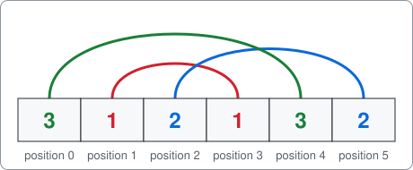

# Langford pairings

A command-line solver for Langford pairings, written as an example of using package [dlx](https://github.com/dimchansky/dlx). If exact cover is new to you, read the [introduction to the examples](../README.md) first.

## The problem

Take two copies of each number from 1 to n, and arrange them in a line. The rule: the two copies of a number k must have exactly k other numbers between them.

For n=3, one answer is:

    3 1 2 1 3 2



The two 1s have one number between them, the two 2s have two, and the two 3s have three. Having k numbers between them puts the two copies of k exactly k+1 places apart. Counting positions from 0, the 3s sit at positions 0 and 4.

The puzzle is interesting because such a simple rule behaves so unevenly: n=3 and n=4 have an answer, while n=5 and n=6 have none at all.

It is a good example here because its matrix is tiny, which leaves room for a new idea: removing mirror images from the matrix itself.

## How it becomes a matrix

**One column of the matrix is one thing that must happen exactly once:** a number gets placed, or a position gets filled. **One row of the matrix is one number placed at one pair of positions.** A row has three 1s: the number, its first position and its second position.

| Matrix part | Meaning                                                  | Count for n=3 | Count for n=7 |
|-------------|----------------------------------------------------------|---------------|---------------|
| Column      | A number, which must be placed exactly once              | 3             | 7             |
| Column      | A position, which must be filled exactly once            | 6             | 14            |
| Row         | A number placed at one pair of positions                 | 9             | 63            |

The section on [removing mirror images](#removing-mirror-images) below cuts those rows to 7 and 57.

Here is the whole matrix for n=3:

|            | num 1 | num 2 | num 3 | pos 0 | pos 1 | pos 2 | pos 3 | pos 4 | pos 5 |
|------------|:-:|:-:|:-:|:-:|:-:|:-:|:-:|:-:|:-:|
| 1 at 0, 2  | 1 | 0 | 0 | 1 | 0 | 1 | 0 | 0 | 0 |
| 1 at 1, 3  | 1 | 0 | 0 | 0 | 1 | 0 | 1 | 0 | 0 |
| 1 at 2, 4  | 1 | 0 | 0 | 0 | 0 | 1 | 0 | 1 | 0 |
| 1 at 3, 5  | 1 | 0 | 0 | 0 | 0 | 0 | 1 | 0 | 1 |
| 2 at 0, 3  | 0 | 1 | 0 | 1 | 0 | 0 | 1 | 0 | 0 |
| 2 at 1, 4  | 0 | 1 | 0 | 0 | 1 | 0 | 0 | 1 | 0 |
| 2 at 2, 5  | 0 | 1 | 0 | 0 | 0 | 1 | 0 | 0 | 1 |
| 3 at 0, 4  | 0 | 0 | 1 | 1 | 0 | 0 | 0 | 1 | 0 |
| 3 at 1, 5  | 0 | 0 | 1 | 0 | 1 | 0 | 0 | 0 | 1 |

The distance rule never appears as a check: a row simply doesn't exist for a number at the wrong distance. The columns only have to ensure that each number is used once and each position once.

This matrix has two exact covers:

| Picked rows                    | Arrangement   |
|--------------------------------|---------------|
| 3 at 0, 4; 2 at 2, 5; 1 at 1, 3 | `3 1 2 1 3 2` |
| 3 at 1, 5; 2 at 0, 3; 1 at 2, 4 | `2 3 1 2 1 3` |

## Removing mirror images

Read an arrangement backwards and you get another valid arrangement, because the distances don't change. `3 1 2 1 3 2` backwards is `2 3 1 2 1 3`, the second row of the table above. So every solution has a mirror twin, and the plain matrix finds both.

You could filter the twins afterwards, as the [pentomino example](../pentomino) does, but then the search has already done the work. Removing rows from the matrix is better, because the search never goes down those paths.

Which rows? Look at where the two 1s sit. They have one number between them, so they have a middle cell. For n=3:

```
Position:   0 1 2 3 4 5
            left | right

3 1 2 1 3 2       the 1s are at 1 and 3, so their middle cell is 2 (left half)
2 3 1 2 1 3       the 1s are at 2 and 4, so their middle cell is 3 (right half)
```

The line has an even number of positions, 2n, so its centre lies between two cells, not on one. That means:

1. The middle cell of the 1s is always in the left half or the right half, and never on the centre.
2. Reading the arrangement backwards swaps left and right.

So of each pair of twins, exactly one has the middle of its 1s in the left half. Keep only the rows that place the 1s there, and exactly one twin of each pair survives. The left half is positions 0 to n-1. A 1 starting at position p has its middle cell at p+1, so the rule is that p must be below n-1.

For n=3, this drops the rows `1 at 2, 4` and `1 at 3, 5`, which leaves 7 rows and the single solution `3 1 2 1 3 2`. For n=7 it drops 6 of the 63 rows, which leaves 57.

The trick needs a number with a middle cell. An even number doesn't have one: it can stand exactly around the centre, as the row `2 at 1, 4` does for n=3. That row is its own mirror image, so it can't separate a pair of twins. The number 1 is the simplest choice that works.

[solver.go](solver.go) removes these rows unless you pass `-mirrors`.

## How a solution decodes back

dlx reports column numbers, so the labels in the table above need numbers too. Counting from 0, the numbers 1 to n are columns 0 to n-1, and position p is column n+p.

Each row of a solution lists three columns, in the order they were given to `AddRow`: the number, then its two positions. For n=3, the row `3 at 0, 4` is `AddRow(2, 3, 7)`, and it comes back from dlx as `[2 3 7]`:

| Column | Calculation | Meaning |
|--------|-------------|---------|
| 2 | 2 + 1 | the number 3 |
| 3 | 3 - 3 | position 0 |
| 7 | 7 - 3 | position 4 |

[solver.go](solver.go) writes the number into both positions, and the arrangement is complete.

## Number of arrangements

| n             | 1 | 2 | 3 | 4 | 5 | 6 | 7  | 8   | 9 | 10 | 11    | 12     |
|---------------|---|---|---|---|---|---|----|-----|---|----|-------|--------|
| Up to mirrors | 0 | 0 | 1 | 1 | 0 | 0 | 26 | 150 | 0 | 0  | 17792 | 108144 |

"Up to mirrors" means an arrangement and its reversal count as one. With `-mirrors`, each total doubles.

Arrangements exist only when dividing n by 4 leaves a remainder of 0 or 3, as the table shows: 3, 4, 7, 8, 11, 12 and so on. This is a known result, which this example confirms for the sizes above and doesn't prove.

## Installation

    go install github.com/dimchansky/dlx/examples/langford@latest

## Usage

    langford [-n size] [-limit n] [-count] [-mirrors]

- `-n size` sets the largest number, 7 by default, from 1 to 64. That cap only stops the program building a huge matrix: sizes near it are not practical.
- `-limit n` sets how many arrangements to print, 1 by default. Zero prints all of them.
- `-count` goes through every arrangement and prints the total instead, so `-limit` has no effect with it. The total grows quickly: n=12 took under a second on the machine used to write this, and n=15 took a minute or two. Large n can take very long even when no arrangement exists, because the search has to rule them all out.
- `-mirrors` counts an arrangement and its reversal as two.

`-help` prints the usage text to standard error.

Arrangements and totals go to standard output. Error messages go to standard error, and most start with `langford:`.

| Exit code | Meaning                                                 |
|-----------|---------------------------------------------------------|
| 0         | At least one arrangement exists, or `-help` was given   |
| 1         | There are no arrangements                               |
| 2         | Invalid usage, or a write failure                       |

## Examples

Find the first arrangement for n=7:

    langford

Output:

    1 7 1 2 5 6 2 3 4 7 5 3 6 4

List n=3 with its mirror image:

    langford -n 3 -mirrors -limit 0

Output:

    3 1 2 1 3 2
    2 3 1 2 1 3

Count the arrangements for n=7, then count them again with mirrors:

    langford -count
    langford -count -mirrors

Output:

    Arrangements: 26
    Arrangements: 52

The value n=5 has no arrangements, so this exits with code 1:

    langford -n 5

Output, on standard error:

    langford: no arrangement found

## How the results are checked

The tests check these totals and compare every arrangement with a separate [backtracking](../README.md#how-dlx-searches) search that doesn't use dlx. They also confirm that the reduced matrix finds half as many arrangements, one of each pair, and that no arrangement is its own mirror.

`go test` checks every total. `go test -short` skips n=11 and n=12, which are much slower with `-race`. Use `-short` with `-race`.

## Limits

The number of arrangements grows very fast, so `-count` is practical only for small n, and `-n 64` is only a cap on the matrix and not a size this search can finish.
