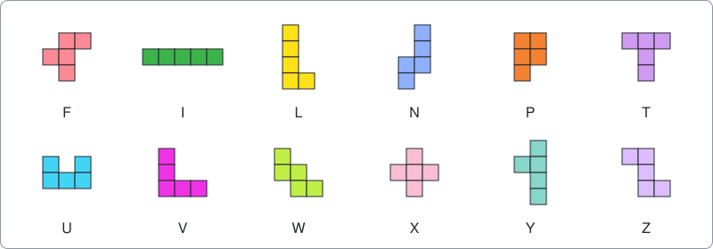
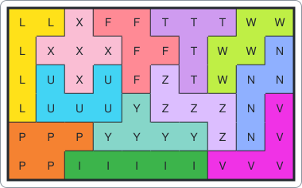

# Pentomino tiling

A command-line solver that fills a rectangle with the 12 pentominoes, each used exactly once, written as an example of using package [dlx](https://github.com/dimchansky/dlx). If exact cover is new to you, read the [introduction to the examples](../README.md) first.

## The problem

A pentomino is a shape made of five squares joined edge to edge. There are exactly 12 of them, if you count a shape and its rotations and flips as the same piece. Each is named after a letter it resembles:



Pieces may be rotated and flipped. Twelve pieces of five squares have 60 squares in all, so the board must have 60 cells, such as 6 by 10. Filling a shape completely with pieces, with no gaps and no overlaps, is called tiling it. This is one tiling of the 6 by 10 board:



## How it becomes a matrix

This is the classic geometric use of exact cover. Two different kinds of requirement share one matrix.

**A column of the matrix is one of two things:** a piece that must be used exactly once, or a board cell that must be filled exactly once. **A row of the matrix is one placement:** one piece, turned one way, at one position on the board.

| Matrix part | Meaning                                                       | Count for 6x10 |
|-------------|---------------------------------------------------------------|----------------|
| Column      | A piece, which must be used exactly once                      | 12             |
| Column      | A board cell, which must be filled exactly once               | 60             |
| Row         | One piece, in one orientation, at one position on the board   | 2056           |

Each row has six 1s: its piece and the five cells it occupies.

### A tiny version

The real matrix is far too big to draw, so here is the same idea with a board of 2 rows and 3 columns, and two pieces: a domino D of two squares, and an L of four squares. The cells are named by row letter and column number:

```
a1 a2 a3
b1 b2 b3
```

The domino fits in 7 places, and the L in 4. Each placement is one row of the matrix. D and L are the piece columns, and the rest are the cell columns:

|    | D | L | a1 | a2 | a3 | b1 | b2 | b3 |
|----|:-:|:-:|:-:|:-:|:-:|:-:|:-:|:-:|
| D1 | 1 | 0 | 1 | 1 | 0 | 0 | 0 | 0 |
| D2 | 1 | 0 | 0 | 1 | 1 | 0 | 0 | 0 |
| D3 | 1 | 0 | 0 | 0 | 0 | 1 | 1 | 0 |
| D4 | 1 | 0 | 0 | 0 | 0 | 0 | 1 | 1 |
| D5 | 1 | 0 | 1 | 0 | 0 | 1 | 0 | 0 |
| D6 | 1 | 0 | 0 | 1 | 0 | 0 | 1 | 0 |
| D7 | 1 | 0 | 0 | 0 | 1 | 0 | 0 | 1 |
| L1 | 0 | 1 | 1 | 1 | 1 | 1 | 0 | 0 |
| L2 | 0 | 1 | 1 | 1 | 1 | 0 | 0 | 1 |
| L3 | 0 | 1 | 1 | 0 | 0 | 1 | 1 | 1 |
| L4 | 0 | 1 | 0 | 0 | 1 | 1 | 1 | 1 |

This matrix has four exact covers: L1 with D4, L2 with D3, L3 with D2, and L4 with D1. Here is the first:

```
L L L
L D D
```

The piece columns matter. Without them, three dominoes D1, D7 and D3 would also fill the board, which would use one piece three times and the other not at all. The piece columns allow one D row and one L row in each solution, and no more. In the real problem, a tiling could otherwise use one pentomino three times and skip another.

### The 12 pieces in the matrix

[solver.go](solver.go) starts from one drawing of each piece, and generates its distinct orientations by rotating and flipping it. A symmetric piece gives fewer, because some turns look the same. The X looks the same however you turn it, while a piece with no symmetry has 8. There are 63 orientations in all, which give 2056 placements on a 6 by 10 board:

| Piece | F | I | L | N | P | T | U | V | W | X | Y | Z |
|-------|---|---|---|---|---|---|---|---|---|---|---|---|
| Orientations | 8 | 2 | 8 | 8 | 8 | 4 | 4 | 4 | 4 | 1 | 8 | 4 |
| Rows for 6x10 | 256 | 56 | 248 | 248 | 304 | 128 | 152 | 128 | 128 | 32 | 248 | 128 |

### One real row

dlx knows columns only by number. The piece columns come first, numbered 0 to 11 in the order of the table above. The cell columns follow, numbered `12 + boardRow*10 + boardColumn` on a 6 by 10 board, with board rows and columns counted from 0.

Take the X piece in the first tiling under [Examples](#examples). Its centre is at board row 1, column 2:

| Part of the row | Calculation | Matrix column |
|-----------------|-------------|---------------|
| Piece X | tenth piece, counting from 0 | 9 |
| Cell at board row 0, column 2 | 12 + 0\*10 + 2 | 14 |
| Cell at board row 1, column 1 | 12 + 1\*10 + 1 | 23 |
| Cell at board row 1, column 2 | 12 + 1\*10 + 2 | 24 |
| Cell at board row 1, column 3 | 12 + 1\*10 + 3 | 25 |
| Cell at board row 2, column 2 | 12 + 2\*10 + 2 | 34 |

So this placement is the matrix row `AddRow(9, 14, 23, 24, 25, 34)`.

## How a solution decodes back

A solution has 12 rows, one per piece, because the piece columns allow no more and no fewer. Each row lists its piece first and then its five cells, because dlx keeps columns in `AddRow` order. For the row above, 9 means the piece X. Subtracting 12 from each other number gives 2, 11, 12, 13 and 22, which are places on the board counted left to right and top to bottom from 0. The decoder writes the letter X into those five places.

## Counting duplicates

Take a finished tiling and flip the board top to bottom. The result is still a valid tiling, but it is a different exact cover. So is the left-to-right flip, and so is a half turn, which is both flips together. A rectangle that isn't square has no other moves that fit it back in place, since a quarter turn changes its shape.

`Tilings` counts all of these as separate. `Distinct` counts each group once. For that to work, each group must have exactly four different members, and it does: the F piece has no symmetry and appears once, so no flip can leave a tiling unchanged.

The code compares each tiling with its three images, and counts it as distinct only if it comes first in alphabetical order. The matrix could remove the images instead, by limiting the orientations of the F piece. This example wants the full total as well, so it keeps every row. The [Langford example](../langford) shows the other approach, which removes mirror images from the matrix itself.

| Board | Tilings | Distinct |
|-------|---------|----------|
| 6x10  | 9356    | 2339     |
| 5x12  | 4040    | 1010     |
| 4x15  | 1472    | 368      |
| 3x20  | 8       | 2        |
| 2x30  | 0       | 0        |
| 1x60  | 0       | 0        |

Each `Tilings` total is four times its `Distinct` total, as the argument above predicts.

## Installation

    go install github.com/dimchansky/dlx/examples/pentomino@latest

## Usage

    pentomino [-size RxC] [-limit n] [-count]

- `-size RxC` sets the board as rows and columns, 6x10 by default. Any size with 60 cells is accepted.
- `-limit n` sets how many tilings to print, 1 by default. Zero prints all of them.
- `-count` goes through every tiling and prints the totals instead, so `-limit` has no effect with it. This took about 4 seconds for 6x10 on the machine used to write this, while finding the first tiling took milliseconds.

`-help` prints the usage text to standard error.

Tilings and totals go to standard output. Error messages go to standard error, and most start with `pentomino:`.

| Exit code | Meaning                                                 |
|-----------|---------------------------------------------------------|
| 0         | At least one tiling exists, or `-help` was given        |
| 1         | The board has no tilings                                |
| 2         | Invalid usage, or a write failure                       |

## Examples

Find the first tiling of the default board. Each letter is the piece that covers that cell:

    pentomino

Output:

    Tiling 1:
    LLXFFTTTWW
    LXXXFFTWWN
    LUXUFZTWNN
    LUUUYZZZNV
    PPPYYYYZNV
    PPIIIIIVVV

Find the first tiling of a long, thin board:

    pentomino -size 3x20

Output:

    Tiling 1:
    UUXIIIIINNNFTWYYYYZV
    UXXXPPLNNFFFTWWYZZZV
    UUXPPPLLLLFTTTWWZVVV

Count the tilings of a 5x12 board:

    pentomino -size 5x12 -count

Output:

    Tilings: 4040
    Distinct: 1010

## How the results are checked

The tests check these totals against a separate [backtracking](../README.md#how-dlx-searches) search that doesn't use dlx and has its own table of pieces.

`go test` checks every total. `go test -short` skips the 4x15, 5x12 and 6x10 totals, which take seconds normally and minutes with `-race`. Use `-short` with `-race`.

## Limits

Only rectangles of 60 cells are accepted, and the set of pieces is fixed. Boards of other shapes would need a different encoding of the cells.
