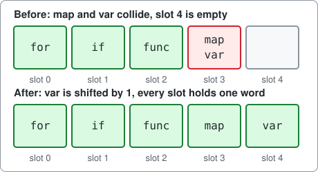
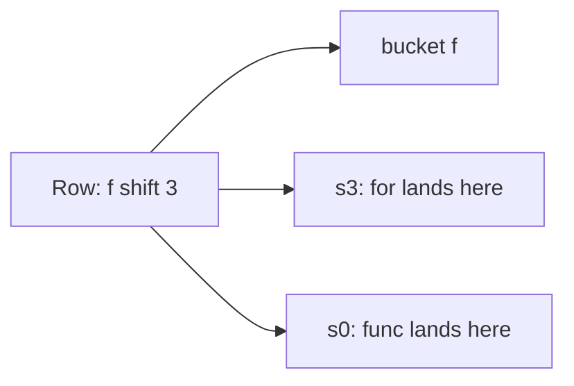
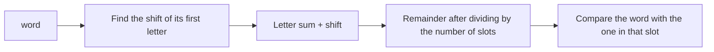

# Perfect hash

A command-line tool that builds a perfect hash for Go's 25 keywords, written as an example of using package [dlx](https://github.com/dimchansky/dlx). If exact cover is new to you, read the [introduction to the examples](../README.md) first.

## The problem

A **hash table** is a row of numbered boxes, called slots, plus a rule that turns a word into a slot number. To store a word, you compute its number and put the word in that box. To find a word later, you compute the same number and look in that one box, instead of reading the whole list. A compiler can use this to tell keywords such as `for` from ordinary names.

The trouble comes when the rule gives two words the same number. They want the same box. This is called a **collision**, and a normal hash table spends extra work on it, for example by keeping a short list in that box.

A rule with no collisions for a known list of words is called a **perfect hash**. If there are also exactly as many slots as words, so that no box is wasted, it is a **minimal perfect hash**. This is what the command builds: 25 slots, 25 keywords, one keyword in each slot.

A perfect hash needs the list to be known in advance, and Go's keyword list is. Go's own compiler uses a perfect hash for its keywords, in `src/cmd/compile/internal/syntax/scanner.go`. Its table has 64 slots (as of Go 1.27), so it is perfect but not minimal.

## A small example

Take five keywords and five slots. A word gets its number in two steps.

**Step 1: the letter sum.** Number the letters a=1, b=2, up to z=26. Multiply each letter of the word by its position in the word, and add up. Without the positions, `abc` and `cba` would always get the same sum.

**Step 2: the remainder.** Divide the sum by the number of slots, 5 here, and keep the remainder. It is always 0 to 4, so it is always a slot number. For example, 78 divided by 5 is 15 with remainder 3.

| Word | Letter sum              | Sum | Remainder after dividing by 5 |
|------|-------------------------|-----|-------------------------------|
| for  | 6×1 + 15×2 + 18×3       | 90  | 0                             |
| func | 6×1 + 21×2 + 14×3 + 3×4 | 102 | 2                             |
| if   | 9×1 + 6×2               | 21  | 1                             |
| map  | 13×1 + 1×2 + 16×3       | 63  | 3                             |
| var  | 22×1 + 1×2 + 18×3       | 78  | 3                             |

`map` and `var` collide on slot 3, and slot 4 stays empty, as the top of this picture shows:

**The fix: a shift for each first letter.** Words that start with the same letter form a group, called a bucket. Each bucket gets one small extra number, its shift, which is added to the sum before taking the remainder. Giving the `v` bucket a shift of 1 turns 78 into 79, which has remainder 4. The collision is gone, as the bottom of the picture shows.

A whole bucket moves together, and it wraps around: with a shift of 3, the `f` bucket moves `for` from slot 0 to slot 3, and `func` from slot 2 to slot 0, since 102 + 3 = 105 has remainder 0.

So the only thing to find is one shift per bucket. The Go keywords have 13 buckets and 25 possible shifts for each, which makes 25 multiplied by itself 13 times: far too many combinations to try one by one. Exact cover cuts the search down.

## How it becomes a matrix

**One column of the matrix is either a bucket, which must get exactly one shift, or a slot, which must hold exactly one word.** **One row of the matrix is one shift for one bucket.** A row has a 1 in its bucket's column, and a 1 in each slot its words land on.

| Matrix part | Meaning                                 | Five keywords | Go keywords   |
|-------------|-----------------------------------------|---------------|---------------|
| Column      | A bucket, which needs exactly one shift | 4             | 13            |
| Column      | A slot, which needs exactly one word    | 5             | 25            |
| Row         | One bucket with one shift               | 4 × 5 = 20    | 13 × 25 = 325 |

There is one row for each shift from 0 to the number of slots minus 1. A larger shift would wrap around to one of these.

The row `f shift 3` puts `for` in slot 3 and `func` in slot 0, so it has a 1 in three columns:

Here is the whole matrix for the five keywords. Columns `f` to `v` are the buckets and `s0` to `s4` are the slots. The bold rows are the solution the command prints, and you can check that they have exactly one 1 in every column.

| Row | f | i | m | v | s0 | s1 | s2 | s3 | s4 |
|-----|:-:|:-:|:-:|:-:|:--:|:--:|:--:|:--:|:--:|
| **f shift 0** | 1 | 0 | 0 | 0 | 1 | 0 | 1 | 0 | 0 |
| f shift 1 | 1 | 0 | 0 | 0 | 0 | 1 | 0 | 1 | 0 |
| f shift 2 | 1 | 0 | 0 | 0 | 0 | 0 | 1 | 0 | 1 |
| f shift 3 | 1 | 0 | 0 | 0 | 1 | 0 | 0 | 1 | 0 |
| f shift 4 | 1 | 0 | 0 | 0 | 0 | 1 | 0 | 0 | 1 |
| **i shift 0** | 0 | 1 | 0 | 0 | 0 | 1 | 0 | 0 | 0 |
| i shift 1 | 0 | 1 | 0 | 0 | 0 | 0 | 1 | 0 | 0 |
| i shift 2 | 0 | 1 | 0 | 0 | 0 | 0 | 0 | 1 | 0 |
| i shift 3 | 0 | 1 | 0 | 0 | 0 | 0 | 0 | 0 | 1 |
| i shift 4 | 0 | 1 | 0 | 0 | 1 | 0 | 0 | 0 | 0 |
| **m shift 0** | 0 | 0 | 1 | 0 | 0 | 0 | 0 | 1 | 0 |
| m shift 1 | 0 | 0 | 1 | 0 | 0 | 0 | 0 | 0 | 1 |
| m shift 2 | 0 | 0 | 1 | 0 | 1 | 0 | 0 | 0 | 0 |
| m shift 3 | 0 | 0 | 1 | 0 | 0 | 1 | 0 | 0 | 0 |
| m shift 4 | 0 | 0 | 1 | 0 | 0 | 0 | 1 | 0 | 0 |
| v shift 0 | 0 | 0 | 0 | 1 | 0 | 0 | 0 | 1 | 0 |
| **v shift 1** | 0 | 0 | 0 | 1 | 0 | 0 | 0 | 0 | 1 |
| v shift 2 | 0 | 0 | 0 | 1 | 1 | 0 | 0 | 0 | 0 |
| v shift 3 | 0 | 0 | 0 | 1 | 0 | 1 | 0 | 0 | 0 |
| v shift 4 | 0 | 0 | 0 | 1 | 0 | 0 | 1 | 0 | 0 |

A collision is now a clash between rows. `m shift 0` and `v shift 0` both have a 1 under `s3`, so they can't both be picked. And since there are as many slots as words, every slot must be used, so no slot is optional and no [slack rows](../README.md#at-most-once-slack-rows) are needed. Being minimal is what makes this an exact cover problem as it stands.

## How a solution decodes back

dlx reports column numbers. The bucket columns come first, numbered from 0 in alphabetical order, and the slot columns follow them. For the five keywords, `f`, `i`, `m` and `v` are columns 0 to 3, and slot `s0` is column 4. A row lists its bucket first, and then one slot for each word of the bucket, in the bucket's order.

So `v shift 1` comes back as `[3 8]`. The 3 is bucket `v`, whose only word is `var`, and 8 - 4 = 4 is its slot. [solver.go](solver.go) stores `var` in slot 4. It then works out the shift from the first word of the bucket: `var` lands on slot 3 with no shift and on slot 4 now, so the shift is 1.

## Using the table

The finished table is the list of slots and one shift per letter. Looking up a word follows the same steps as above:

The comparison is needed because a perfect hash only promises to keep the listed words apart. Any other word lands on some slot too. With the keyword table below, `goto` has sum 157 and `g` has shift 2, and 159 has remainder 9 after dividing by 25, so it is in slot 9. `gopher` has sum 250, and 252 has remainder 2, but slot 2 holds `func`, so `gopher` is not a keyword.

## Installation

    go install github.com/dimchansky/dlx/examples/perfecthash@latest

## Usage

    perfecthash [-keys word,word,...]

- `-keys` gives your own words, separated by commas. They must be different, and made of the lowercase letters a to z, with at most 64 letters each and at most 256 words. Without it, the words are Go's 25 keywords.

`-help` prints the usage text to standard error.

The table goes to standard output. Error messages go to standard error, and most start with `perfecthash:`.

| Exit code | Meaning                                                 |
|-----------|---------------------------------------------------------|
| 0         | A table was found, or `-help` was given                 |
| 1         | No table exists for these words                         |
| 2         | Invalid usage, or a write failure                       |

## Examples

Build the table for Go's keywords:

    perfecthash

Output:

    Keys: 25, first letters: 13
    Matrix: 38 columns, 325 rows

    Letter  Shift
    b       0
    c       0
    d       2
    e       0
    f       0
    g       2
    i       1
    m       3
    p       8
    r       3
    s       3
    t       4
    v       22

    Slot  Key
    0     var
    1     const
    2     func
    3     chan
    4     import
    5     default
    6     else
    7     case
    8     fallthrough
    9     goto
    10    struct
    11    package
    12    break
    13    switch
    14    go
    15    for
    16    map
    17    type
    18    range
    19    defer
    20    interface
    21    continue
    22    if
    23    select
    24    return

Build the table for the five keywords above:

    perfecthash -keys for,func,if,map,var

Output:

    Keys: 5, first letters: 4
    Matrix: 9 columns, 20 rows

    Letter  Shift
    f       0
    i       0
    m       0
    v       1

    Slot  Key
    0     for
    1     if
    2     func
    3     map
    4     var

Two words of a bucket can't be separated, because a shift moves them together. With two slots, `ab` has sum 5 and `ad` has sum 9, and both have remainder 1. So this exits with code 1:

    perfecthash -keys ab,ad

Output, on standard error:

    perfecthash: no hash table found

## How the results are checked

- **The keyword list can't drift.** A test reads the keywords from the standard package `go/token` and compares them with the list in [main.go](main.go).
- **The table is checked without the solver.** A test recomputes the slot of each word with a separate version of the hash, and checks that each word is in one slot and that lookups find it. It also checks that strangers such as `gopher` and `Go` are rejected.
- **Small cases are checked against every combination.** A test with no matrix tries all shifts for seven small word lists, and dlx must find the same tables. The five keywords above have 30 tables out of 625 combinations.
- **Existence is checked by a second search.** A plain [backtracking](../README.md#how-dlx-searches) search that doesn't use dlx must agree on whether a table exists, including for the 25 keywords.
- The letter sums are checked against values worked out by hand, and the outputs above are checked in full.

## Limits

- The command stops at the first table. Going through all the tables for the 25 keywords didn't finish in 20 seconds, so this page gives no total.
- Not every list has a table, because two words of a bucket that collide do so under every shift. The first ten keywords have none, since `const` and `continue` both have remainder 1 after dividing by 10. A list of 31 of Go's other predeclared names, such as `cap`, `len` and `nil`, fails the same way, on `cap` and `complex` among others.
- Shifts can also fail to fit together when no such pair exists: the list `aa,ab,ba,baa` has no table.
- Finding the table for the keywords took under a millisecond on the machine used to write this. Lists near the 256-word cap were not tried, and may not finish in practical time: the cap only stops the program building a huge matrix.
- The table has to be built again if a word is added.
- Leaving spare slots would need a slack row for each slot, as in the [queens example](../queens). This command doesn't do that.
