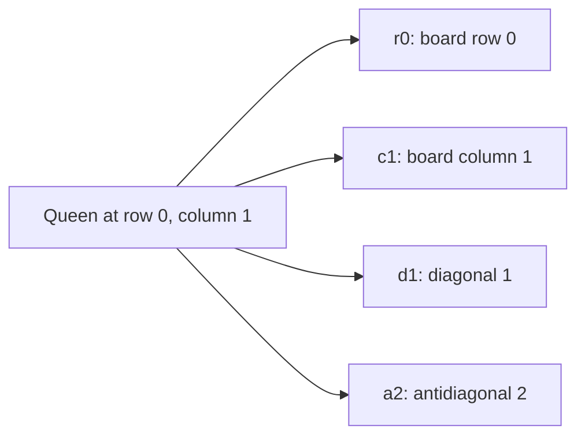

# N queens

A command-line solver for the n-queens problem, written as an example of using package [dlx](https://github.com/dimchansky/dlx). If exact cover is new to you, read the [introduction to the examples](../README.md) first.

## The problem

A queen in chess attacks along four lines: its row, its column and its two diagonals.


The task is to place n queens on an n by n board so that no two share a row, a column or a diagonal. It is a classic search puzzle because the rules are simple, yet a queen placed early can block many squares much later.

For n=4 there are two solutions. This is the first:

```
. Q . .
. . . Q
Q . . .
. . Q .
```

Rotations and reflections of a placement count as separate solutions, so the second solution for n=4 is this one flipped.

## Why diagonals are "at most once"

Count the lines. A board of size n has n rows and n queens, and no two queens share a row, so each row holds exactly one queen. The same goes for columns.

Diagonals are different. An n by n board has 2n-1 diagonals in each direction: 7 for n=4, and 15 for n=8. The n queens stand on n different diagonals in each direction, so exactly n-1 diagonals in each direction stay empty: 3 for n=4, and 7 for n=8. So a row or column needs **exactly one** queen, but a diagonal takes **at most one**.

dlx requires every column of the matrix to be covered exactly once, so diagonals don't fit as they stand. The fix is a slack row: for each diagonal, add a matrix row that covers that diagonal alone. The [introduction](../README.md#at-most-once-slack-rows) explains the idea on a small example. Think of a slack row as a stand-in that says "this diagonal is empty".

## How it becomes a matrix

**One column of the matrix is one line on the board.** **One row of the matrix is either a queen on one square, or a slack row for one diagonal.**

| Matrix part | Meaning                                               | Count for n=4 | Count for n=8 |
|-------------|-------------------------------------------------------|---------------|---------------|
| Column      | A board row, which needs exactly one queen            | 4             | 8             |
| Column      | A board column, which needs exactly one queen         | 4             | 8             |
| Column      | A diagonal, which takes at most one queen             | 7             | 15            |
| Column      | An antidiagonal, which takes at most one queen        | 7             | 15            |
| Row         | A queen on one square, covering its four lines        | 16            | 64            |
| Row         | A slack row for one diagonal or antidiagonal          | 14            | 30            |

Board rows and columns are counted from 0. All the squares of a diagonal share a simple number, which gives it a name:

- A **diagonal** runs from bottom left to top right, and its squares have the same value of row+column. One step down and to the left adds 1 to the row and takes 1 from the column, so the sum stays the same.
- An **antidiagonal** runs from top left to bottom right, and its squares have the same value of row-column. One step down and to the right adds 1 to both, so the difference stays the same. Adding n-1 keeps the number from being negative.

For n=4, these are the numbers on each square:

```
Diagonal number           Antidiagonal number
(row + column)            (row - column + 3)

0 1 2 3                   3 2 1 0
1 2 3 4                   4 3 2 1
2 3 4 5                   5 4 3 2
3 4 5 6                   6 5 4 3
```

So the queen at row 0, column 1 lies on diagonal 1 and antidiagonal 2. Its matrix row has four 1s, one for each line it stands on:



The full matrix for n=4 has 22 columns and 30 rows. This table shows only the 10 rows of the first solution above, so you can check that each column has a 1 in exactly one row. The other 12 queen rows and 8 slack rows are not shown.

|   | r0 | r1 | r2 | r3 | c0 | c1 | c2 | c3 | d0 | d1 | d2 | d3 | d4 | d5 | d6 | a0 | a1 | a2 | a3 | a4 | a5 | a6 |
|---|:-:|:-:|:-:|:-:|:-:|:-:|:-:|:-:|:-:|:-:|:-:|:-:|:-:|:-:|:-:|:-:|:-:|:-:|:-:|:-:|:-:|:-:|
| queen r0 c1 | 1 | 0 | 0 | 0 | 0 | 1 | 0 | 0 | 0 | 1 | 0 | 0 | 0 | 0 | 0 | 0 | 0 | 1 | 0 | 0 | 0 | 0 |
| queen r1 c3 | 0 | 1 | 0 | 0 | 0 | 0 | 0 | 1 | 0 | 0 | 0 | 0 | 1 | 0 | 0 | 0 | 1 | 0 | 0 | 0 | 0 | 0 |
| queen r2 c0 | 0 | 0 | 1 | 0 | 1 | 0 | 0 | 0 | 0 | 0 | 1 | 0 | 0 | 0 | 0 | 0 | 0 | 0 | 0 | 0 | 1 | 0 |
| queen r3 c2 | 0 | 0 | 0 | 1 | 0 | 0 | 1 | 0 | 0 | 0 | 0 | 0 | 0 | 1 | 0 | 0 | 0 | 0 | 0 | 1 | 0 | 0 |
| slack d0 | 0 | 0 | 0 | 0 | 0 | 0 | 0 | 0 | 1 | 0 | 0 | 0 | 0 | 0 | 0 | 0 | 0 | 0 | 0 | 0 | 0 | 0 |
| slack d3 | 0 | 0 | 0 | 0 | 0 | 0 | 0 | 0 | 0 | 0 | 0 | 1 | 0 | 0 | 0 | 0 | 0 | 0 | 0 | 0 | 0 | 0 |
| slack d6 | 0 | 0 | 0 | 0 | 0 | 0 | 0 | 0 | 0 | 0 | 0 | 0 | 0 | 0 | 1 | 0 | 0 | 0 | 0 | 0 | 0 | 0 |
| slack a0 | 0 | 0 | 0 | 0 | 0 | 0 | 0 | 0 | 0 | 0 | 0 | 0 | 0 | 0 | 0 | 1 | 0 | 0 | 0 | 0 | 0 | 0 |
| slack a3 | 0 | 0 | 0 | 0 | 0 | 0 | 0 | 0 | 0 | 0 | 0 | 0 | 0 | 0 | 0 | 0 | 0 | 0 | 1 | 0 | 0 | 0 |
| slack a6 | 0 | 0 | 0 | 0 | 0 | 0 | 0 | 0 | 0 | 0 | 0 | 0 | 0 | 0 | 0 | 0 | 0 | 0 | 0 | 0 | 0 | 1 |

This table shows a solution, so nothing in it clashes. Two queens on the same diagonal would both have a 1 in that diagonal's column, so they can't both be picked. For example, the queens r0 c1 and r1 c0 attack each other, and both rows have a 1 under `d1`, because 0+1 and 1+0 are both 1. That single rule is the whole "no attacks" condition.

Two facts make slack rows safe here, and both must hold whenever you use the recipe:

- Slack rows add no duplicate solutions. An empty diagonal can be covered in only one way, by its own slack row, so each placement of queens is exactly one exact cover.
- Slack rows can be told apart from real rows. A queen's row has four columns and a slack row has one.

## How a solution decodes back

dlx reports column numbers, not the labels used above. The families are laid out one after another: `r` first, then `c` from n, `d` from 2n, and `a` from 4n-1.

[solver.go](solver.go) skips the rows with one column, because those are slack rows. In each remaining row, the first column is the board row and the second is the board column plus n, since the column family comes after the n row columns. For n=4, the queen r1 c3 comes back as `[1 7 12 16]`: the 1 is board row 1, and 7 - 4 = 3 is board column 3. The last two numbers are its diagonals, `d4` and `a1`, which the decoder doesn't need. That is enough to draw the board.

## Installation

    go install github.com/dimchansky/dlx/examples/queens@latest

## Usage

    queens [-n size] [-limit n] [-count]

- `-n size` sets the board size, 8 by default, from 1 to 64. That cap only stops the program building a huge matrix: sizes near it are not practical, as the timings below show.
- `-limit n` sets how many solutions to print, 1 by default. Zero prints all of them.
- `-count` goes through every solution and prints the total instead, so `-limit` has no effect with it.

`-help` prints the usage text to standard error.

Solutions and totals go to standard output. Error messages go to standard error, and most start with `queens:`.

| Exit code | Meaning                                                 |
|-----------|---------------------------------------------------------|
| 0         | At least one solution exists, or `-help` was given      |
| 1         | The board has no solutions                              |
| 2         | Invalid usage, or a write failure                       |

## Examples

Find the first solution for a standard chessboard:

    queens

Output:

    Solution 1:
    Q . . . . . . .
    . . . . Q . . .
    . . . . . . . Q
    . . . . . Q . .
    . . Q . . . . .
    . . . . . . Q .
    . Q . . . . . .
    . . . Q . . . .

Count the solutions for n=12:

    queens -n 12 -count

Output:

    Solutions: 14200

A board of size 2 or 3 has no solutions, so this exits with code 1:

    queens -n 3

Output, on standard error:

    queens: no solution found

## Number of solutions

| n         | 1 | 2 | 3 | 4 | 5  | 6 | 7  | 8  | 9   | 10  | 11   | 12    |
|-----------|---|---|---|---|----|---|----|----|-----|-----|------|-------|
| Solutions | 1 | 0 | 0 | 2 | 10 | 4 | 40 | 92 | 352 | 724 | 2680 | 14200 |

## How the results are checked

The tests check these totals and compare every solution with a separate [backtracking](../README.md#how-dlx-searches) search that doesn't use dlx.

`go test` checks every total. `go test -short` skips n=11 and n=12, which are much slower with `-race`. Use `-short` with `-race`.

## Limits

Slack rows have a cost. dlx always tries the column with the fewest remaining rows next, and it treats optional diagonals like any other column, so it can spend its time deciding which diagonals stay empty. On the machine used to write this, the first solution for n=24 took under a second, while n=32 took nearly three minutes. The total for n=13 took about a second.
