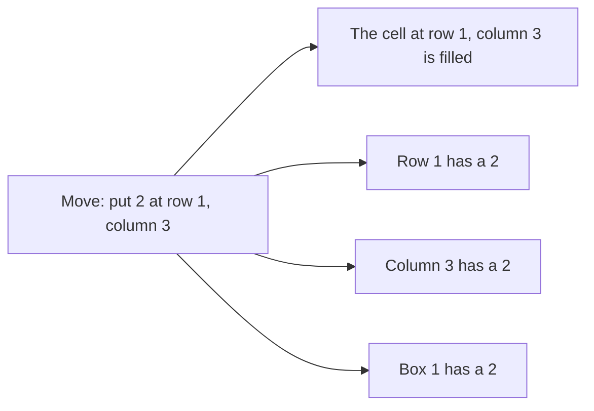

# Sudoku solver

A command-line Sudoku solver, written as an example of using package [dlx](https://github.com/dimchansky/dlx). It reads a board from standard input and prints its solutions to standard output. If exact cover is new to you, read the [introduction to the examples](../README.md) first.

## The problem

A Sudoku board has 9 rows, 9 columns and 9 boxes of 3 by 3 cells. Some cells already hold digits. You fill in the rest so that each row, each column and each box contains every digit from 1 to 9 exactly once.

The boxes are numbered like this, left to right and top to bottom:

```
1 1 1 | 2 2 2 | 3 3 3
1 1 1 | 2 2 2 | 3 3 3
1 1 1 | 2 2 2 | 3 3 3
------+-------+------
4 4 4 | 5 5 5 | 6 6 6
4 4 4 | 5 5 5 | 6 6 6
4 4 4 | 5 5 5 | 6 6 6
------+-------+------
7 7 7 | 8 8 8 | 9 9 9
7 7 7 | 8 8 8 | 9 9 9
7 7 7 | 8 8 8 | 9 9 9
```

Here is the sample board used throughout this page, with `_` for a blank, and one way to fill it in:

```
The board                One way to fill it

_ 8 _ | _ _ 9 | 7 4 3    2 8 6 | 1 5 9 | 7 4 3
_ 5 _ | _ _ 8 | _ 1 _    4 5 7 | 6 3 8 | 2 1 9
_ 1 _ | _ _ _ | _ _ _    3 1 9 | 7 4 2 | 5 6 8
------+-------+------    ------+-------+------
8 _ _ | _ _ 5 | _ _ _    8 2 1 | 9 6 5 | 4 3 7
_ _ _ | 8 _ 4 | _ _ _    6 9 3 | 8 7 4 | 1 2 5
_ _ _ | 3 _ _ | _ _ 6    7 4 5 | 3 2 1 | 8 9 6
------+-------+------    ------+-------+------
_ _ _ | _ _ _ | _ 7 _    5 6 8 | 2 1 3 | 9 7 4
_ 3 _ | 5 _ _ | _ 8 _    1 3 4 | 5 9 7 | 6 8 2
9 7 2 | 4 _ _ | _ 5 _    9 7 2 | 4 8 6 | 3 5 1
```

Sudoku is the standard introduction to exact cover because nearly every rule already says "exactly once".

## How it becomes a matrix

**One row of the matrix is one possible move:** "put digit d in the cell at row r, column c". **One column of the matrix is one fact that must end up true exactly once.** To avoid confusion, a matrix row is called a *move* below, a matrix column is called a *fact*, and "row" and "column" on their own always mean the board.

There are four families, with 81 facts each:

| Family | Example fact | How many |
|--------|--------------|----------|
| Each cell holds one digit | "the cell at row 1, column 3 is filled" | 9 x 9 = 81 |
| Each row has each digit | "row 1 has a 2" | 9 x 9 = 81 |
| Each column has each digit | "column 3 has a 2" | 9 x 9 = 81 |
| Each box has each digit | "box 1 has a 2" | 9 x 9 = 81 |

That gives 324 facts. Every move makes exactly four facts true, one from each family:



The whole matrix is too big to draw, so here is a small part of it. Take the top left of the sample board, where the cells at row 1, column 1 and row 1, column 3 are both blank. This table shows three moves for those cells and the nine facts they touch, with r1c3 short for "row 1, column 3":

| Move | cell r1c1 | cell r1c3 | row 1 has 2 | row 1 has 6 | col 1 has 2 | col 1 has 6 | col 3 has 2 | box 1 has 2 | box 1 has 6 |
|------|:-:|:-:|:-:|:-:|:-:|:-:|:-:|:-:|:-:|
| 2 at r1c1 | 1 | 0 | 1 | 0 | 1 | 0 | 0 | 1 | 0 |
| 6 at r1c1 | 1 | 0 | 0 | 1 | 0 | 1 | 0 | 0 | 1 |
| 2 at r1c3 | 0 | 1 | 1 | 0 | 0 | 0 | 1 | 1 | 0 |

The rules of Sudoku appear as clashes between moves:

- The first two moves both have a 1 under "cell r1c1". Only one can be picked, so a cell can't hold two digits.
- The first and third moves both have a 1 under "row 1 has 2" and "box 1 has 2". Only one can be picked, so a digit can't appear twice in a row or box.

A blank cell adds nine moves, one per digit. A cell that already holds a digit adds only one move, which is how the given digits enter the problem. An empty board would have 9 x 9 x 9 = 729 moves. The sample board has 24 given digits and 57 blanks, so it has 24 + 57 x 9 = 537.

Moves are added for every digit in a blank cell, even digits that visibly clash with a given. The search rules those out at once, so the code stays short.

### The fact numbers

dlx knows each column of its matrix only by a number, so each fact needs a number. The code counts rows, columns, boxes and digits from 0, so its row 0 is the top row and its digit 1 means the digit 2. The four families are laid out one after another:

| Family | Fact numbers | Formula |
|--------|----------------|---------|
| Cell filled | 0 to 80 | `row*9 + column` |
| Row has digit | 81 to 161 | `81 + row*9 + digit` |
| Column has digit | 162 to 242 | `162 + column*9 + digit` |
| Box has digit | 243 to 323 | `243 + box*9 + digit` |

These formulas work because each row of cells takes a fresh block of nine numbers: in `row*9 + column`, row 0 uses 0 to 8, row 1 uses 9 to 17, and so on, so no two cells share a number. The other three families use the same idea, then add 81, 162 or 243 to start after the family before.

The box number comes from `box = row/3*3 + column/3`. Each division is rounded down, and this happens before the multiplication, so the two 3s don't cancel: `row/3*3` is 0, 3 or 6, the number of the leftmost box in that row of boxes. For `row` 4 and `column` 7, `row/3` is 1 and `column/3` is 2, so the box is 1\*3 + 2 = 5. This gives boxes numbered from 0 to 8, one less than in the picture above.

For example, the solved board above has the digit 5 at the third row and seventh column. That is `row` 2, `column` 6 and `digit` 4. It lies in box 0\*3 + 2 = 2, so its move is `AddRow(24, 103, 220, 265)`:

| Family | Calculation | Fact number |
|--------|-------------|-------------|
| Cell filled | 2\*9 + 6 | 24 |
| Row has digit | 81 + 2\*9 + 4 | 103 |
| Column has digit | 162 + 6\*9 + 4 | 220 |
| Box has digit | 243 + 2\*9 + 4 | 265 |

## How a solution decodes back

A solution is a list of 81 moves, one per cell, each given by its four fact numbers. Only the first two are needed. For the move above, the list is `[24 103 220 265]`:

- The first number is the cell: 24 means cell 24, counting left to right and top to bottom from 0.
- The second number gives the digit. Dividing 103 by 9 gives 11, with a remainder of 4. The remainder is the digit in the code's numbering, so the real digit is 4 + 1 = 5.

This works because `AddRow` keeps the numbers in the order given, and because the "row has digit" numbers go up in blocks of nine. The family starts at 81, which is itself a multiple of 9, and `row*9` is a multiple of 9 too. So only `digit`, which is below 9, is left over as the remainder.

## Installation

    go install github.com/dimchansky/dlx/examples/sudoku@latest

## Input

A board is nine lines of nine cells, with whitespace between the cells. A cell is a digit from 1 to 9, or `_` or `0` for a blank. This is the sample board as the file [sudoku.txt](sudoku.txt) holds it:

```
_ 8 _ _ _ 9 7 4 3
_ 5 _ _ _ 8 _ 1 _
_ 1 _ _ _ _ _ _ _
8 _ _ _ _ 5 _ _ _
_ _ _ 8 _ 4 _ _ _
_ _ _ 3 _ _ _ _ 6
_ _ _ _ _ _ _ 7 _
_ 3 _ 5 _ _ _ 8 _
9 7 2 4 _ _ _ 5 _
```

- `.` is not accepted as a blank by the command. The `solver` package accepts it, but the command's parser does not.
- The board starts on the first line, so a blank line before it or inside it is an error.
- Only blank lines may follow the ninth line. Anything else after it is an error.
- Input is read to the end, so if you type a board at a terminal, finish with Ctrl-D.
- A board with conflicting digits is not an input error. It has no solutions.

## Usage

    sudoku [-limit n] < board.txt

`-limit n` sets how many solutions to print, 1 by default. Zero prints all of them, which may never finish on a board with few digits: an empty board has too many solutions to print.

`-help` prints the usage text to standard error.

Solutions go to standard output. Error messages go to standard error, and most start with `sudoku:`.

| Exit code | Meaning                                                        |
|-----------|----------------------------------------------------------------|
| 0         | At least one solution was printed, or `-help` was given        |
| 1         | The board has no solutions                                     |
| 2         | Invalid usage, invalid input, or a read or write failure       |

## Examples

These commands use [sudoku.txt](sudoku.txt), the board shown above. Run them from this directory. A published Sudoku normally has one solution, but the digits on this board don't fix the answer, and it has 8 solutions.

Find the first solution:

    sudoku < sudoku.txt

Output:

    Solution 1:
    2 8 6 1 5 9 7 4 3
    4 5 7 6 3 8 2 1 9
    3 1 9 7 4 2 5 6 8
    8 2 1 9 6 5 4 3 7
    6 9 3 8 7 4 1 2 5
    7 4 5 3 2 1 8 9 6
    5 6 8 2 1 3 9 7 4
    1 3 4 5 9 7 6 8 2
    9 7 2 4 8 6 3 5 1

Find two solutions:

    sudoku -limit 2 < sudoku.txt

Find all solutions:

    sudoku -limit 0 < sudoku.txt

## How the results are checked

The tests compare the solver's output with a list of known solutions, including all 8 solutions of the sample board, and check that boards with conflicting digits give no solutions. The code is in [solver/solver.go](solver/solver.go).

## Limits

The solver finds every solution, but it doesn't say how hard a board is, and it doesn't check that a board has only one solution unless you ask for all of them with `-limit 0`.
