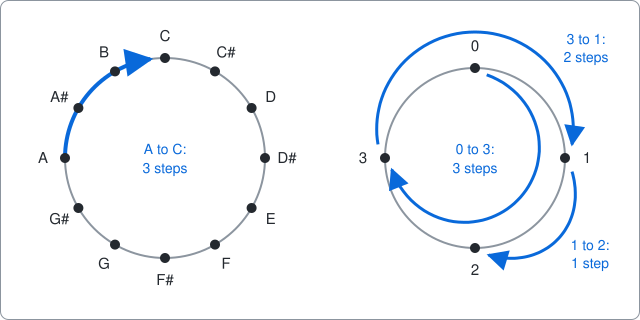
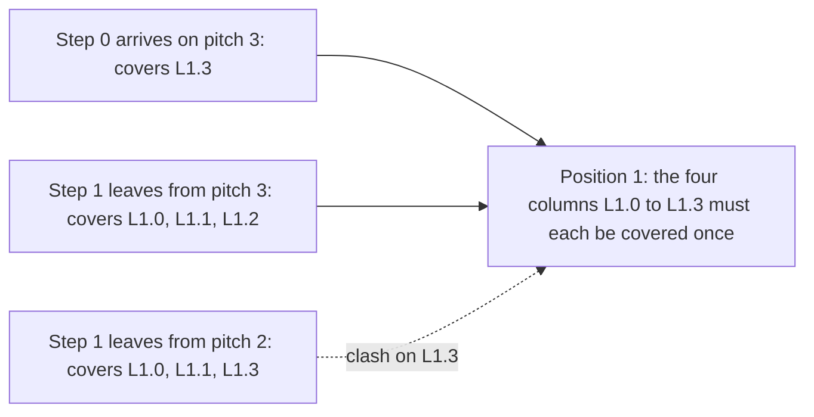

# All-interval twelve-tone rows

A command-line solver for all-interval twelve-tone rows, written as an example of using package [dlx](https://github.com/dimchansky/dlx). If exact cover is new to you, read the [introduction to the examples](../README.md) first.

This example teaches one trick: how to make two rows of a matrix agree on a value, even though dlx has no "these two must be equal" setting. No music knowledge is needed. The next section explains every musical word used.

## The problem

A piano repeats the same twelve notes over and over: C, C#, D, D#, E, F, F#, G, G#, A, A#, B, then C again, one octave higher. Music calls a C the same note in any octave, so the twelve notes sit on a circle, like the hours on a clock.

We number the notes from 0 (C) to 11 (B), and call each one a **pitch**.

An **interval** is how many steps clockwise you walk from one pitch to the next. Going from C (0) to E (4) is 4 steps. Going from A (9) to C (0) passes the top of the circle: 10, 11, 0 is 3 steps. As a formula, the interval is the second pitch minus the first, plus 12 if that is negative. For A to C: 0 - 9 + 12 = 3. Two different pitches are always 1 to 11 steps apart.

A **twelve-tone row** is an ordering of all twelve pitches, each used once. Composers such as Arnold Schoenberg and Alban Berg built whole pieces from one such ordering. A row has 11 steps between neighbours, and there are 11 possible intervals, which raises a question: can a row use **every interval exactly once**? Such a row is called all-interval.

In this README a twelve-tone row is called a **series**, because "row" also means a row of the matrix.

Alban Berg used one in his Lyric Suite (1926):

| Note             | F | E  | C | A | G  | D | A♭ | D♭ | E♭ | G♭ | B♭ | B  |
|------------------|---|----|---|---|----|---|----|----|----|----|----|----|
| Pitch            | 5 | 4  | 0 | 9 | 7  | 2 | 8  | 1  | 3  | 6  | 10 | 11 |
| Interval to next | 11 | 8 | 9 | 10 | 7 | 6 | 5  | 2  | 3  | 4  | 1  |    |

Each of 1 to 11 appears once in the bottom line. A♭ is another name for G#, D♭ for C#, E♭ for D#, G♭ for F# and B♭ for A#, and the program prints the sharp names.

The same question works for any number of pitches n on a circle. For n=4 there are 3 steps and the intervals are 1, 2 and 3. The series `0 3 1 2`, drawn on the right of the picture, is all-interval: 0 to 3 is 3 steps, 3 to 1 is 2 steps (3 to 0 is one step, 0 to 1 is another), and 1 to 2 is 1 step. We use n=4 as the small example below.

## Two facts from adding up the intervals

Walking along a series takes you from its first pitch to its last. The steps add up to 1 + 2 + ... + 11 = 66 for twelve pitches, and 66 is five full turns of the circle (60) plus 6 more. So **the last pitch is always 6 steps past the first**, in every all-interval series. On n=4 the same sum gives 1 + 2 + 3 = 6, one full turn plus 2, and `0 3 1 2` does end 2 past its start.

For an even n, the steps add up to a whole number of turns plus n/2, so the last pitch is always n/2 past the first. The matrix below uses this.

For an odd n, the sum is a whole number of turns. For n=11 it is 1 + 2 + ... + 10 = 55, exactly 5 turns. The walk would end on the pitch it started from, which is used only once, so **no series exists for odd n**. The program finds none, as it should.

Every even n has a series: `0, n-1, 1, n-2, 2, ...` is one. For n=4 that is `0 3 1 2`, and for n=12 it is `0 11 1 10 2 9 3 8 4 7 5 6`.

## How it becomes a matrix

The obvious first idea is one matrix row per "pitch p at position q", as a Sudoku would do. That can't work, because an interval depends on two neighbouring pitches, and no single choice knows both. So a choice has to be a whole step.

**One row of the matrix is one step: at step s, the series moves from pitch x to pitch y.** Step s joins position s to position s+1, and positions count from 0. **One column of the matrix is one thing that must happen exactly once.**

| Matrix part | Meaning                                                    | Count for n=4 | Count for n=12 |
|-------------|------------------------------------------------------------|---------------|----------------|
| Column      | A step, which must be taken once                           | 3             | 11             |
| Column      | A pitch, which must be used once                           | 4             | 12             |
| Column      | An interval, which must be made once                       | 3             | 11             |
| Column      | A link: one inner position and one pitch (explained below) | 8             | 120            |
| Row         | One step from one pitch to another                         | 18            | 1210           |

The first three families say almost everything. Each row covers its step, the pitch it leaves, and the interval from x to y. There are n-1 steps but n pitches, so the last step also covers the pitch it reaches.

One thing is still missing. Nothing yet says that step 1 must **start** where step 0 **ended**. Picking "0 to 3" and then "2 to 1" would break the series in two. Equality is not something exact cover can state. It can only say "exactly once".

## The equality trick

Step 0 and step 1 share position 1, and they must agree on its pitch. Give that position one link column per pitch. Label the column `L1.3` for position 1, pitch 3.

- The step that **arrives** on pitch y covers one link column: `L1.y`.
- The step that **leaves** from pitch x covers all the others: every `L1.p` except `L1.x`.

Here are the four link columns of position 1 for n=4. The step arriving on 3 is shown with two steps that could follow it:

|                                 | L1.0 | L1.1 | L1.2 | L1.3 |
|---------------------------------|:----:|:----:|:----:|:----:|
| arrives on 3 (`0 to 3`)         |  0   |  0   |  0   |  1   |
| leaves from 3 (`3 to 1`)        |  1   |  1   |  1   |  0   |
| leaves from 2 (`2 to 1`)        |  1   |  1   |  0   |  1   |

The first two rows fit perfectly: each of the four columns has exactly one 1. The first and third rows clash on `L1.3` and leave `L1.2` empty, so they can't be picked together.

The reason is a counting one. The arriving row has one 1 and the leaving row has n-1 of them, which makes n in total for n columns. They cover everything exactly once only if they don't overlap, and that happens only when the one column the leaving row skips is the one column the arriving row covers. So:

> When exactly two rows share a variable, let one cover (variable, value), and let the other cover (variable, v) for every v except its own value. Exact cover then forces the two values to be equal.

Only inner positions need links, because only they are shared by two steps. That gives n-2 positions with n columns each. Exactly two steps touch a position, which is what the trick needs.

The trick is not specific to music. It also works where neighbouring tiles must agree along a shared edge, as in MacMahon's squares, a puzzle of 24 tiles with coloured edges: the tile on one side of an edge covers its colour, and the tile on the other side covers every other colour. A throwaway program that isn't in this repository used it on the 6 by 4 board with every outer edge in one chosen colour, and counted 106624 arrangements. That is exactly 8 times the [13,328 solutions quoted](https://www.gamepuzzles.com/edgemtch.htm) for this board, which would fit a count that treats rotations, mirror images and swapping the other two colours as the same. The source doesn't say so, and a plain search meant to confirm the number was stopped before it finished, so treat this as a good match and not a proof. `go test` doesn't check it.

## Fixing both ends

Two reductions make the search much faster.

**Fix the first pitch.** Add the same number to every pitch of a series and all the intervals stay the same, so each series has one copy per starting pitch. The program looks only at series that start on pitch 0 unless asked otherwise, by giving step 0 rows only for that pitch.

**Fix the last pitch.** The sum above says where a series must end, so step n-2 gets rows only for that pitch. This removes few rows, but it lets the search close in from both ends, which helps far more than the count suggests:

| Matrix for n=12                | Rows | Series found | Time to find them all |
|--------------------------------|------|--------------|-----------------------|
| No reduction                   | 1452 | 46272        | 34 s                  |
| First pitch fixed              | 1331 | 3856         | 2.9 s                 |
| First and last pitch fixed     | 1210 | 3856         | 0.5 s                 |

Those times were taken once on the machine used to write this. The first two rows of the table come from throwaway versions of the matrix that aren't in this directory. [solver.go](solver.go) always builds the third.

## The whole matrix for n=4

With both ends fixed, the n=4 matrix has 18 columns and 18 rows, small enough to show in full. Series must start on 0, so they end on 2. `s` is a step, `p` a pitch, `i` an interval and `L` a link. Row labels give the step and its two pitches.

|   | s0 | s1 | s2 | p0 | p1 | p2 | p3 | i1 | i2 | i3 | L1.0 | L1.1 | L1.2 | L1.3 | L2.0 | L2.1 | L2.2 | L2.3 |
|---|:-:|:-:|:-:|:-:|:-:|:-:|:-:|:-:|:-:|:-:|:-:|:-:|:-:|:-:|:-:|:-:|:-:|:-:|
| s0: 0 to 1 | 1 | 0 | 0 | 1 | 0 | 0 | 0 | 1 | 0 | 0 | 0 | 1 | 0 | 0 | 0 | 0 | 0 | 0 |
| s0: 0 to 2 | 1 | 0 | 0 | 1 | 0 | 0 | 0 | 0 | 1 | 0 | 0 | 0 | 1 | 0 | 0 | 0 | 0 | 0 |
| s0: 0 to 3 | 1 | 0 | 0 | 1 | 0 | 0 | 0 | 0 | 0 | 1 | 0 | 0 | 0 | 1 | 0 | 0 | 0 | 0 |
| s1: 0 to 1 | 0 | 1 | 0 | 1 | 0 | 0 | 0 | 1 | 0 | 0 | 0 | 1 | 1 | 1 | 0 | 1 | 0 | 0 |
| s1: 0 to 2 | 0 | 1 | 0 | 1 | 0 | 0 | 0 | 0 | 1 | 0 | 0 | 1 | 1 | 1 | 0 | 0 | 1 | 0 |
| s1: 0 to 3 | 0 | 1 | 0 | 1 | 0 | 0 | 0 | 0 | 0 | 1 | 0 | 1 | 1 | 1 | 0 | 0 | 0 | 1 |
| s1: 1 to 0 | 0 | 1 | 0 | 0 | 1 | 0 | 0 | 0 | 0 | 1 | 1 | 0 | 1 | 1 | 1 | 0 | 0 | 0 |
| s1: 1 to 2 | 0 | 1 | 0 | 0 | 1 | 0 | 0 | 1 | 0 | 0 | 1 | 0 | 1 | 1 | 0 | 0 | 1 | 0 |
| s1: 1 to 3 | 0 | 1 | 0 | 0 | 1 | 0 | 0 | 0 | 1 | 0 | 1 | 0 | 1 | 1 | 0 | 0 | 0 | 1 |
| s1: 2 to 0 | 0 | 1 | 0 | 0 | 0 | 1 | 0 | 0 | 1 | 0 | 1 | 1 | 0 | 1 | 1 | 0 | 0 | 0 |
| s1: 2 to 1 | 0 | 1 | 0 | 0 | 0 | 1 | 0 | 0 | 0 | 1 | 1 | 1 | 0 | 1 | 0 | 1 | 0 | 0 |
| s1: 2 to 3 | 0 | 1 | 0 | 0 | 0 | 1 | 0 | 1 | 0 | 0 | 1 | 1 | 0 | 1 | 0 | 0 | 0 | 1 |
| s1: 3 to 0 | 0 | 1 | 0 | 0 | 0 | 0 | 1 | 1 | 0 | 0 | 1 | 1 | 1 | 0 | 1 | 0 | 0 | 0 |
| s1: 3 to 1 | 0 | 1 | 0 | 0 | 0 | 0 | 1 | 0 | 1 | 0 | 1 | 1 | 1 | 0 | 0 | 1 | 0 | 0 |
| s1: 3 to 2 | 0 | 1 | 0 | 0 | 0 | 0 | 1 | 0 | 0 | 1 | 1 | 1 | 1 | 0 | 0 | 0 | 1 | 0 |
| s2: 0 to 2 | 0 | 0 | 1 | 1 | 0 | 1 | 0 | 0 | 1 | 0 | 0 | 0 | 0 | 0 | 0 | 1 | 1 | 1 |
| s2: 1 to 2 | 0 | 0 | 1 | 0 | 1 | 1 | 0 | 1 | 0 | 0 | 0 | 0 | 0 | 0 | 1 | 0 | 1 | 1 |
| s2: 3 to 2 | 0 | 0 | 1 | 0 | 0 | 1 | 1 | 0 | 0 | 1 | 0 | 0 | 0 | 0 | 1 | 1 | 1 | 0 |

It has two exact covers, one per series:

| Picked rows                            | Series    |
|----------------------------------------|-----------|
| s0: 0 to 3, s1: 3 to 1, s2: 1 to 2     | `0 3 1 2` |
| s0: 0 to 1, s1: 1 to 3, s2: 3 to 2     | `0 1 3 2` |

Check the first one against the table. Each step, pitch and interval column has one 1. Step `0 to 3` covers `L1.3`, and step `3 to 1` covers the other three `L1` columns. Step `3 to 1` covers `L2.1`, and step `1 to 2` covers the other three `L2` columns.

## How a solution decodes back

dlx reports column numbers. The families are laid out one after another. For n pitches, steps start at column 0, pitches at n-1, intervals at 2n-1 and links at 3n-2. For n=4 those are 0, 3, 7 and 10.

Each row comes back with its columns in `AddRow` order: the step, the pitch it leaves, the interval, then what it arrives on, then the links for where it left from. For the series `0 3 1 2`:

| Row from dlx            | Step | Pitch left, column minus 3 | Pitch reached          |
|-------------------------|------|----------------------------|------------------------|
| `[0 3 9 13]`            | 0    | 3 - 3 = 0                  | not needed             |
| `[1 6 8 15 10 11 12]`   | 1    | 6 - 3 = 3                  | not needed             |
| `[2 4 7 5 14 16 17]`    | 2    | 4 - 3 = 1                  | fourth column, 5 - 3 = 2 |

[solver.go](solver.go) writes each pitch left into its position, and the last step also fills in the final position. The links did their work during the search, so the decoder ignores them.

## Installation

    go install github.com/dimchansky/dlx/examples/twelvetone@latest

## Usage

    twelvetone [-n size] [-first pitch] [-limit n] [-count]

- `-n size` sets the number of pitches, 12 by default, from 2 to 32. That cap only stops the program building a huge matrix: sizes near it are not practical, as the limits below show.
- `-first pitch` sets the pitch a series starts on, 0 by default. A value of -1 tries every pitch in turn, one matrix per pitch.
- `-limit n` sets how many series to print, 1 by default. Zero prints all of them.
- `-count` goes through every series and prints the total instead, so `-limit` has no effect with it.

Series of 12 pitches are printed as note names, and other sizes as pitch numbers.

`-help` prints the usage text to standard error.

Series and totals go to standard output. Error messages go to standard error, and most start with `twelvetone:`.

| Exit code | Meaning                                                 |
|-----------|---------------------------------------------------------|
| 0         | At least one series exists, or `-help` was given        |
| 1         | There are no series                                     |
| 2         | Invalid usage, or a write failure                       |

## Examples

Find the first series that starts on C:

    twelvetone

Output:

    C C# G# B E A# G A F D# D F#

List every series for n=6:

    twelvetone -n 6 -limit 0

Output:

    0 1 5 2 4 3
    0 2 1 4 5 3
    0 4 5 2 1 3
    0 5 1 4 2 3

Find Berg's row among the series that start on F, which is pitch 5:

    twelvetone -first 5 -limit 0 | grep '^F E C A G D'

Output:

    F E C A G D G# C# D# F# A# B

Count the series that start on C, then count those on any starting pitch:

    twelvetone -count
    twelvetone -first -1 -count

Output:

    Series: 3856
    Series: 46272

The second command took about 7 seconds on the machine used to write this. The first took about half a second.

An odd size has no series, so this exits with code 1:

    twelvetone -n 5

Output, on standard error:

    twelvetone: no series found

## Number of series

| n                     | 2 | 4 | 6  | 8   | 10   | 12    |
|-----------------------|---|---|----|-----|------|-------|
| Starting on pitch 0   | 1 | 2 | 4  | 24  | 288  | 3856  |
| Starting on any pitch | 2 | 8 | 24 | 192 | 2880 | 46272 |

The totals for n=12 match the [published counts](https://en.wikipedia.org/wiki/All-interval_twelve-tone_row). The smaller ones were not matched to a source: they rest on the two searches below agreeing.

## How the results are checked

The tests check every total above, and they compare every series with a separate [backtracking](../README.md#how-dlx-searches) search that doesn't use dlx. That search extends a series one pitch at a time and rejects a repeated pitch or interval. It knows nothing about where a series ends, so it also proves the rule for the last pitch, for these sizes.

The tests also check that:

- each series passes a direct check of the definition,
- odd sizes up to 9 have no series,
- the series from each starting pitch are shifted copies of those from pitch 0,
- Berg's row passes the definition and is found by the search,
- the `0, n-1, 1, n-2, ...` construction is a series for every even size up to 32,
- the equality trick accepts a pair of rows exactly when the two values are equal,
- the matrix sizes and the column lists in this README are right.

`go test` checks every total. `go test -short` skips n=10 and n=12, which are much slower with `-race`. Use `-short` with `-race`.

## Limits

The first series is quick for small sizes and then gets slow. On the machine used to write this, it took about 2 seconds for n=24 and 12 seconds for n=28. A run for n=32 had found nothing after 4 minutes, when it was stopped.

An odd size is answered by search, not by the argument above, so it gets slow too: n=13 took about 3.5 seconds to find nothing.

dlx is not the fast way to solve this one problem. The plain search used by the tests finds all 3856 series in about 0.02 seconds, against 0.5 seconds here, because it can simply compare two neighbouring pitches and the matrix has to do that through link columns. The point of this example is the encoding.
