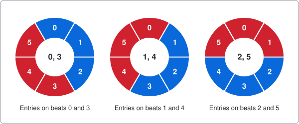
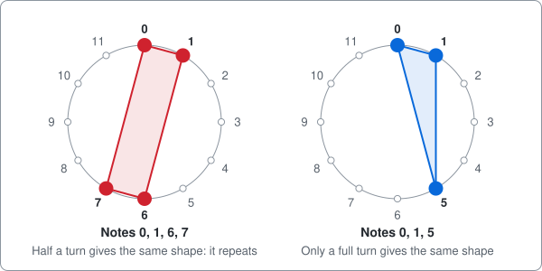
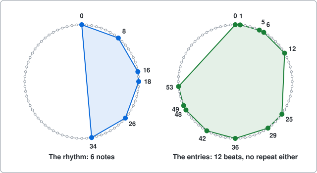
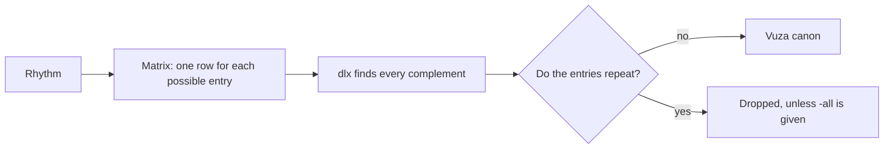

# Vuza canons

A command-line solver for rhythmic canons, written as an example of using package [dlx](https://github.com/dimchansky/dlx). You give it a rhythm, and it finds where copies of that rhythm must enter so that every beat is struck exactly once. If exact cover is new to you, read the [introduction to the examples](../README.md) first.

## The problem

Think of a drum loop with a fixed number of beats. After the last beat it starts again from the first, like the hours on a clock. We number the beats from 0, so a 72-beat loop has beats 0 to 71.

A **rhythm** is a set of beats to strike in that loop, and each of those beats is called a **note**. A **voice** is one player playing the rhythm from some starting beat, called its **entry**. If the rhythm is 0, 1, 2 and a voice enters on beat 3, it strikes 3, 4, 5.

Beat numbers wrap round the loop. In a 72-beat loop, a note 8 beats after beat 66 lands on beat 2, because 66 + 8 = 74, and 74 is 2 past the end. That is the only arithmetic in this example: add, and take away the length of the loop if you went past the end.

A **canon** here means several voices playing the same rhythm from different entries, so that **every beat of the loop is struck by exactly one voice**. Nothing clashes and nothing is left silent. The list of entries that achieves this is called a **complement** of the rhythm.

To **shift** a list of beats is to add the same number to each of them, wrapping round the loop as usual.

The smallest interesting case has 6 beats and the rhythm 0, 1, 2. Two voices are enough, and there are three ways to place them. Each ring below is the loop, with one colour per voice:

### Why repeating matters

Draw the loop as a wheel, with the notes marked on it. Turning the wheel is the same thing as shifting the notes, so this page uses "turn" and "shift" for one operation. A pattern **repeats** if some turn of the wheel, short of a full circle, puts every note back onto a note. Such a pattern is called **periodic**, and a pattern with no such turn is **aperiodic**.

The notes 0, 1, 6, 7 repeat every 6 beats, so they are really a shorter pattern played twice. The notes 0, 1, 5 don't repeat.

Look again at the 6-beat canon. Its rhythm 0, 1, 2 doesn't repeat, but its entries do: 0 and 3 are half a loop apart. So that canon is a shorter idea played twice.

A **Vuza canon** is a canon where **neither the rhythm nor the entries repeat**. That is surprisingly hard to get. Around 1948 the mathematician Hajós thought one of the two must always repeat. That turned out to be false, and the examples that prove it wrong are exactly these canons, named after D. T. Vuza, who brought them to music in 1991. The shortest loop that has one has **72 beats**. The next lengths are 108, 120, 144 and 168.

Here is one such pair, the rhythm that this command uses by default, and its entries:

Twelve voices each play six notes, which makes 72 strikes, one for each beat. The rhythm has a simple recipe: three notes 8 beats apart, played twice, 18 beats apart. So it is 0, 8, 16 and then 18, 26, 34.

## How it becomes a matrix

**One column of the matrix is one beat of the loop**, which must be struck exactly once. **One row of the matrix is one possible voice**: a voice entering on one particular beat. The row has a 1 on each beat that voice strikes.

| Matrix part | Meaning                                         | Count for 6 beats, 3 notes | Count for 72 beats, 6 notes |
|-------------|-------------------------------------------------|----------------------------|-----------------------------|
| Column      | A beat, which must be struck exactly once       | 6                          | 72                          |
| Row         | A voice entering on one beat                    | 6                          | 72                          |
| 1s per row  | The notes of the rhythm                         | 3                          | 6                           |

Here is the whole matrix for the 6-beat loop and the rhythm 0, 1, 2:

|           | beat 0 | beat 1 | beat 2 | beat 3 | beat 4 | beat 5 |
|-----------|:-:|:-:|:-:|:-:|:-:|:-:|
| entry 0   | 1 | 1 | 1 | 0 | 0 | 0 |
| entry 1   | 0 | 1 | 1 | 1 | 0 | 0 |
| entry 2   | 0 | 0 | 1 | 1 | 1 | 0 |
| entry 3   | 0 | 0 | 0 | 1 | 1 | 1 |
| entry 4   | 1 | 0 | 0 | 0 | 1 | 1 |
| entry 5   | 1 | 1 | 0 | 0 | 0 | 1 |

Each row is the row above it moved one place to the right, and the last rows wrap round, just as the beats do. The columns say nothing about music: they only demand that each beat is struck once.

This matrix has three exact covers, one for each ring in the picture above:

| Picked rows        | Entry of the voice striking beats 0 to 5 |
|--------------------|------------------------------------------|
| entry 0, entry 3   | 0 0 0 3 3 3                              |
| entry 1, entry 4   | 4 1 1 1 4 4                              |
| entry 2, entry 5   | 5 5 2 2 2 5                              |

Each digit is an entry number, with one digit per beat. So 4 1 1 1 4 4 says the voice with entry 4 strikes beats 0, 4 and 5, and the voice with entry 1 strikes beats 1, 2 and 3.

Picking entry 0 and entry 1 fails, because both strike beat 1.

The rule "the entries must not repeat" has no column. It is a property of a whole solution, not of any one choice, so it can't be written as "cover this exactly once". Instead dlx finds every complement, and the command then throws away those that repeat, the same way the [crew example](../crew) ranks costs outside dlx:

## How a solution decodes back

dlx reports the column numbers of the picked rows, which are the beats a voice strikes. To get the entry back, [solver.go](solver.go) takes the first column of the row, which is the rhythm's first note moved on by the entry, and subtracts that first note.

Take the rhythm 1, 2, 3 in a 6-beat loop, and a voice entering on beat 5. Its row is `[0 1 2]`: 1 + 5 = 6 wraps to beat 0, and so on. The first column is 0 and the first note is 1. So the entry is 0 - 1 = -1, and adding the loop length gives 5.

The entries are then sorted, and tested for repeats.

## Installation

    go install github.com/dimchansky/dlx/examples/vuza@latest

## Usage

    vuza [-n beats] [-tile list] [-limit n] [-count] [-all] [-score]

- `-n beats` sets the length of the loop, 72 by default, from 2 to 1024. That cap only stops the program building a huge matrix.
- `-tile list` sets the rhythm, as comma-separated beats from 0 to n-1. The default is `0,8,16,18,26,34`. "Tile" is the usual name for a shape that fills a space without overlaps. A rhythm that repeats is refused, even with `-all`: a Vuza canon can't use it, and two different entries would give the same row of the matrix.
- `-limit n` sets how many results to print, 1 by default. Zero prints all of them.
- `-count` goes through every complement and prints the totals instead, so `-limit` and `-score` have no effect with it.
- `-all` also accepts entries that repeat. The rhythm still must not.
- `-score` prints one line per voice under each result, with an `x` on each beat that voice strikes.

`-help` prints the usage text to standard error.

Results and totals go to standard output. Error messages go to standard error, and most start with `vuza:`.

| Exit code | Meaning                                                  |
|-----------|----------------------------------------------------------|
| 0         | At least one result exists, or `-help` was given         |
| 1         | No result exists                                         |
| 2         | Invalid usage, or a write failure                        |

With `-count` the totals still go to standard output when the exit code is 1, for example `Aperiodic: 0`. With `-count -all` any complement counts as a result, so the exit code is 0 even when the output says `Aperiodic: 0`.

## Examples

Find the first Vuza canon of the default rhythm, and print its voices:

    vuza -score

Output:

    Complement 1: 0 1 5 6 12 25 29 36 42 48 49 53
    x.......x.......x.x.......x.......x.....................................
    .x.......x.......x.x.......x.......x....................................
    .....x.......x.......x.x.......x.......x................................
    ......x.......x.......x.x.......x.......x...............................
    ............x.......x.......x.x.......x.......x.........................
    .........................x.......x.......x.x.......x.......x............
    .............................x.......x.......x.x.......x.......x........
    ....................................x.......x.......x.x.......x.......x.
    ....x.....................................x.......x.......x.x.......x...
    ..x.......x.....................................x.......x.......x.x.....
    ...x.......x.....................................x.......x.......x.x....
    .......x.......x.....................................x.......x.......x.x

This is the matrix again, cut down to the 12 picked rows, with `x` for 1 and `.` for 0. Each line is the same rhythm moved along, and each of the 72 columns has one `x`.

Count the complements:

    vuza -count

Output:

    Complements: 1296
    Aperiodic: 432

Swap the roles. A voice strikes note + entry, and note + entry = entry + note, so rhythm and entries can trade places and the same sums come out. For example, the rhythm 0, 1, 2 with entries 0, 3 in 6 beats becomes the rhythm 0, 3 with entries 0, 1, 2. (That sum works, but the command would refuse the rhythm 0, 3, because it repeats.) The entries above don't repeat, so they can be used as a rhythm of 12 notes, which needs 6 voices. All of its complements are aperiodic:

    vuza -tile 0,1,5,6,12,25,29,36,42,48,49,53 -count

Output:

    Complements: 216
    Aperiodic: 216

The small example has complements, but they all repeat, so this exits with code 1:

    vuza -n 6 -tile 0,1,2

Output, on standard error:

    vuza: no aperiodic complement found

With `-all` it prints the three solutions from the matrix section:

    vuza -n 6 -tile 0,1,2 -all -limit 0 -score

Output:

    Complement 1: 0 3
    xxx...
    ...xxx
    Complement 2: 1 4
    .xxx..
    x...xx
    Complement 3: 2 5
    ..xxx.
    xx...x

A rhythm from the paper in a 144-beat loop:

    vuza -n 144 -tile 0,16,32,36,52,68

Output:

    Complement 1: 0 1 2 3 11 12 13 14 24 25 26 51 59 72 73 74 84 85 86 96 97 98 99 107

## Reading the totals

Shift all the entries of a canon by one beat and you get another canon, which is the same music started later. The totals count these separately. Two lists of entries have the same **shape** if one is a shift of the other. An aperiodic list of entries has one different shift for each beat of the loop, because if two shifts gave the same list, the list would repeat. So dividing the aperiodic total by 72 gives the number of different shapes of entries:

| Rhythm              | Notes | Complements | Aperiodic | Different entry patterns, up to shifting (aperiodic / 72) |
|---------------------|-------|-------------|-----------|-----------------------------------------------------------|
| Default rhythm      | 6     | 1296        | 432       | 6, each of 12 entries                                     |
| Its 12-note entries | 12    | 216         | 216       | 3, each of 6 entries                                      |

Rhythm and entries can swap roles, so the last column counts partners. The 6 in the first row counts twelve-note partners of a six-note rhythm, and the 3 in the second row counts six-note partners of a twelve-note rhythm.

That matches the known answer for 72 beats. There are 3 six-note rhythms and 6 twelve-note rhythms, and each of the 3 fits with each of the 6, which makes 18 canons.

## How the results are checked

- **Published rhythms.** [Fripertinger's list](https://imsc.uni-graz.at/fripertinger/canons/canon_3.html) gives the 3 and the 6 rhythms for 72 beats. The tests start from each published rhythm and check that the aperiodic complements found are exactly the published partners, each shifted 72 ways. Every six-note rhythm gives 1296 and 432, and every twelve-note rhythm gives 216 and 216. With `-short` they try only the first rhythm of each kind.
- **Published totals.** Table 1 of Jedrzejewski's [On the enumeration of Vuza canons](https://arxiv.org/abs/1304.6609) gives 3 and 6 for 72 beats, and one of its rows gives 8640 shapes for 144 beats with 6 notes and 24 entries. The tests confirm 8640 by counting only the complements with an entry on beat 0. Every complement has exactly one voice striking beat 0, with one of the six notes. Shift the complement by that note and the voice's entry lands on 0, so the complements split into six equal groups, one per note, and the group for note 0 is the one counted. The rhythm 0, 1, 2 in 6 beats shows this on a small scale: in the complement 1, 4, note 2 of the voice on entry 4 strikes beat 0, and shifting by 2 gives 3, 0. Of the 3 complements, exactly 1 contains entry 0, which is 3 / 3. So the count finds exactly a sixth of each total: 279936 complements, 207360 of them aperiodic. Multiplied by 6 they give the 1679616 and 1244160 that the full run of `vuza -n 144 -tile 0,16,32,36,52,68 -count` reports, and 1244160 is 8640 x 144. dlx has to reach these numbers, and the same sum is tested on the 72-beat totals, which are also counted in full.
- **A separate search.** The totals for the default rhythm, its 12-note partner and the small examples are compared with a backtracking search that doesn't use dlx. For the 144-beat rhythm it counts only the complements with an entry on beat 0, as above, and gets the same 279936 and 207360 as dlx. The tests leave out the full totals of 1679616 and 1244160 only to keep `go test` quick: counting them takes a few seconds with dlx and about 10 seconds with the separate search. A one-off run of both gave these same totals. In the tests they rest on that sum, the definition below and the published number.
- **Trying everything.** For every aperiodic rhythm starting on beat 0, in loops of up to 12 beats, the tests try every possible list of entries and compare the result with dlx.
- **The definition.** Every complement in those tests is checked by adding each note to each entry and seeing that every beat comes up once. The repeat check is compared with trying every possible turn.
- **Short loops.** For loops of up to 28 beats, the tests search for a Vuza canon and find none. They don't need every rhythm, only the short ones that start on beat 0, for three reasons:
  1. Notes times voices equals the loop length n, so one of the two lists, rhythm or entries, has at most sqrt(n) members, and that size divides n. For 28 beats, sqrt(n) is about 5.3, which leaves sizes 1, 2 and 4.
  2. Rhythm and entries can swap roles, as shown above, so the shorter list can always be taken as the rhythm.
  3. Any canon can be shifted so that this rhythm starts on beat 0.

  The test stops at 28 only to stay quick, so that 72 is the shortest length comes from the published proofs, not from this test.

The rhythm itself comes from Example 18 of the paper, which also gives a partner that the tests confirm. A warning if you read that paper: the 12-note set printed in its Example 7 completes this rhythm but repeats every 36 beats, so it isn't a Vuza partner. A test records this.

`go test` checks everything. `go test -short` skips the 144-beat count, the larger exhaustive loops, the published rhythms after the first of each kind, and command-line cases that repeat a count, all of which are slower with `-race`. Use `-short` with `-race`.

## Limits

**You must supply the rhythm.** dlx answers "where do the entries go?", not "which rhythm works?". The matrix is built from one rhythm, so finding rhythms means a separate outer search, solving one matrix per candidate. Even for six notes in 72 beats that is 13019909 rhythms starting on beat 0. A one-off run of that search, not part of the tests, took minutes, running 8 searches side by side. It found 18 rhythms, which are the 3 published shapes, each started from its 6 notes. The number of rhythms grows fast: twelve notes in 72 beats would mean 2560547383576 of them, about 200000 times as many. That is why the rhythm is an input here.

**The totals grow fast.** On the machine used to write this, `vuza -count` took a few milliseconds and the 144-beat count above took about 6 seconds for 1679616 complements. Printing the first results is much quicker than counting all of them.

**Results aren't grouped.** Shifts of one canon are listed separately, and so are canons that a musician might call the same, such as one played backwards.
