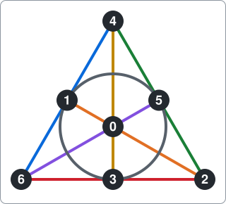
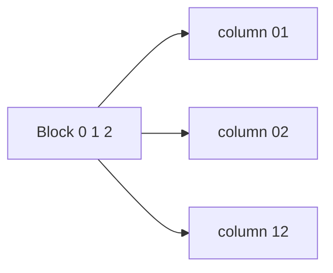
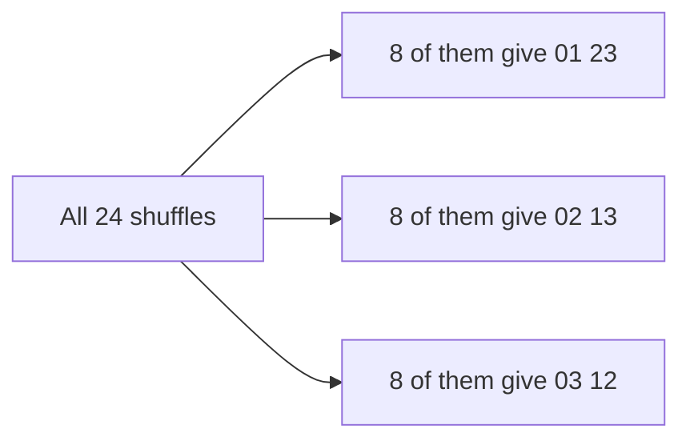

# Witt design and Steiner systems

A command-line search for Steiner systems, written as an example of using package [dlx](https://github.com/dimchansky/dlx). If exact cover is new to you, read the [introduction to the examples](../README.md) first.

## The problem

Twelve people need committees of six. The rule: take **any five** people, and they must sit together on **exactly one** committee. Not zero, and not two.

It is not obvious that this can be done at all. It can, with 132 committees, and the result is called the small Witt design. Its tidiness is what makes it famous: pick any five people, and they name a unique sixth who completes their committee.

The general form has three numbers. A **Steiner system** S(t,k,v) takes v points and chooses groups of k points, called **blocks**, so that every set of t points lies in exactly one block. So the committees are S(5,6,12): any 5 people meet in exactly one group of 6, out of 12.

## A small example: the Fano plane

The smallest interesting case is S(2,3,7): 7 points, blocks of 3, and every pair of points in exactly one block. It has 7 blocks, and it fits in a picture. Each of the six straight lines is a block, and so is the circle.

The blocks are:

    0 1 2    0 3 4    0 5 6    1 3 5    1 4 6    2 3 6    2 4 5

The circle is `1 3 5`. Pick any two points, say 4 and 6, and exactly one block holds both: `1 4 6`. The circle counts as much as the straight lines: points 1 and 3 share only the circle.

## How many blocks

A count fixes the number of blocks before any search begins. "How many ways can I choose" comes up a lot on this page, so here it is once in full. To choose 2 points out of 7, there are 7 options for the first and 6 for the second. That counts each pair twice, once in each order, so the answer is 7·6 / (2·1) = 21.

Each block of 3 points holds 3 pairs. Every one of the 21 pairs must lie in exactly one block, so there must be 21 / 3 = 7 blocks.

The same count for S(5,6,12): there are 12·11·10·9·8 / (5·4·3·2·1) = 792 sets of five people. A committee of six holds 6 sets of five, because you can leave out any one member. So there are 792 / 6 = 132 committees.

This count also rules some systems out. S(2,3,8) would need 28 / 3 blocks, which is not a whole number, so it can't exist. S(2,4,12) passes that test, with 66 / 6 = 11 blocks, but fails another. Point 0 must pair with 11 other points and each block through it supplies 3 of them, and 11 / 3 is not whole either.

## How it becomes a matrix

**One column of the matrix is one set of t points**, which must end up in exactly one block. **One row of the matrix is one possible block**, with a 1 in the column of every t-set inside it.

| Matrix part        | Meaning                                          | S(2,3,7) | S(5,6,12) |
|--------------------|--------------------------------------------------|----------|-----------|
| Column             | A set of t points, which needs exactly one block | 21       | 792       |
| Row                | A possible block of k points                     | 35       | 924       |
| 1s in a row        | The t-sets inside one block                      | 3        | 6         |
| 1s in a column     | The possible blocks through one t-set            | 5        | 7         |
| Rows in a solution | The blocks of the system                         | 7        | 132       |

For the Fano plane, a row has three 1s, one for each pair inside the block:

The full matrix for S(2,3,7) has 21 columns and 35 rows. This table shows the 7 rows of the solution above, so you can check that each column has a 1 in exactly one of them. Below them is one more row that doesn't belong. The column `13` means the pair of points 1 and 3. The other 27 rows are not shown.

|       | 01 | 02 | 03 | 04 | 05 | 06 | 12 | 13 | 14 | 15 | 16 | 23 | 24 | 25 | 26 | 34 | 35 | 36 | 45 | 46 | 56 |
|-------|:-:|:-:|:-:|:-:|:-:|:-:|:-:|:-:|:-:|:-:|:-:|:-:|:-:|:-:|:-:|:-:|:-:|:-:|:-:|:-:|:-:|
| 0 1 2 | 1 | 1 | 0 | 0 | 0 | 0 | 1 | 0 | 0 | 0 | 0 | 0 | 0 | 0 | 0 | 0 | 0 | 0 | 0 | 0 | 0 |
| 0 3 4 | 0 | 0 | 1 | 1 | 0 | 0 | 0 | 0 | 0 | 0 | 0 | 0 | 0 | 0 | 0 | 1 | 0 | 0 | 0 | 0 | 0 |
| 0 5 6 | 0 | 0 | 0 | 0 | 1 | 1 | 0 | 0 | 0 | 0 | 0 | 0 | 0 | 0 | 0 | 0 | 0 | 0 | 0 | 0 | 1 |
| 1 3 5 | 0 | 0 | 0 | 0 | 0 | 0 | 0 | 1 | 0 | 1 | 0 | 0 | 0 | 0 | 0 | 0 | 1 | 0 | 0 | 0 | 0 |
| 1 4 6 | 0 | 0 | 0 | 0 | 0 | 0 | 0 | 0 | 1 | 0 | 1 | 0 | 0 | 0 | 0 | 0 | 0 | 0 | 0 | 1 | 0 |
| 2 3 6 | 0 | 0 | 0 | 0 | 0 | 0 | 0 | 0 | 0 | 0 | 0 | 1 | 0 | 0 | 1 | 0 | 0 | 1 | 0 | 0 | 0 |
| 2 4 5 | 0 | 0 | 0 | 0 | 0 | 0 | 0 | 0 | 0 | 0 | 0 | 0 | 1 | 1 | 0 | 0 | 0 | 0 | 1 | 0 | 0 |
| 0 1 3 | 1 | 0 | 1 | 0 | 0 | 0 | 0 | 1 | 0 | 0 | 0 | 0 | 0 | 0 | 0 | 0 | 0 | 0 | 0 | 0 | 0 |

The last row, `0 1 3`, can't join the solution. It has a 1 under `01`, and so does the row `0 1 2`: the pair 0, 1 would be in two blocks. No column may have two 1s, which is the "never twice" half of the rule, and no column may be left without a 1, which is the "never missed" half. Exact cover says both at once, so the matrix is the definition of a Steiner system with nothing added. No [slack rows](../README.md#at-most-once-slack-rows) are needed, because those are for "at most once", and here every column needs exactly one.

## How a solution decodes back

dlx reports column numbers. [solver.go](solver.go) numbers the t-sets in dictionary order, as in the table: `01` is column 0, `02` is column 1, and so on up to `56`, column 20. It keeps the list of t-sets so it can look them up later.

To get a block back from a row, join its t-sets. The block `1 3 5` comes back as `[7 9 16]`:

| Column | t-set |
|--------|-------|
| 7      | 1 3   |
| 9      | 1 5   |
| 16     | 3 5   |

Joined, those give the points 1, 3 and 5. The solver then sorts the blocks, so a system reads the same however the search reached it.

## Why the totals are about symmetry

The solver finds 30 Fano planes, not one. Yet they are all the same picture with the numbers swapped around. So the total measures something else: how much symmetry the system has.

Start with a case you can check by hand. S(1,2,4) splits four people into two pairs. There are 3 ways: `01 23`, `02 13` and `03 12`.

A **shuffle** gives each point a new name. Four points have 4·3·2·1 = 24 shuffles. Apply them all to `01 23`. Some change nothing: you can swap the two people in the first pair, swap the two in the second, and swap the pairs themselves. Those are 3 yes-or-no choices, so 2·2·2 = 8 shuffles leave `01 23` unchanged. The 24 shuffles fall into packs of 8, and each pack produces one split. The packs are equal for this reason: if a shuffle A gives some split, then doing any of the 8 unchanging shuffles first and A afterwards gives the same split, and no other shuffle does. So there are 24 / 8 = 3 splits.

The rule in general, when every system is a renaming of one system:

    number of systems = all shuffles / shuffles that leave a system unchanged

The more symmetric a system is, the fewer different systems it can be renamed into.

| System    | Name                                     | Blocks | All shuffles | Shuffles that change nothing | Systems found |
|-----------|------------------------------------------|--------|--------------|------------------------------|---------------|
| S(1,2,4)  | Two pairs                                | 2      | 24           | 8                            | 3             |
| S(2,3,7)  | Fano plane                               | 7      | 5040         | 168                          | 30            |
| S(4,5,11) | Derived small Witt design                | 66     | 39916800     | 7920                         | 5040          |
| S(5,6,12) | Small Witt design                        | 132    | 479001600    | 95040                        | 5040          |
| S(2,4,13) | Projective plane of order 3              | 13     | 6227020800   | 5616                         | 1108800       |

Each row is a division you can check: 479001600 / 95040 = 5040. "All shuffles" is v·(v-1)·…·2·1.

Two rows need a word. S(4,5,11) is cut out of S(5,6,12): keep only the 66 blocks through one point, then delete that point from them. Any four remaining points plus the deleted one make five, which lie in exactly one block, so the four lie in exactly one shortened block. The last row, a projective plane, is explained in [the card game section](#the-card-game-connection).

The 95040 is striking. It equals 12·11·10·9·8, and that is no accident. Choose any five different points as new names for points 0 to 4: exactly one shuffle that keeps the Witt design does that, and the other seven points have no freedom left. Mathematicians call this set of 95040 shuffles the Mathieu group M12. You don't need the name to follow anything here.

That is also why both Witt rows end in 5040. The 95040 shuffles use up the first five factors of 12·11·…·2·1, so dividing leaves 7·6·5·4·3·2·1. S(4,5,11) does the same with four points: its 7920 shuffles are 11·10·9·8, and dividing leaves the same seven factors. The 5040 in the Fano row is a separate fact: it is all the shuffles of 7 points, because v = 7.

S(5,6,12) and S(4,5,11) are [known to be unique](https://en.wikipedia.org/wiki/Steiner_system) up to renaming, and Yuki Irie's paper [arXiv 2001.00415](https://arxiv.org/abs/2001.00415) mentions the 5040 copies of S(5,6,12).

## The card game connection

Spot It, also sold as Dobble, deals cards with symbols on them, and any two cards share exactly one symbol. Decks like this come from systems of the form S(2,n+1,n²+n+1), which are called **projective planes** of order n. The points are the symbols and the blocks are the cards, so there are as many cards as symbols.

The Fano plane is the plane of order 2: 7 cards with 3 symbols each. Cards `0 1 2` and `1 3 5` share the symbol 1. The system's own rule is about symbols: any two symbols sit on exactly one card. In a projective plane that also gives the rule of the game, which is about cards, and a short count shows why. A symbol pairs with n²+n other symbols and each card holding it supplies n of them, so it is on n+1 cards. Now take one card. Each of its n+1 symbols is on n other cards, which makes n(n+1) other cards. They are all different, because two cards sharing two symbols would put that pair on two cards. The whole deck has exactly n²+n = n(n+1) other cards, so every one of them shares exactly one symbol with the card you took. The tests also confirm this pair by pair on the first solution found for each of the orders 2 to 5, or only 2 and 3 with `-short`.

The plane of order 5 is the largest deck this example builds: 31 cards with 6 symbols each.

    witt -t 2 -k 6 -v 31

Output, cut to the first few cards:

    Solution 1:
    0 1 2 3 4 5
    0 6 7 8 9 10
    0 11 12 13 14 15
    0 16 17 18 19 20
    0 21 22 23 24 25
    0 26 27 28 29 30
    1 6 11 16 21 26
    ...

The real game is out of reach. It has [eight symbols per card](https://en.wikipedia.org/wiki/Dobble), which makes it the plane of order 7, S(2,8,57), with 55 of the possible 57 cards in the box. Its matrix would have 1652411475 rows with 28 ones each. That is over 46 billion ones, and at 48 bytes for each one, over 2 TB of memory. The command refuses it:

    witt -t 2 -k 8 -v 57

Output, on standard error:

    witt: S(2,8,57) needs 1652411475 rows with 28 ones each: the limit is 20000000 ones in all

## Installation

    go install github.com/dimchansky/dlx/examples/witt@latest

## Usage

    witt [-t n] [-k n] [-v n] [-limit n] [-count]

- `-t n`, `-k n` and `-v n` set the parameters of S(t,k,v), 5, 6 and 12 by default. They must satisfy 1 <= t <= k <= v <= 60, and the matrix may hold at most 20 million ones.
- `-limit n` sets how many systems to print, 1 by default. Zero prints all of them.
- `-count` goes through every system and prints the total instead, so `-limit` has no effect with it.

`-help` prints the usage text to standard error.

Points are numbered from 0. A system prints one block per line, and systems that differ only in the names of their points count as separate solutions. Systems and totals go to standard output. Error messages go to standard error, and most start with `witt:`.

| Exit code | Meaning                                                    |
|-----------|------------------------------------------------------------|
| 0         | At least one system exists, or `-help` was given           |
| 1         | No system exists                                           |
| 2         | Invalid usage, a matrix over the limit, or a write failure |

## Examples

Find the first small Witt design:

    witt

Output, cut to the first lines of 132 blocks:

    Solution 1:
    0 1 2 3 4 5
    0 1 2 3 6 7
    0 1 2 3 8 9
    0 1 2 3 10 11
    0 1 2 4 6 8
    0 1 2 4 7 10
    ...

Print the Fano plane:

    witt -t 2 -k 3 -v 7

Output:

    Solution 1:
    0 1 2
    0 3 4
    0 5 6
    1 3 5
    1 4 6
    2 3 6
    2 4 5

Count the small Witt designs:

    witt -count

Output:

    Solutions: 5040

Count the projective planes of order 3:

    witt -t 2 -k 4 -v 13 -count

Output:

    Solutions: 1108800

S(2,3,8) can't exist, so this exits with code 1:

    witt -t 2 -k 3 -v 8

Output, on standard error:

    witt: no solution found

## How the results are checked

Each total in the table above is checked in these ways:

1. **The solver.** It must find the total. Every system except those of S(2,4,13), whose 1108800 systems are costly to decode, is also checked by a different rule from the matrix: the right number of blocks, k points in each, and no two blocks sharing t points. Those three facts together force a Steiner system.
2. **The division.** The tests build one system by arithmetic, with no search, and count the shuffles that leave it unchanged. All shuffles divided by that count must equal the total. This also shows that every system is a renaming of one: the renamings of the built system are all valid and they number exactly the total, so there is no room for any other.
3. **A second search.** A separate [backtracking](../README.md#how-dlx-searches) search that doesn't use dlx must find the same total.

The system built by arithmetic must also appear among the solver's results, again except for S(2,4,13). For S(1,2,4) and S(2,3,7) the tests apply every shuffle and confirm that they give exactly the systems listed.

The tests also confirm that the 95040 shuffles send points 0 to 4 to 95040 different lists of targets, and that the 7920 shuffles of S(4,5,11) do the same with four points.

`go test` checks every total and takes a few seconds. `go test -short` skips the totals for S(4,5,11), S(5,6,12) and S(2,4,13), and the planes of order 4 and 5, which are much slower with `-race`. It still checks the first solution of each system. Use `-short` with `-race`.

## Limits

These systems are small enough because their rows and solutions both stay few. That doesn't last:

- On the machine used to write this, `witt -t 2 -k 6 -v 31` took about a second, most of it spent building the matrix. The total for S(2,4,13) took about three seconds.
- Finding one system can be far easier than counting them. `witt -t 2 -k 5 -v 21` finds a plane of order 4 quickly, while `-count` on the same system did not finish in 30 seconds.
- The command doesn't apply the counting tests above, so proving that a system doesn't exist can take a long time. S(2,5,22) did not finish in 30 seconds, although a point would need 21 / 4 blocks, which rules it out at once.
- Some systems pass both counting tests and still can't exist. S(2,6,16) would have 120 / 15 = 8 blocks, with 15 / 5 = 3 of them through each point. But take one block: each of its 6 points needs 2 more blocks, and those 12 are all different, because a block sharing two points with the first would put that pair in two blocks. That makes at least 13 blocks, not 8. The search knows none of this, and took about 16 seconds to report none.
- The limit of 20 million ones bounds memory, not time. `witt -t 5 -k 5 -v 60 -count` passes the check: each row has a single 1, and there is only one solution. But dlx looks through all the remaining columns at every step, so the time grows with the square of the number of columns. With v = 30 and 142506 columns that took about 25 seconds, and v = 60 has 5461512 columns.
- The next Witt design, S(5,8,24), is over the limit, with 735471 rows of 56 ones each.
